Cre: [Stanford CS146S: How always-on agents work](https://www.youtube.com/watch?v=L1OBRtfPS34)

Bài giảng "How always-on agents work" thuộc khóa Stanford CS146S, do Lee Robinson trình bày. Lee Robinson là kỹ sư machine learning tại SpaceX, trước đó làm tại Cursor và từng làm tại Vercel. Theo lời diễn giả, một số nội dung trong bài giảng vẫn đang được phát triển tại SpaceX.

Bài đi theo đúng thứ tự trong video. Mở đầu là sự khác nhau giữa agent chạy trong terminal và agent chạy nền. Tiếp theo là cách agent ngủ, thức và dùng máy tính riêng, rồi cách giữ context nhỏ, cách nhớ, cách huấn luyện và cải tiến. Checklist những việc cần làm nằm ở cuối.

## Nhắc lại nhanh: từ agent loop đến always-on agent

Trước khi so sánh hai loại agent, cần nhớ lại thành phần cơ bản nhất mà cả hai cùng dùng.

> **Ý chính:** always-on agent vẫn là agent loop của tuần 1, nhưng chạy trên server.

**Harness** là phần mềm bao quanh model, cung cấp tool và chạy vòng lặp. Ở tuần 1, harness rất đơn giản: một model gọi tool trong một vòng lặp, gọi là **agent loop**. Vì vòng lặp nằm trong terminal của người dùng, đóng laptop thì process dừng theo.

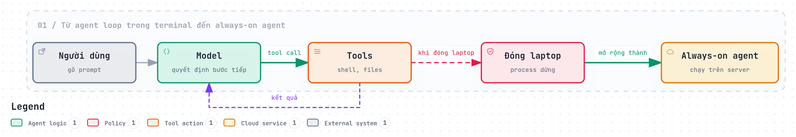

Với always-on agent, cùng vòng lặp đó chạy trên server. Một sự kiện đi qua các bước sau:

- **Bước 1.** Sự kiện (tin nhắn, lịch, Slack...) vào một **queue** (hàng đợi).
- **Bước 2.** Queue gọi agent loop.
- **Bước 3.** Loop dùng tool, kể cả máy tính riêng của agent.
- **Bước 4.** State (trạng thái làm việc) được lưu xuống database.
- **Bước 5.** Khi cần báo người dùng, agent gọi một **send tool**. Không cần thì không nhắn.

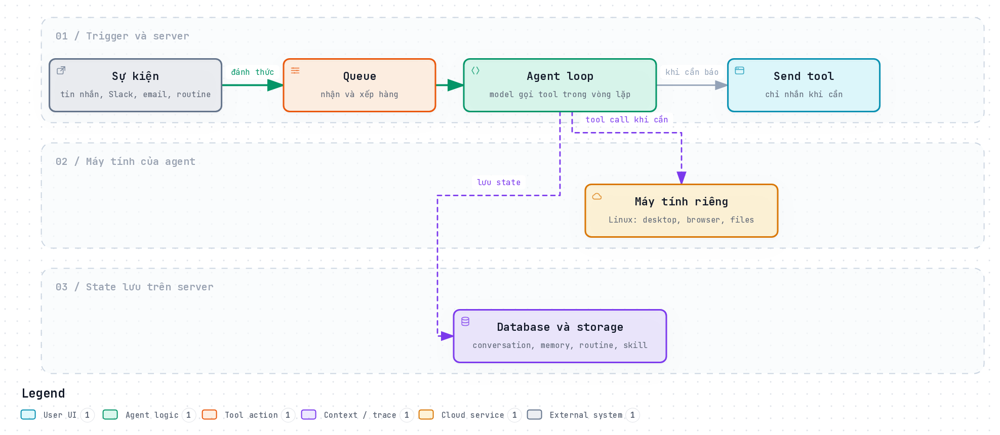

## Agent tuần 1 và always-on agent khác nhau ở đâu

Từ sơ đồ trên, slide đầu tiên của bài giảng đặt hai loại agent cạnh nhau để thấy mỗi hàng khác ở đâu.

> **Ý chính:** agent chuyển từ chờ lệnh sang chạy nền, và chỉ lên tiếng khi cần.

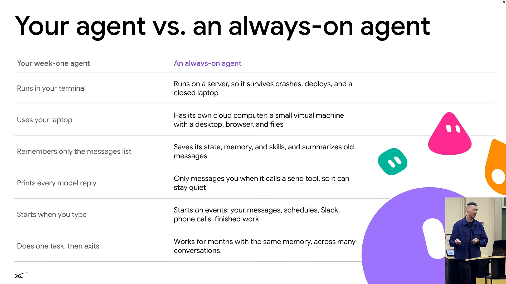

### Bảng "Your week-one agent" và "An always-on agent" có gì

Slide mở đầu (khoảng phút 1) là bảng hai cột, sáu hàng. Cột trái là "Your week-one agent", cột phải là "An always-on agent":

| Khía cạnh | Agent tuần 1 | Always-on agent |
|---|---|---|
| Nơi chạy | Terminal | Server, nên vẫn sống khi cập nhật mã, crash hoặc đóng laptop |
| Máy tính | Laptop của người dùng | Máy Linux riêng trên cloud, có desktop, browser, files |
| Trí nhớ | Chỉ danh sách messages | State, memory, skills và bản tóm tắt tin cũ |
| Giao tiếp | In mọi câu trả lời | Chỉ nhắn khi gọi send tool, nên làm việc âm thầm được |
| Cách bắt đầu | Người dùng gõ | Sự kiện: tin nhắn, lịch, Slack, cuộc gọi, việc nền vừa xong |
| Thời gian | Làm một việc rồi thoát | Làm việc nhiều tháng với cùng một memory |

### Vì sao ví với một đồng nghiệp

Bài giảng ví always-on agent với một đồng nghiệp. Đồng nghiệp tốt không nhắn ngay mọi lúc. Họ làm nền, rồi chỉ báo khi có cập nhật quan trọng.

Mục tiêu là một agent chạy được vài tuần hoặc vài tháng. Sáu hàng trong bảng chính là sáu thứ phải thay đổi để đạt mục tiêu đó.

## Bốn giai đoạn làm việc với AI

Hàng "cách bắt đầu" trong bảng cho thấy một thay đổi lớn: người dùng không còn gõ từng lệnh. Bài giảng giải thích thay đổi này qua bốn giai đoạn.

> **Ý chính:** qua mỗi giai đoạn, người dùng ngày càng ít phải canh từng lệnh.

### Bốn giai đoạn

- **Giai đoạn 1.** Sao chép code từ ChatGPT vào editor.
- **Giai đoạn 2.** Terminal agent: model có harness đơn giản, sửa file và chạy shell command.
- **Giai đoạn 3.** Coding agent trong ứng dụng riêng: nhiều agent chạy song song, có khi trên cloud. Người dùng vẫn phải duyệt từng command.
- **Giai đoạn 4.** Always-on agent: chạy "ambiently" (âm thầm) trong nền, có máy tính và memory riêng, học skill mới khi làm việc, và vẫn làm tiếp khi người dùng đi ngủ.

### Giai đoạn 4 khác gì

Ở giai đoạn 4, người dùng **steer** (lái) agent thay vì xếp hàng lệnh. Ví dụ, nhắn "kiểm tra thread này", rồi ngay sau đó nhắn "à, làm việc đó vào thứ Năm". Model hiện nay hiểu hai câu có liên quan, còn model đời trước dễ rối.

Diễn giả gọi loại agent này là **bot**. Ai cũng biết nhắn tin nên giao diện đơn giản đi. Bot vẫn nhận được cả việc dài, như khi giao việc cho một đồng nghiệp.

## Sáu năng lực mới của model

Giai đoạn 4 chỉ khả thi vì chính model đã thay đổi. Slide tiếp theo liệt kê sáu năng lực mới.

> **Ý chính:** sáu thay đổi ở chính model làm always-on agent khả thi.

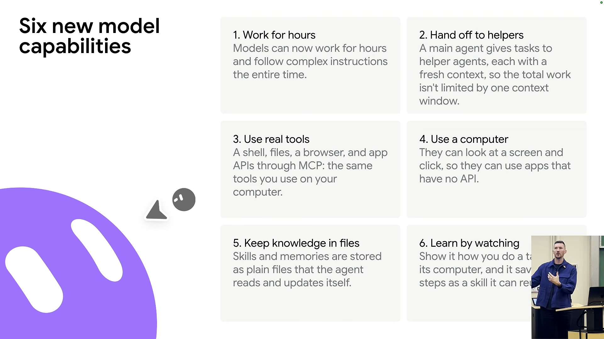

### Sáu thẻ của slide "Six new model capabilities"

Slide "Six new model capabilities" (khoảng phút 6'48") là lưới 2x3 gồm sáu thẻ:

- **Thẻ 1, Work for hours:** làm theo chỉ dẫn hàng giờ, thậm chí hàng ngày, nhờ nén context (compaction, xem phần sau).
- **Thẻ 2, Hand off to helpers:** main agent giao việc cho helper (sub-agent) có working memory mới.
- **Thẻ 3, Use real tools:** shell, files, browser, API ứng dụng qua MCP (giao thức chuẩn để agent gọi tool của ứng dụng).
- **Thẻ 4, Use a computer:** nhìn màn hình và click như người (computer use).
- **Thẻ 5, Keep knowledge in files:** skill và memory là file mà agent đọc và tự cập nhật.
- **Thẻ 6, Learn by watching:** chữ trên thẻ bị camera che một phần. Phần đọc được cho thấy bot học từ việc được chỉ cách làm, rồi lưu thành skill, memory hoặc routine.

### Vì sao helper, tool thật và file đều quan trọng

- **Helper:** working memory của model sẽ đầy dần. Khi helper nhận việc tốn token rồi chỉ trả báo cáo, main agent gần như không bị giới hạn bởi một context window (bộ nhớ làm việc của model, tính bằng token).
- **Tool thật và computer use:** vài năm trước model gọi tool kém và hay hallucinate (bịa), nay phần lớn đã được giải quyết. Website không có API hay MCP server vẫn dùng được vì agent tự thao tác trên màn hình.
- **File:** model chạy shell command giỏi nên tìm và đọc file dễ. Hồ sơ người dùng (ví dụ thích nhắn chữ thường) nằm trong mọi prompt, còn nhật ký công việc nằm trong file để agent tự tra.

### Skill và routine là gì

- **Skill:** file markdown mã hóa cách làm tốt một việc, gồm quy trình cụ thể và điều quyết định thành công hay thất bại.
- **Routine:** prompt chạy theo lịch, tương tự **cron job** (bộ lập lịch chạy việc vào thời điểm đặt trước).

## Ngủ khi rảnh, thức khi có trigger

Một agent chạy nhiều tháng không thể chiếm máy suốt ngày. Slide tiếp theo cho thấy bài giảng giải quyết điều đó như thế nào.

> **Ý chính:** không có việc thì không có gì chạy, và vì mọi thứ quan trọng đã được lưu, trigger nào cũng đưa agent trở lại.

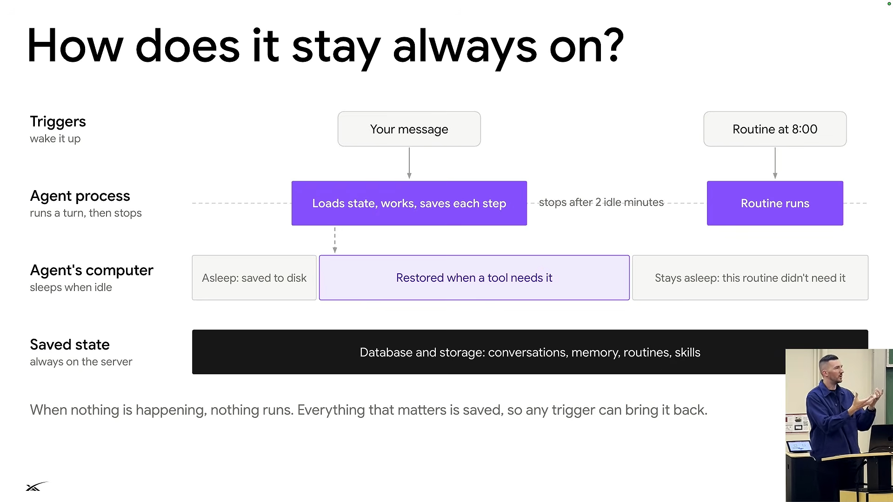

### Bốn hàng của slide "How does it stay always on?"

Slide "How does it stay always on?" (khoảng phút 10'37") có bốn hàng, đọc từ trên xuống:

- **Triggers (wake it up):** hai ô "Your message" và "Routine at 8:00", mỗi ô có mũi tên xuống hàng process.
- **Agent process (runs a turn, then stops):** ô tím "Loads state, works, saves each step", chú thích "stops after 2 idle minutes" (dừng sau 2 phút rảnh), rồi ô "Routine runs".
- **Agent's computer (sleeps when idle):** "Asleep: saved to disk", "Restored when a tool needs it" (mũi tên nét đứt từ process xuống) và "Stays asleep: this routine didn't need it".
- **Saved state (always on the server):** thanh đen "Database and storage" chứa conversations, memory, routines, skills.

### Một vòng ngủ và thức

- **Bước 1.** Process và máy tính của agent đều đang ngủ.
- **Bước 2.** Tin nhắn đến. Process nạp state từ server, làm việc và lưu từng bước.
- **Bước 3.** Nếu cần máy tính (mở browser, click), máy được khôi phục từ đĩa.
- **Bước 4.** Rảnh 2 phút thì process dừng, máy tính ngủ lại.
- **Bước 5.** Đến 8:00, routine chạy. Nếu routine không cần máy tính, máy vẫn ngủ.

Lý do là chi phí. Giữ máy chạy liên tục cho mọi người dùng thì quá đắt và không đủ máy. State nằm ở database nên việc ngủ không làm mất gì.

### Cái gì đánh thức agent

Ngoài tin nhắn trực tiếp, trigger có thể là tin Slack (nơi bot "sống"), cuộc gọi, cuộc họp bot tham gia, routine, hoặc việc nền chạy hàng giờ rồi quay lại báo tóm tắt. Tại SpaceX, bot dự họp thay nhân viên vắng mặt, ghi chú rồi báo lại.

Một **router** loại sự kiện trùng và đưa chúng vào hội thoại. Sau đó một **heuristic** (quy tắc kinh nghiệm) quyết định có cần làm phiền người dùng không, vì không phải tiến triển nào cũng đáng báo.

## Máy tính riêng của agent

Slide trước nhắc đến "máy tính của agent" có thể ngủ và thức. Slide này mở máy đó ra để xem bên trong có gì.

> **Ý chính:** mỗi người dùng có một máy Linux trong máy ảo Firecracker. Máy ảo dễ lưu snapshot nên cho ngủ khi rảnh được.

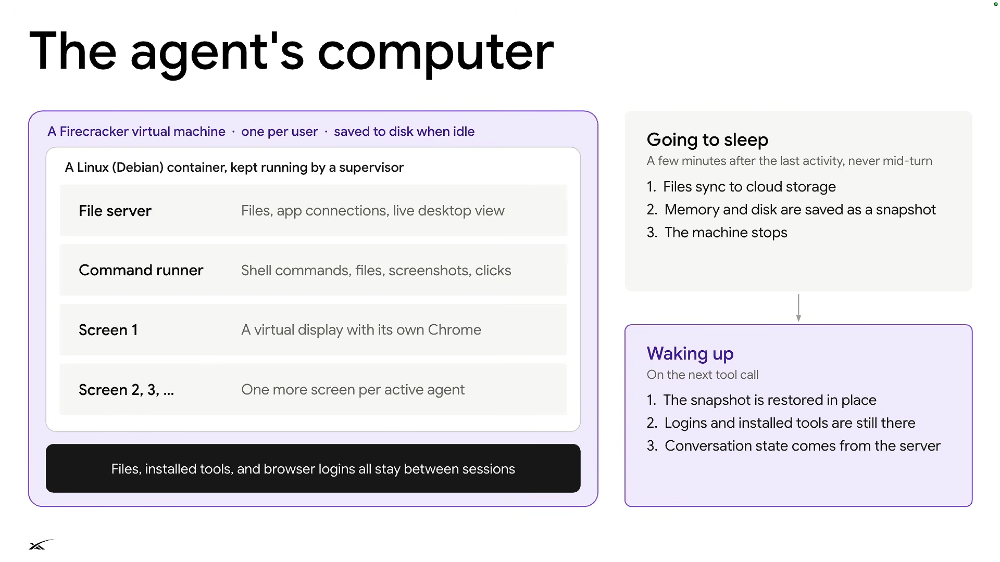

### Các khối của slide "The agent's computer"

Slide "The agent's computer" (khoảng phút 12'27") có một khung ngoài và các khối bên trong:

- **Khung ngoài:** "A Firecracker virtual machine · one per user · saved to disk when idle".
- **Môi trường Linux (Debian) dạng container:** một supervisor giữ cho luôn chạy.
- **File server:** files, kết nối ứng dụng, chế độ xem desktop trực tiếp.
- **Command runner:** shell command, files, chụp screenshot, click.
- **Các màn hình ảo:** mỗi màn hình có một Chrome riêng.
- **Thanh đen ở đáy:** files, tool đã cài và phiên đăng nhập browser được giữ giữa các phiên.

### Máy ảo là gì

**Virtual machine** là một máy hoàn chỉnh chạy bên trong phần mềm. Vì vậy dễ chụp **snapshot** (lưu nguyên trạng thái), tắt rồi bật lại.

Command chạy ở đây thay vì trên laptop cá nhân, trong môi trường được khóa chặt. Người dùng có thể kết nối vào xem và tự điều khiển. Khi chạy nhiều bot, mỗi bot có một màn hình ảo riêng trên hạ tầng dùng chung.

### Ngủ và thức của máy ảo

| | Đi ngủ | Thức dậy |
|---|---|---|
| Khi nào | Vài phút sau hoạt động cuối, không bao giờ giữa lượt | Ở tool call kế tiếp |
| Việc xảy ra | Files đồng bộ lên cloud storage, memory và đĩa lưu thành snapshot, máy dừng | Snapshot khôi phục tại chỗ, đăng nhập và tool vẫn còn, state hội thoại lấy từ server |

Cuối bài, diễn giả còn nêu **sandbox** như một khối xây dựng riêng (xem phần dự đoán).

## Kiến trúc phía server

Máy tính của agent chỉ là một nửa bức tranh. Nửa còn lại là phần điều khiển nó, nằm trên server. Đoạn này của bài giảng không có slide.

> **Ý chính:** agent loop nằm trên server nên cập nhật nhanh, dựng lại máy ảo được bất cứ lúc nào và khôi phục được sau lỗi.

### Ba khối và đường đi của một lệnh

Bài giảng mô tả ba khối: trigger bên trái, server ở giữa, máy tính của agent bên phải. Trên server, lệnh vào queue, queue gọi agent loop, và khi loop dừng thì state được lưu vào database hoặc storage.

Thứ tự xử lý cũng có quy tắc. Tin nhắn của chính người dùng được ưu tiên và làm loop dừng để xử lý trước. Tin từ nhóm chat hay routine xếp cuối hàng, và nhiều tin đến sát nhau có thể gộp thành một lượt.

### Thin client, thick server

Agent loop chạy trên server (client mỏng, server dày). Cách này có ba lợi ích:

- Cập nhật mã agent chỉ cần đẩy bản server, không phải phát hành bản ứng dụng.
- Việc nặng như phiên âm hoặc tạo ảnh thường nhanh hơn trên server.
- **Lý do quan trọng nhất:** nếu loop nằm trong máy ảo thì không tắt máy ảo độc lập với agent được. Khi loop nằm trên server, máy ảo luôn dựng lại được (ví dụ cần vá Linux khẩn cấp) mà loop không mất.

### Durable workflow thay vì job queue

Giả sử một tác vụ đi qua step 1, 2, 3 rồi gặp sự cố hạ tầng. Hai cách xử lý cho kết quả khác nhau:

| | Job queue thông thường | Durable workflow |
|---|---|---|
| Sau khi restart | Chạy lại cả step 1, 2, 3 | Tiếp tục đúng tại step 3 |
| Retry | Có thể lặp việc đã xong | An toàn |

Bài giảng dùng **Temporal**, công cụ mã nguồn mở, để khỏi tự xây phần phức tạp này.

### Chỉ một tool nối client và server

Harness thêm một tool duy nhất giữa hai phía: `send user`. Các tool nặng (shell, đọc file, gọi cloud agent, ghi màn hình, làm demo) nằm trên server.

Nhờ vậy client mới (app di động, desktop, email, Slack) chỉ cần hiểu tool này, rồi tự quyết cách hiển thị. Đó có thể là form đăng nhập, bước thanh toán, hoặc bản nháp để duyệt trước hành động không hoàn tác như gửi email. Khi không cần nhắn gì, chỉ cần một emoji. Nhờ vậy agent cũng có thể không nhắn gì.

## Chỉ nạp chi tiết tool khi cần

Server và máy ảo đã lo phần chạy. Từ slide này, bài giảng chuyển sang vấn đề khác: context window có hạn, nên đưa gì vào đó là một quyết định thiết kế.

> **Ý chính:** chỉ đưa tên tool vào context window, đọc chi tiết khi cần dùng.

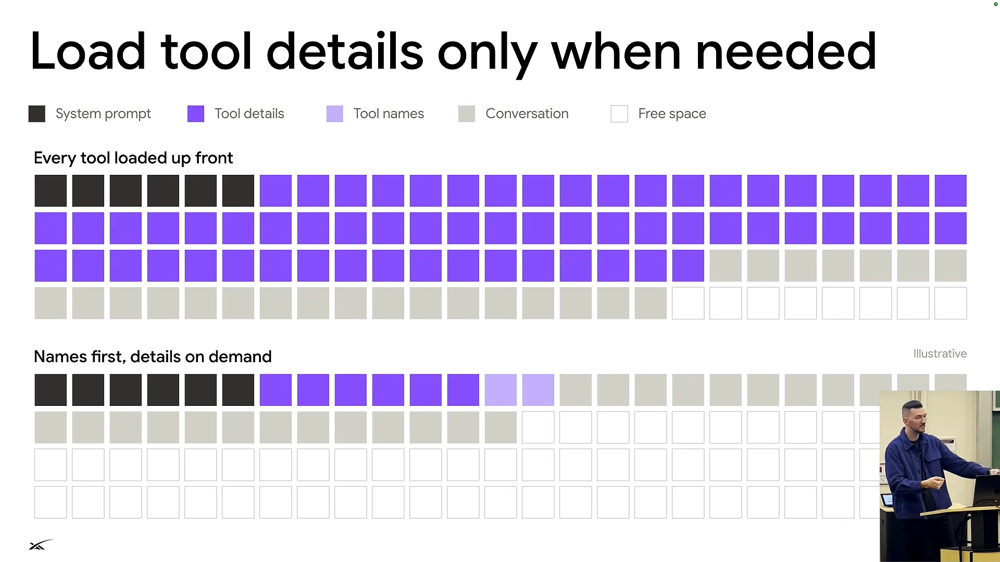

### Hai lưới của slide "Load tool details only when needed"

Slide "Load tool details only when needed" (khoảng phút 21'22") dùng chú giải năm màu: System prompt, Tool details, Tool names, Conversation, Free space. Mỗi ô là một phần của context window. Slide có hai lưới ô vuông:

- **Lưới trên, "Every tool loaded up front":** ô tím chi tiết tool chiếm gần ba hàng, chỉ còn ít chỗ cho hội thoại.
- **Lưới dưới, "Names first, details on demand"** (ghi chú "Illustrative"): một khối tím nhỏ, hai ô tên tool, nhiều chỗ trống.

### Vì sao chỉ nạp tên tool trước

Mỗi tool có tên, schema (khuôn mô tả đầu vào) và nhiều chi tiết. Khi cài các connector như Google Drive, Gmail, YouTube, mỗi cái là một MCP server với nhiều tool. Theo diễn giả, lúc đó nhiều ô trong context window đã bị chiếm sẵn, model còn ít chỗ cho việc của cuộc hội thoại.

Giải pháp là **dynamic context** (còn gọi là *tool search tool*). Chỉ tên tool nằm trong mỗi message, và khi cần model tự đọc chi tiết từ file. Cách này tiết kiệm context và chi phí.

## Thử cách rẻ nhất trước, hỏi người dùng sau cùng

Cũng như context, công sức của agent là thứ có giá. Slide này xếp các cách lấy thông tin theo thứ tự từ rẻ đến đắt.

> **Ý chính:** đi từ cách rẻ nhất lên dần, và hỏi người dùng sau cùng.

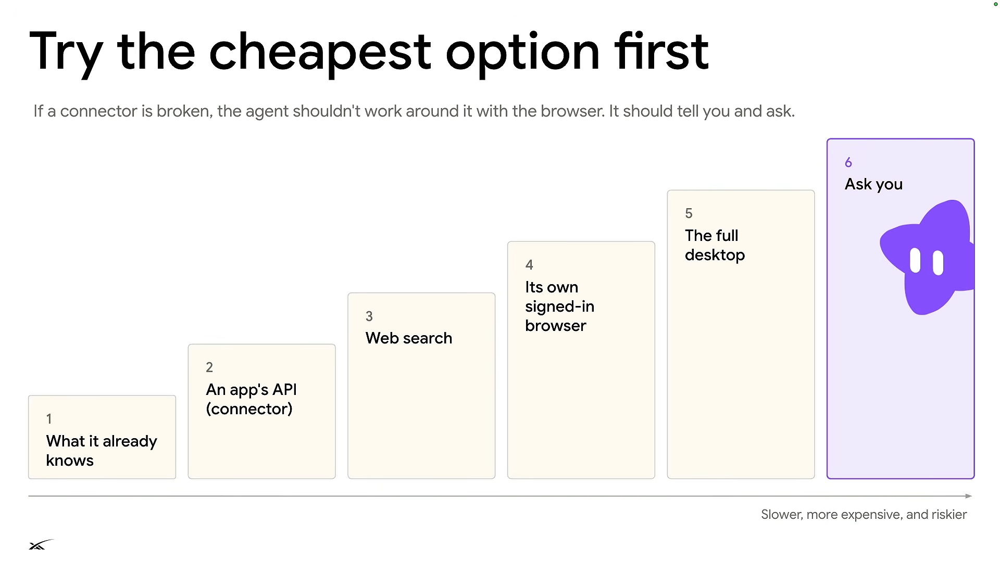

### Sáu bậc của slide "Try the cheapest option first"

Slide "Try the cheapest option first" (khoảng phút 21'32") là thang sáu bậc, đọc từ trái sang phải. Mũi tên dưới cùng ghi "Slower, more expensive, and riskier":

| Bậc | Cách thử | Ví dụ từ bài giảng |
|---|---|---|
| 1 | What it already knows | Thông tin có sẵn trong hội thoại |
| 2 | An app's API (connector) | Lấy dữ liệu ngân hàng qua Plaid |
| 3 | Web search | Tra tỷ số trận Cubs đêm qua |
| 4 | Its own signed-in browser | Mở browser và tìm kiếm |
| 5 | The full desktop | Chạy script, command trên máy Linux |
| 6 | Ask you (ô tím) | Xin người dùng nhập hoặc duyệt |

Phụ đề slide: nếu connector hỏng, agent nên báo và hỏi người dùng thay vì lách bằng browser.

### Hỏi người dùng và ba cách đọc màn hình

Nhờ thang này, bot hành xử như một đồng nghiệp: thử nhiều hướng trước rồi mới làm phiền người khác. Bậc cuối là hỏi người dùng, ví dụ khi cần mã hai yếu tố hoặc captcha.

Khi dùng máy tính, agent có ba cách đọc màn hình:

- **Screenshot:** cách cơ bản, nhưng tốn token.
- **HTML hoặc accessibility tree** (danh sách có cấu trúc gồm nút, link, ô nhập của trang): giảm token và giúp tìm đúng phần tử cần click.
- **Click theo pixel:** phương án cuối, cần cho trường hợp như hộp thoại bật lên.

## Một main agent, nhiều helper

Thang sáu bậc giải quyết chuyện chọn cách làm. Còn việc nặng thì cần một người làm riêng, và đó là vai trò của helper.

> **Ý chính:** main agent điều phối, việc nặng nằm ở helper, và chỉ báo cáo ngắn quay lại.

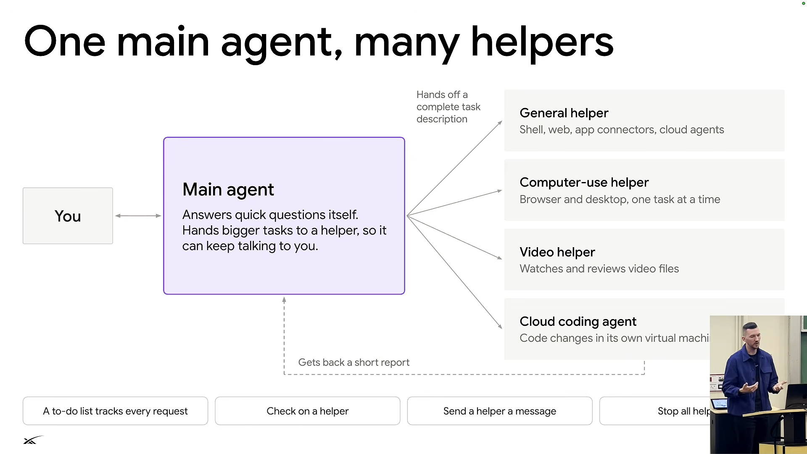

### Các phần của slide "One main agent, many helpers"

Slide "One main agent, many helpers" (khoảng phút 24'12") có người dùng, main agent và bốn helper:

- **"You" ↔ "Main agent":** mũi tên hai chiều. Main agent tự trả lời câu hỏi nhanh và giao việc lớn cho helper để tiếp tục trò chuyện.
- **Mũi tên "Hands off a complete task description":** giao mô tả tác vụ đầy đủ cho helper.
- **General helper:** shell, web, connector ứng dụng, cloud agent.
- **Computer-use helper:** browser và desktop.
- **Video helper:** xem và đánh giá file video.
- **Cloud coding agent:** sửa code trong máy ảo riêng (phần cuối bị camera che).
- **Mũi tên nét đứt "Gets back a short report":** helper chỉ trả báo cáo ngắn.
- **Hàng dưới:** main agent giữ to-do list theo dõi mọi yêu cầu, kiểm tra helper, nhắn cho helper và dừng helper (ô cuối bị che một phần).

### Giải thích: vì sao tách như vậy

Cuộc hội thoại của main agent nên thưa nhất có thể. Khi helper chạy hàng loạt shell command hay tool call đắt tiền, quá trình đó không làm phình context của main agent. Chỉ câu trả lời quay về.

Nhờ vậy sản phẩm có cảm giác context vô hạn, dù bài giảng nói rõ context vô hạn không có thật. Mỗi helper còn là một durable workflow riêng: video helper crash hay hết bộ nhớ thì khởi động lại mà không mất tiến độ.

### Mẹo thiết kế harness

- **Tool riêng thay vì chỉ shell:** nếu model dành khoảng 90% thời gian shell cho một việc, tool chuyên dụng hiệu quả hơn và người xem xét sản phẩm cũng dễ đọc hơn.
- **Thông báo lỗi rõ ràng:** nói rõ điều gì hỏng và nên làm gì tiếp. Cách này giúp cả agent.
- **Mô tả tool gọn:** mô tả và schema dài chiếm context window và làm tăng chi phí.

## Bảo mật khi giao việc dài hạn

Giao nhiều việc cho helper và máy tính riêng cũng có nghĩa là agent làm nhiều thứ mà không ai nhìn từng bước. Đoạn này của bài giảng (không có slide) nói về cách giữ an toàn.

> **Ý chính:** agent chạy lâu và nhận dữ liệu từ ngoài, nên cần nhiều lớp kiểm tra dù đã có máy riêng.

Bài giảng nêu bốn biện pháp:

- **Auto review:** một model riêng kiểm tra mọi shell command. Diễn giả nói rằng nếu làm một bài kiểm tra mù giữa model và người, phần lớn thời gian model kiểm tra tốt hơn một người đang mệt vì phải duyệt hàng trăm command.
- **Nội dung bên ngoài không phải chỉ thị:** email phishing hoặc webhook không được xử lý như lời người dùng. Chống prompt injection (chèn lệnh vào nội dung để điều khiển model) vẫn còn nhiều việc phải làm.
- **Hỏi trước khi làm việc không hoàn tác**, như gửi email.
- **Giữ mật khẩu ngoài cuộc hội thoại với model.**

## Prompt caching: giữ phần đầu prompt không đổi

Quay lại chủ đề chi phí: mỗi lượt agent đều gửi lại cả cuộc hội thoại, nên cách sắp xếp prompt quyết định lượng token phải trả giá đầy đủ.

> **Ý chính:** phần đầu prompt giống hệt giữa các lần gọi thì cache được tái dùng, vừa rẻ vừa nhanh.

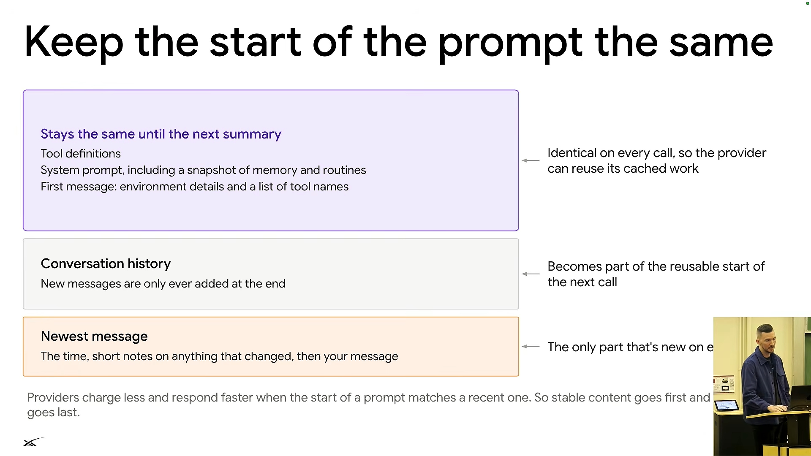

### Giải thích: vì sao cache quan trọng

Mỗi lượt, agent gửi lại toàn bộ hội thoại cộng một message mới. Vì vậy phần lớn token là **cached token** (token nhà cung cấp đã xử lý và dùng lại được), được giảm giá mạnh.

Do đó tool definitions và system prompt cần càng tĩnh càng tốt, để chỉ message mới nhất bị tính giá token chưa cache. Bài giảng coi context engineering và harness engineering gần như là một.

### Ba hộp của slide "Keep the start of the prompt the same"

Slide "Keep the start of the prompt the same" (khoảng phút 27'46") có ba hộp xếp chồng:

- **Hộp tím "Stays the same until the next summary":** Tool definitions, System prompt (kèm ảnh chụp memory và routine), First message (chi tiết môi trường, danh sách tên tool). Phần này giống hệt ở mọi lần gọi nên được tái dùng.
- **Hộp xám "Conversation history":** tin mới chỉ thêm vào cuối.
- **Hộp cam "Newest message":** giờ hiện tại, ghi chú ngắn về thay đổi, rồi tin nhắn người dùng. Đây là phần duy nhất mới ở mỗi lần gọi (ghi chú bị che một phần).

Dòng cuối slide: nội dung ổn định đặt trước, nội dung thay đổi đặt sau.

## Giữ context của main agent nhỏ

Prompt ổn định giúp rẻ hơn, nhưng context vẫn lớn dần theo thời gian. Slide này liệt kê sáu cách giữ nó nhỏ.

> **Ý chính:** thứ nặng nằm ngoài context của main agent, chỉ con trỏ hoặc bản tóm tắt quay về.

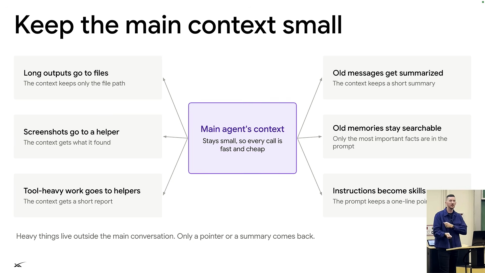

### Sáu thẻ của slide "Keep the main context small"

Slide "Keep the main context small" (khoảng phút 29'13") có một hộp giữa: "Main agent's context: stays small, so every call is fast and cheap". Sáu thẻ quanh đó:

- **Thẻ 1.** Output dài → file. Context chỉ giữ đường dẫn.
- **Thẻ 2.** Screenshot → helper.
- **Thẻ 3.** Việc dùng nhiều tool → helper. Chỉ nhận lại báo cáo ngắn.
- **Thẻ 4.** Tin nhắn cũ → bản tóm tắt.
- **Thẻ 5.** Memory cũ vẫn tìm kiếm được. Chỉ sự kiện quan trọng nhất nằm trong prompt.
- **Thẻ 6.** Chỉ dẫn → skill. Prompt giữ một dòng trỏ tới skill (phần cuối thẻ bị che).

Chân slide: thứ nặng nằm ngoài cuộc hội thoại chính, chỉ con trỏ hoặc bản tóm tắt quay về.

### Vì sao đưa output dài vào file

Agent đọc file rất tốt nên đưa output dài vào file không làm mất thông tin. Tỉa context liên tục có lợi cho chi phí, khả năng nhớ đúng và chất lượng model.

## Xem cache miss như một bug

Giữ context nhỏ chỉ có ích nếu cache không bị phá vỡ giữa chừng. Với agent chạy liên tục, điều này quan trọng đến mức slide gọi cache miss là bug.

> **Ý chính:** mỗi lần cache miss (không tái dùng được cache) đều tốn kém, nên phải coi là lỗi.

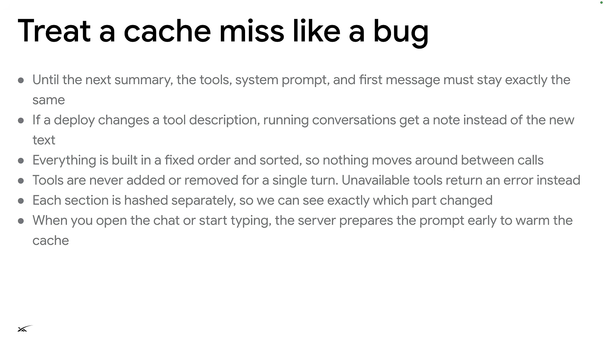

Đầu năm nay, OpenClaw phổ biến và người dùng chạy nó trong gói thuê bao của nhà cung cấp model. Harness chưa được tối ưu cho cách dùng mới này nên có nhiều cache miss, và phải sửa nhiều chỗ.

### Sáu quy tắc của slide "Treat a cache miss like a bug"

Slide "Treat a cache miss like a bug" (khoảng phút 29'53") có sáu quy tắc:

- **Quy tắc 1.** Tools, system prompt và first message giữ nguyên đến lần tóm tắt tiếp theo.
- **Quy tắc 2.** Nếu cập nhật đổi mô tả tool, các cuộc hội thoại đang chạy nhận một ghi chú thay vì văn bản mới.
- **Quy tắc 3.** Mọi thứ dựng theo thứ tự cố định và đã sắp xếp.
- **Quy tắc 4.** Không thêm hoặc bớt tool cho riêng một lượt. Tool không khả dụng thì trả về lỗi.
- **Quy tắc 5.** Mỗi phần được hash riêng nên thấy chính xác phần nào đã đổi. **Hash** là giá trị tính từ nội dung, đổi khi nội dung đổi.
- **Quy tắc 6.** Khi chat mở hoặc người dùng bắt đầu gõ, server chuẩn bị prompt sớm để làm ấm cache.

### Giải thích: vì sao cần thứ tự cố định

Giả sử thử nghiệm A/B bằng cách chèn một đoạn mới vào system prompt. Nếu thứ tự các phần bị xáo trộn cho mọi người dùng thì cache của tất cả đều hỏng. Thứ tự cố định cộng hash từng phần giữ ảnh hưởng trong đúng nhóm thử nghiệm.

## Tóm tắt khi người dùng không có mặt

Dù đã giữ context nhỏ, hội thoại dài vẫn sẽ đầy. Lúc đó phải tóm tắt, và slide này nói nên chọn thời điểm nào.

> **Ý chính:** nén hội thoại luôn mất thông tin, nên tóm tắt đúng lúc: ngay sau lượt lớn, khi cache còn ấm.

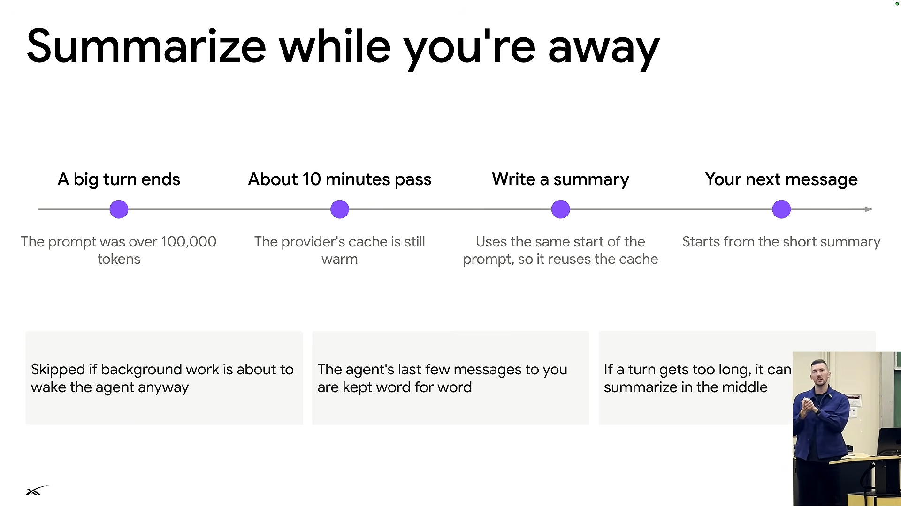

### Giải thích: vì sao compaction bắt buộc

Với model có context window 200.000 token, chạy đủ lâu thì đến lúc phải tóm tắt, gọi là **compaction**. Mọi phép nén đều mất thông tin, nên cần thuật toán tốt để không bỏ sót chi tiết quan trọng. Diễn giả nói bài toán này khó đến mức có thể thành cả luận án.

Có một mẹo về thời điểm. Sau khi hội thoại vượt 100.000 token, cache còn ấm một thời gian (theo diễn giả có thể 10 hoặc 60 phút). Tóm tắt ngay lúc đó rẻ hơn nhiều. Khi người dùng quay lại, cuộc trò chuyện bắt đầu từ bản tóm tắt ngắn.

### Timeline của slide "Summarize while you're away"

Slide "Summarize while you're away" (khoảng phút 31'43") có timeline bốn điểm:

- **Bước 1, "A big turn ends":** prompt vượt 100.000 token.
- **Bước 2, "About 10 minutes pass":** con số 10 phút là của slide.
- **Bước 3, "Write a summary":** dùng cùng phần đầu prompt nên tái dùng cache.
- **Bước 4, "Your next message":** bắt đầu từ bản tóm tắt ngắn.

Ba ghi chú đi kèm:

- Bỏ qua việc tóm tắt nếu việc nền sắp đánh thức agent.
- Vài tin gần nhất agent gửi người dùng được giữ nguyên văn.
- Lượt quá dài có thể tóm tắt giữa lượt (phần cuối ghi chú bị che một phần).

## Agent ghi nhớ như thế nào

Bản tóm tắt chỉ giữ được một phần. Phần còn lại cần một nơi lưu khác, và đó là memory.

> **Ý chính:** memory chia bốn tầng, và chỉ phần thật sự cần mới vào prompt.

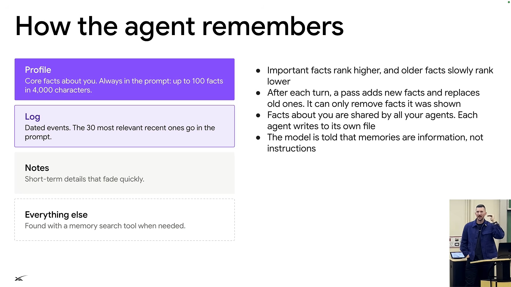

### Bốn tầng của slide "How the agent remembers"

Slide "How the agent remembers" (khoảng phút 33'03") có bốn tầng ở bên trái:

| Tầng | Chứa gì | Vào prompt thế nào |
|---|---|---|
| **Profile** | Sự thật cốt lõi về người dùng | Luôn có trong prompt, tối đa 100 sự kiện trong 4.000 ký tự |
| **Log** | Sự kiện theo ngày | 30 sự kiện gần đây phù hợp nhất vào prompt |
| **Notes** | Chi tiết ngắn hạn, nhanh mờ đi | Theo diễn giả, liên quan trong khoảng 30 phút hoặc một giờ |
| **Everything else** | Mọi thứ còn lại | Không vào prompt, tìm bằng công cụ tìm kiếm memory khi cần |

Bên phải slide là bốn quy tắc:

- **Quy tắc 1.** Sự kiện quan trọng xếp cao hơn, sự kiện cũ dần xếp thấp đi.
- **Quy tắc 2.** Sau mỗi lượt, một bước xử lý thêm sự kiện mới và thay sự kiện cũ. Bước này chỉ được xóa sự kiện đã được cho xem.
- **Quy tắc 3.** Sự kiện về người dùng dùng chung cho mọi agent của họ, còn mỗi agent ghi vào file riêng của nó.
- **Quy tắc 4.** Model được dặn rằng memory là thông tin, không phải chỉ thị.

### Giải thích: vì sao chia tầng

Khi compaction, phải chọn đưa gì vào memory. Profile giữ điều phải có ở mọi tin. Ví dụ, nếu người dùng luôn muốn viết chữ thường, thiếu thông tin này sẽ có lúc agent gửi một tin viết hoa bất ngờ.

Notes là ghi chú nháp, thiết kế để biến mất. Phần còn lại nằm trong file, và vì model chạy command giỏi nên tự tra cứu được.

## Huấn luyện model cho đúng sản phẩm

Memory và context là việc của harness. Slide tiếp theo chuyển sang phía model: model cũng cần được huấn luyện để làm việc trong harness đó.

> **Ý chính:** model được huấn luyện để làm việc trong harness, và main agent với helper được tối ưu theo hai mục tiêu khác nhau.

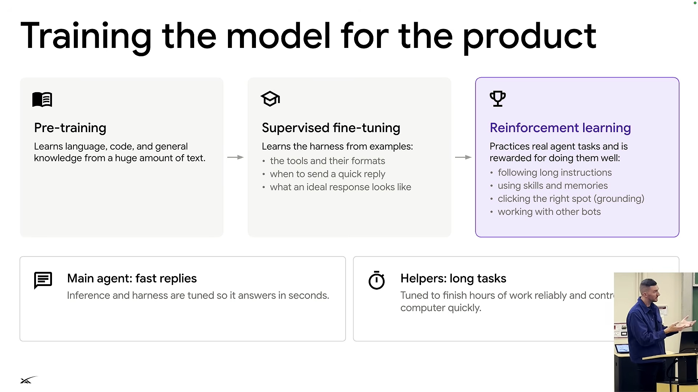

### Ba giai đoạn huấn luyện LLM

Bài giảng nhắc lại ba giai đoạn:

- **Pre-training:** học hiểu biết chung từ lượng lớn văn bản.
- **Supervised fine-tuning (SFT):** dạy cách ứng xử, như trợ lý chat hoặc agent.
- **Reinforcement learning:** giống dạy model chơi game để chơi giỏi dần.

### Ba thẻ của slide "Training the model for the product"

Slide "Training the model for the product" (khoảng phút 34'55") có ba thẻ nối bằng mũi tên và hai thẻ dưới:

- **Pre-training → Supervised fine-tuning:** học harness qua ví dụ, gồm các tool, định dạng và khi nào gửi phản hồi nhanh.
- **→ Reinforcement learning:** luyện tác vụ agent thật và được thưởng. Gồm làm theo chỉ dẫn dài, chọn đúng skill giữa hàng trăm skill, dùng memory, click đúng vị trí (grounding) và phối hợp với bot khác.
- **Main agent: fast replies:** trả lời trong vài giây.
- **Helpers: long tasks:** hoàn thành việc nhiều giờ một cách đáng tin (phần cuối bị che).

### Giải thích: vì sao hai mục tiêu khác nhau

Người dùng muốn main agent phản hồi gần như ngay, nên harness và inference (cách chạy model để trả lời) được tinh chỉnh cho độ trễ thấp. Với helper làm việc rất dài, chênh lệch 10 hay 12 phút gần như không đáng kể.

## Vòng lặp trong và vòng lặp ngoài

Model được huấn luyện xong chưa phải là điểm dừng. Slide này mô tả cách lỗi thực tế quay lại cải thiện cả sản phẩm lẫn model.

> **Ý chính:** mỗi lỗi thành một eval, cải thiện sản phẩm hôm nay (vòng trong) và model ngày mai (vòng ngoài).

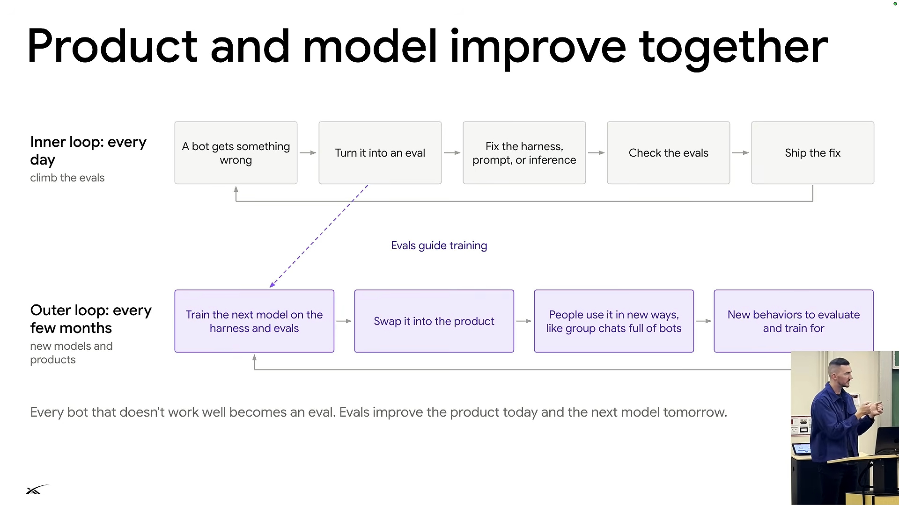

### Hai vòng của slide "Product and model improve together"

**Eval** là bài kiểm tra lặp lại được, đo xem agent có làm đúng không. Slide "Product and model improve together" (khoảng phút 36'25") có hai hàng, mỗi hàng một vòng.

**Inner loop: every day (climb the evals)**, vòng trong hằng ngày:

- **Bước 1.** Bot làm sai một việc, ví dụ gọi một tool lẽ ra không được gọi.
- **Bước 2.** Biến lỗi đó thành một eval.
- **Bước 3.** Sửa harness, prompt hoặc inference.
- **Bước 4.** Chạy lại các eval để kiểm tra đã sửa chưa.
- **Bước 5.** Ship bản sửa, rồi quay về bước 1.

**Outer loop: every few months (new models and products)**, vòng ngoài mỗi vài tháng:

- **Bước 1.** Huấn luyện model kế tiếp trên harness và các eval.
- **Bước 2.** Thay model mới vào sản phẩm.
- **Bước 3.** Người dùng dùng theo cách mới, ví dụ nhóm chat đầy bot.
- **Bước 4.** Hành vi mới xuất hiện, cần đánh giá và huấn luyện tiếp.

Mũi tên nét đứt "Evals guide training" nối bước "Turn it into an eval" xuống hộp đầu của vòng ngoài. Chân slide: mỗi bot hoạt động chưa tốt thành một eval, và eval cải thiện sản phẩm hôm nay lẫn model ngày mai.

### Giải thích: vì sao cần vòng ngoài

Model mới thường có bước nhảy năng lực, mở ra cách dùng mới. Dữ liệu huấn luyện về bot trong nhóm chat còn rất ít, nên cần huấn luyện để model cư xử tốt khi nhiều bot nói chuyện với nhau.

## Xây cho thế hệ model kế tiếp: dự đoán 6 đến 12 tháng

Vòng ngoài kéo theo một câu hỏi: nên xây gì khi model thay đổi nhanh như vậy? Slide cuối của bài giảng đưa ra sáu dự đoán và một nguyên tắc.

> **Ý chính:** model hôm nay là kém nhất từ trước đến nay, nên xây ít và sẵn sàng viết lại.

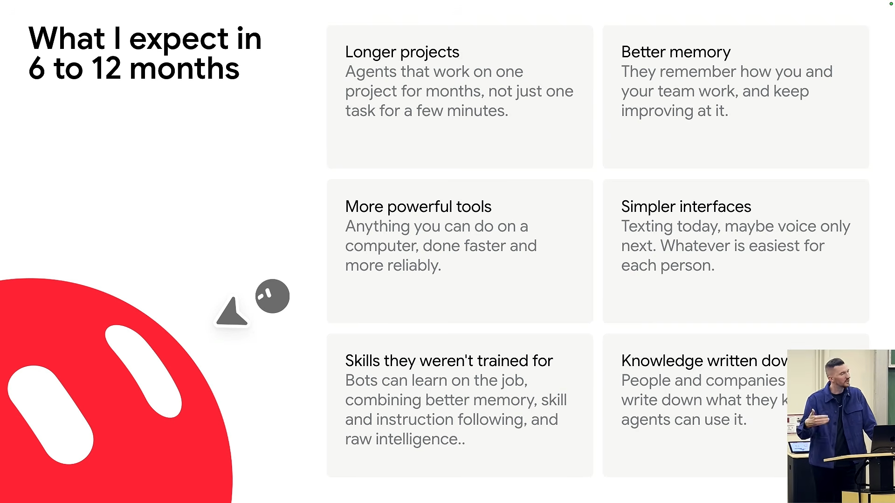

### Nguyên tắc "delete the product"

Nguyên tắc này từng áp dụng tại Cursor và nay tại SpaceX. Vì model hôm nay là kém nhất từ trước đến nay, trong sáu tháng có thể phải xây lại toàn bộ giao diện.

Cách làm: xây cho thế hệ model kế tiếp, xây ít nhất có thể, và giữ giao diện rất đơn giản.

### Sáu thẻ của slide dự đoán 6 đến 12 tháng

Slide dự đoán (khoảng phút 39'57") có sáu thẻ:

- **Thẻ 1, Longer projects:** dự án nhiều tháng thay vì tác vụ vài phút.
- **Thẻ 2, Better memory:** nhớ lại thông tin cũ tốt hơn.
- **Thẻ 3, More powerful tools:** tool mạnh hơn.
- **Thẻ 4, Simpler interfaces:** hôm nay là nhắn tin, sau có thể là giọng nói.
- **Thẻ 5, Skills they weren't trained for:** bot học tại chỗ.
- **Thẻ 6, Knowledge written down:** con người và công ty viết ra những gì họ biết để agent dùng được (chữ bị che một phần).

### Bài toán còn mở

- Đánh giá một agent chạy một tháng khi model ra mắt mỗi tháng.
- Thuật toán memory.
- Bảo mật cho harness và hạ tầng quanh agent, để kẻ xấu không chiếm quyền.
- Heuristic về lúc agent im lặng và lúc nhắn người dùng. Chủ động gợi ý có thể hữu ích hoặc phiền.
- Hiệu quả của inference, model và harness, vì lượng token trên thế giới sẽ tăng nhiều.

### Các khối xây dựng

Mỗi sản phẩm mới sẽ cần một phần "agentic", hoặc trở thành dữ liệu cho agent khác dùng. Ở phút 42'48", diễn giả liệt kê các khối xây dựng: durable workflows, **sandboxes** ("sandboxes, computers in the cloud"), memory, skills, kết nối dịch vụ khác, giọng nói, thanh toán, danh tính, evals và observability.

## Lời khuyên cuối bài giảng

Phần kết (khoảng phút 43'25") chuyển từ dự đoán sang việc người nghe có thể làm ngay. Diễn giả đưa ra ba gợi ý:

- **Gợi ý 1.** Nghĩ về thiết kế hệ thống và kiến trúc, vì các quyết định ở đó tích lũy theo thời gian.
- **Gợi ý 2.** Thử tự dựng một phiên bản để hiểu các mảnh ghép khớp nhau. Theo diễn giả, có thể có bản fork mã nguồn mở của bot trên GitHub, và có thể thêm giao diện cùng "a sandbox somewhere and a VM" (một sandbox ở đâu đó và một máy ảo) để tìm hiểu thêm.
- **Gợi ý 3.** Tìm hiểu cách LLM hoạt động, vì nhiều quyết định ở mức sản phẩm và harness chịu ảnh hưởng của chính model.

## Checklist: việc cần làm khi phát triển AI agent

Từ các slide trên, đây là 16 việc, chia năm nhóm. Phần thân bài đã giải thích khái niệm, nên mỗi việc ở đây chỉ nêu hành động, lý do và một điều kiện để biết đã xong.

### Nhóm A. Nền tảng chạy agent

**Việc 1. Đặt agent loop và state trên server**

- **Việc cần làm:**
  - Chạy agent loop trên server.
  - Lưu conversation, memory, routine, skill vào database hoặc storage.
- **Vì sao:** khi loop nằm trên server, có thể dựng lại máy ảo bất cứ lúc nào mà loop và hội thoại vẫn còn.
- **Xong khi:** dựng lại máy ảo xong, hội thoại tiếp tục từ state đã lưu.

**Việc 2. Cấp cho agent một máy tính riêng**

- **Việc cần làm:**
  - Cấp một máy Linux trên cloud cho mỗi người dùng.
  - Trang bị desktop, files, command runner và browser.
- **Vì sao:** command chạy trong môi trường được khóa chặt thay vì trên laptop cá nhân.
- **Xong khi:** files, tool và phiên đăng nhập còn nguyên sau một lần ngủ rồi thức.

**Việc 3. Chạy tác vụ dài bằng durable workflow**

- **Việc cần làm:**
  - Chạy mỗi tác vụ dài như một durable workflow (bài giảng dùng Temporal).
  - Chạy mỗi helper như một durable workflow riêng.
- **Vì sao:** sau sự cố, job queue thông thường chạy lại từ step 1 và có thể lặp việc đã xong.
- **Xong khi:** sau restart, tác vụ tiếp tục từ bước lỗi, không lặp bước đã xong.

**Việc 4. Cho agent ngủ khi rảnh, thức bằng trigger**

- **Việc cần làm:**
  - Dừng process sau vài phút rảnh.
  - Cho máy tính ngủ và khôi phục ở tool call kế tiếp.
  - Nhận trigger từ tin nhắn, routine, Slack, cuộc gọi và việc nền.
- **Vì sao:** giữ máy chạy liên tục cho mọi người dùng thì quá đắt.
- **Xong khi:** routine 8:00 chạy không cần tin nhắn nào, và máy tính vẫn ngủ nếu routine không cần đến.

### Nhóm B. Giao tiếp và cách agent làm việc

**Việc 5. Giao tiếp qua một send tool, có quy tắc im lặng**

- **Việc cần làm:**
  - Chỉ nhắn người dùng khi gọi send tool.
  - Dùng heuristic để quyết định khi nào đáng làm phiền người dùng.
  - Hiện bản nháp để duyệt trước hành động không hoàn tác.
- **Vì sao:** không phải tiến triển nào cũng đáng báo, và agent có thể làm việc âm thầm nếu không có gì quan trọng.
- **Xong khi:** agent hoàn thành một việc mà không gửi tin nào.

**Việc 6. Trang bị tool thật**

- **Việc cần làm:**
  - Cung cấp shell, files và browser.
  - Kết nối API ứng dụng qua MCP.
  - Cho agent dùng máy tính để thao tác trên màn hình.
- **Vì sao:** website không có API hay MCP server vẫn dùng được khi agent tự thao tác trên màn hình.
- **Xong khi:** agent hoàn thành một tác vụ trong ứng dụng không có API.

**Việc 7. Áp dụng thang "cách rẻ nhất trước"**

- **Việc cần làm:**
  - Thử theo thứ tự: thông tin có sẵn, API, web search, browser, desktop, hỏi người dùng.
  - Đọc màn hình bằng HTML hoặc accessibility tree trước, click pixel là dự phòng.
  - Hỏi người dùng khi cần duyệt, mã hai yếu tố hoặc captcha.
- **Vì sao:** cách rẻ hơn thì nhanh hơn, ít tốn hơn và ít rủi ro hơn.
- **Xong khi:** agent chỉ hỏi người dùng sau khi các bậc thấp hơn thất bại hoặc cần người duyệt.

**Việc 8. Tách main agent và helper**

- **Việc cần làm:**
  - Để main agent trò chuyện và giữ to-do list.
  - Giao helper một mô tả tác vụ đầy đủ.
  - Yêu cầu helper chỉ trả báo cáo ngắn.
- **Vì sao:** helper có working memory mới nên việc nặng không làm phình hội thoại của main agent.
- **Xong khi:** context của main agent chỉ chứa báo cáo của helper, không chứa các tool call nặng.

### Nhóm C. Memory và context

**Việc 9. Biến quy trình thành skill và routine**

- **Việc cần làm:**
  - Viết skill thành file markdown.
  - Đặt routine cho prompt chạy theo lịch.
  - Cho agent lưu cách làm được chỉ thành skill.
- **Vì sao:** kiến thức nằm trong file thì model dễ đọc, cập nhật và tìm.
- **Xong khi:** một việc được chỉ một lần được lặp lại từ skill.

**Việc 10. Xây memory nhiều tầng**

- **Việc cần làm:**
  - Giữ profile luôn trong prompt.
  - Ghi log theo ngày và notes ngắn hạn.
  - Cho phần còn lại tìm bằng công cụ tìm kiếm memory.
  - Xếp hạng sự kiện theo độ quan trọng.
  - Dặn model rằng memory là thông tin, không phải chỉ thị.
- **Vì sao:** nén hội thoại luôn mất thông tin, nên phải chọn kỹ cái giữ lại trong prompt.
- **Xong khi:** một sở thích đã nói (như nhắn chữ thường) xuất hiện trong mọi câu trả lời sau đó.

**Việc 11. Nạp tool theo nhu cầu**

- **Việc cần làm:**
  - Chỉ đưa tên tool vào mỗi request.
  - Để model đọc chi tiết tool từ file khi cần dùng.
- **Vì sao:** chi tiết của nhiều MCP server chiếm chỗ, làm model còn ít không gian cho cuộc hội thoại.
- **Xong khi:** số token mô tả tool trong prompt giảm so với khi nạp toàn bộ tool từ đầu.

**Việc 12. Giữ phần đầu prompt ổn định để tái dùng cache**

- **Việc cần làm:**
  - Giữ nguyên tool definitions, system prompt và first message đến lần tóm tắt tiếp theo.
  - Dựng các phần theo thứ tự cố định.
  - Không thêm hoặc bớt tool cho riêng một lượt.
  - Hash từng phần prompt.
- **Vì sao:** token đã cache rẻ và nhanh hơn, còn cache miss làm tốn kém mỗi lượt.
- **Xong khi:** khi cache miss xảy ra, hash chỉ ra đúng phần prompt đã đổi.

**Việc 13. Giữ context của main agent nhỏ**

- **Việc cần làm:**
  - Đưa output dài vào file và chỉ giữ đường dẫn.
  - Giao screenshot và việc dùng nhiều tool cho helper.
  - Thay tin nhắn cũ bằng bản tóm tắt.
- **Vì sao:** context nhỏ làm mỗi lần gọi nhanh và rẻ hơn.
- **Xong khi:** context của main agent chỉ chứa đường dẫn, báo cáo ngắn và bản tóm tắt cho các việc nặng.

**Việc 14. Tóm tắt đúng lúc**

- **Việc cần làm:**
  - Tóm tắt ngay sau một lượt lớn (prompt vượt 100.000 token), khi cache còn ấm.
  - Bỏ qua việc tóm tắt nếu việc nền sắp đánh thức agent.
  - Giữ nguyên văn vài tin gần nhất gửi người dùng.
- **Vì sao:** mọi phép nén đều mất thông tin, và tóm tắt lúc cache còn ấm thì rẻ hơn.
- **Xong khi:** tin đầu tiên sau một khoảng nghỉ bắt đầu từ bản tóm tắt ngắn mà vẫn giữ chi tiết quan trọng.

### Nhóm D. An toàn

**Việc 15. Bảo vệ agent và dữ liệu**

- **Việc cần làm:**
  - Dùng một model riêng kiểm tra mọi shell command (auto review).
  - Coi email phishing và webhook là dữ liệu, không phải chỉ thị.
  - Yêu cầu người dùng duyệt hành động không hoàn tác, như gửi email.
  - Giữ mật khẩu ngoài cuộc hội thoại với model.
- **Vì sao:** agent làm việc lâu mà không có người giám sát liên tục, và nhận nội dung từ bên ngoài.
- **Xong khi:** một email chứa lệnh không kích hoạt được command nào, và mọi shell command đều qua auto review trước khi chạy.

### Nhóm E. Cải tiến liên tục

**Việc 16. Biến mỗi lỗi thành eval**

- **Việc cần làm:**
  - Biến mỗi hành vi sai thành một eval trước khi sửa.
  - Chạy lại các eval sau khi sửa rồi mới ship.
- **Vì sao:** eval cải thiện sản phẩm hôm nay, và mỗi vài tháng được dùng để huấn luyện model kế tiếp. Model hôm nay là kém nhất từ trước đến nay, nên chỉ xây phần cần thiết và sẵn sàng viết lại khi model mới ra.
- **Xong khi:** mọi hành vi sai được báo cáo đều có một eval tương ứng, và các eval chạy lại đều qua trước khi bản sửa được ship.
