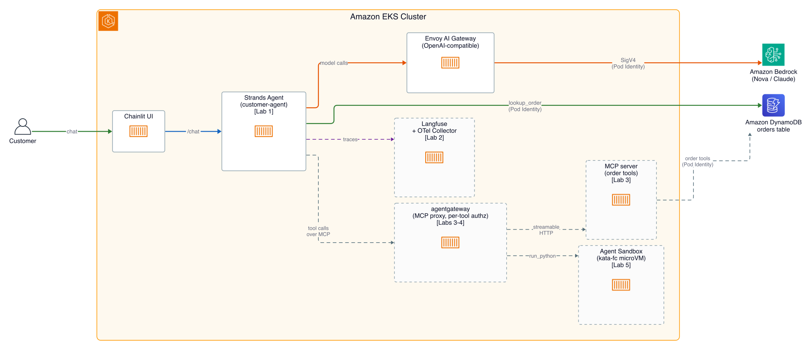
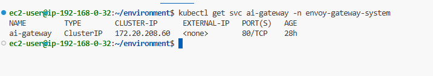
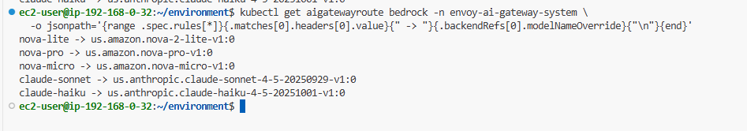
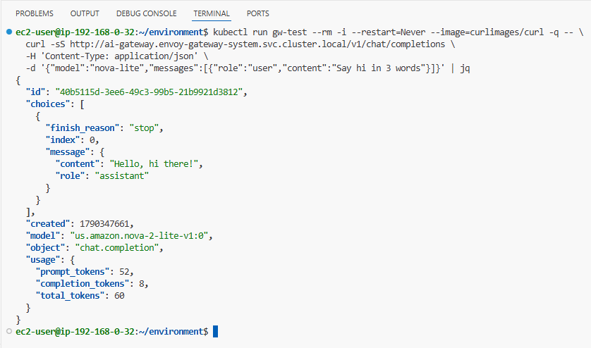
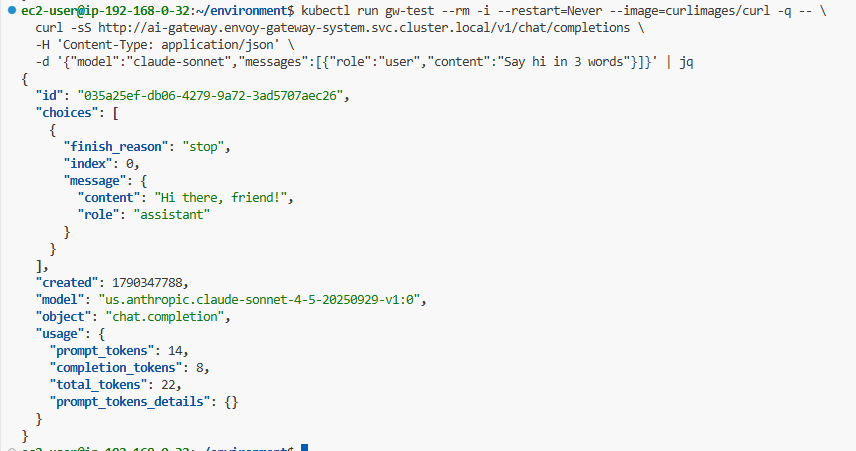

# Building Agents on Amazon EKS - Part 1: The AI Gateway

> Đây là phần mở đầu của loạt bài mình ghi lại khi làm workshop **Building Agents on Amazon EKS**. Xuyên suốt loạt bài, mình xây một customer service agent cho AnyCompany Shop và bồi thêm một khả năng mới sau mỗi part.

## Bối cảnh: Sample Application

Xuyên suốt workshop, bạn sẽ xây và tiến hóa một **customer service agent** cho AnyCompany Shop — một cửa hàng bán lẻ điện tử trực tuyến (hư cấu).

Kịch bản: AnyCompany Shop cần một agent AI xử lý các câu hỏi thường gặp của khách mà không phải chuyển cho người thật. Khách chat với agent qua web UI và mong nó có thể:

- Tra cứu trạng thái đơn hàng, mã tracking, thời gian giao dự kiến
- Trả lời câu hỏi về sản phẩm và đổi trả
- Tính toán nhẹ (ví dụ "cộng tổng hai đơn của tôi")

Bạn bắt đầu với một agent chỉ tra cứu được đơn hàng, rồi xếp chồng dần khả năng qua từng lab cho tới khi có một agent có observability, dùng tool, chạy trong sandbox và phân quyền theo persona.

### Data model

Dữ liệu của agent nằm trong một bảng DynamoDB mà nó đọc qua tool. Bảng có khoảng 500 đơn hàng trải một năm, đủ loại status, region, payment method và channel — đủ để phân tích chứ không chỉ tra cứu. Năm đơn được seed cố định, mỗi status một đơn, để mọi người học đều thấy cùng kết quả:

| Order ID | Customer       | Item                                              | Status     |
| -------- | -------------- | ------------------------------------------------- | ---------- |
| ORD-1001 | Jane Doe       | Laptop Pro 15 ($1,299.99)                         | Shipped    |
| ORD-1002 | John Smith     | Wireless Mouse + 2× USB-C Hub ($129.97)           | Delivered  |
| ORD-1003 | Alice Johnson  | Noise Cancelling Headphones ($249.99)             | Processing |
| ORD-1004 | Bob Williams   | 4K Monitor 27-inch ($399.99)                      | Cancelled  |
| ORD-1005 | Carol Martinez | Mechanical Keyboard + Wireless Earbuds ($149.98)  | Returned   |

Agent đọc đơn từ DynamoDB qua tool `lookup_order`. Lab **Agent tools with MCP** sẽ dời lookup này ra sau một MCP server, còn lab **Agents using a sandbox** dùng một fiscal-period index trên cùng bảng để chạy phân tích số lượng lớn trong một microVM cô lập.

### Agent capabilities by lab

Mỗi lab agent nhận thêm đúng một khả năng mới. Mỗi dòng dưới đây kế thừa dòng trước:

| Lab                          | Khả năng mới               | Cách hoạt động                                                          |
| ---------------------------- | -------------------------- | ---------------------------------------------------------------------- |
| Building your first agent    | Core agent loop + lookup_order | LLM (Bedrock, qua Envoy AI Gateway) quyết định khi nào gọi tool     |
| Observability with Langfuse  | Tracing                    | Mọi LLM call, tool invocation, gateway span được ghi lại thành OTel span |
| Agent tools with MCP         | Dynamic tools              | Một MCP server phục vụ order tools; agentgateway định tuyến tới nó       |
| Securing the agents          | Per-tool authorization     | agentgateway kiểm soát persona nào được gọi tool nào                    |
| Agents using a sandbox       | Isolated compute           | Phân tích không tin cậy chạy trong kata microVM dùng-một-lần, không phải trong pod của agent |

### The chat UI

Một web UI dựa trên Chainlit được deploy sẵn trên cluster, đứng sau CloudFront với Cognito login. Mỗi tin nhắn POST tới Service `customer-agent` trong cluster; các lab redeploy chính Service đó khi agent có thêm khả năng, nên UI không đổi.

Mỗi terminal mới in ra một banner login với URL chat UI và thông tin đăng nhập Support Associate. In lại bất cứ lúc nào bằng:

```bash
echo "Chat UI: $CHAT_UI_URL"
echo "  Support Associate -> $CHAT_UI_SUPPORT_USERNAME / $CHAT_UI_SUPPORT_PASSWORD"
```

Dùng URL đó mở chat UI trên trình duyệt rồi đăng nhập với vai **Support Associate**. Một persona thứ hai, **Sales Analyst**, xuất hiện sau — khi lab Securing the agents cho hai persona vai trò khác nhau.

> Đừng đăng nhập vội nếu bạn chỉ lướt trang này: chat sẽ không trả lời cho tới khi bạn deploy agent trong lab Building your first agent.

---

## Kiến trúc tổng thể



Mỗi lời gọi model đều được Amazon Bedrock phục vụ và đi qua **Envoy AI Gateway**, một proxy chạy trong cluster của bạn. Code agent không bao giờ nói chuyện trực tiếp với Bedrock và không mang credential của Bedrock: nó gửi một request chat-completions bình thường tới gateway, và gateway mang AWS identity đi nốt phần còn lại. Chính control point duy nhất đó cho phép đổi model (Nova, Claude) mà không đụng vào code agent.

> **💡 Giải thích:**
> Hãy hình dung gateway như một "lễ tân" đứng giữa agent và Bedrock. Agent chỉ cần đưa yêu cầu, còn việc chứng minh danh tính với AWS (ký SigV4) do lễ tân lo. Nhờ vậy agent không cần giữ chìa khóa AWS nào — cái gì không cầm thì không làm lộ được. Đây là ý tưởng cốt lõi xuyên suốt cả loạt bài.

> **✍️ Cảm nhận của mình:**
> _(để trống — mình sẽ tự viết phần này)_

---

## The AI Gateway

| At a glance    | Details                                                                                          |
| -------------- | ------------------------------------------------------------------------------------------------ |
| Goal           | Hiểu thứ platform team đã dựng sẵn, và tự gọi nó trước khi viết agent.                            |
| Time           | ~10 phút                                                                                          |
| Prerequisites  | Không                                                                                             |

Mọi lời gọi model trong workshop này đều do Amazon Bedrock phục vụ, và tất cả đều đi qua Envoy AI Gateway chạy trong cluster. Platform team đã set up nó trước khi bạn tới. Lab này không yêu cầu bạn deploy gì, và chưa có agent nào tồn tại. Bạn sẽ gọi gateway trực tiếp — theo cách mà bất kỳ workload nào trong cluster cũng làm — để agent bạn xây ở lab sau có một endpoint mà bạn đã hiểu rõ.

### What is already running

Gateway chạy trong namespace `envoy-gateway-system` dưới dạng một Service tên `ai-gateway`, truy cập trong cluster tại `http://ai-gateway.envoy-gateway-system.svc.cluster.local/v1`. Đây là Service kiểu ClusterIP nên không có địa chỉ ra ngoài cluster.

```bash
kubectl get svc ai-gateway -n envoy-gateway-system
```



Expected output:

```text
NAME         TYPE        CLUSTER-IP     EXTERNAL-IP   PORT(S)   AGE
ai-gateway   ClusterIP   10.100.45.12   <none>        80/TCP    2h
```

Nó nhận request ở hai định dạng và dịch cả hai sang Converse API của Bedrock: OpenAI trên `/v1/chat/completions` và Anthropic Messages trên `/anthropic/v1/messages`. Dùng cái nào là quyết định của client library, không phải của platform.

### Vì sao route traffic model qua một gateway

Ba lý do, và bạn thấy được cả ba từ dòng lệnh trong một phút:

- **Agent không giữ AWS credential.** Gateway sở hữu identity tới Bedrock, ký từng request bằng SigV4 với một role cấp qua EKS Pod Identity. Agent không bao giờ cầm credential thì không thể làm lộ.
- **Tên model không còn là mối bận tâm của application.** Agent hỏi `claude-sonnet`, chứ không phải `us.anthropic.claude-sonnet-4-5-20250929-v1:0`.
- **Có một chỗ duy nhất để nhìn và định hình traffic model.** Mọi lời gọi model trong cluster đều qua hop này — nơi bạn gắn rate limit, token budget theo team, hay usage accounting.

So với phương án không có gateway: mỗi agent tự gọi Bedrock, mỗi cái mang credential riêng, model ID hardcode riêng, và không có chỗ chung nào để thấy chúng đang tiêu bao nhiêu. Gateway đánh đổi một chút latency (một network hop) lấy identity, model naming và visibility tập trung.

> **💡 Giải thích:**
> Ba lý do trên tóm lại thành một câu: gateway biến "mỗi agent tự lo mọi thứ" thành "một chỗ lo cho tất cả". Điều này đúng với tư duy platform — tách phần hạ tầng (danh tính, chọn model, giám sát) ra khỏi phần code ứng dụng, để hai bên đổi độc lập với nhau.

### Model aliases

Gateway giữ một bảng ánh xạ tên thân thiện sang model id thật của Bedrock. In nó ra:

```bash
kubectl get aigatewayroute bedrock -n envoy-ai-gateway-system \
  -o jsonpath='{range .spec.rules[*]}{.matches[0].headers[0].value}{" -> "}{.backendRefs[0].modelNameOverride}{"\n"}{end}'
```

```text
nova-lite -> us.amazon.nova-2-lite-v1:0
nova-pro -> us.amazon.nova-pro-v1:0
nova-micro -> us.amazon.nova-micro-v1:0
claude-sonnet -> us.anthropic.claude-sonnet-4-5-20250929-v1:0
claude-haiku -> us.anthropic.claude-haiku-4-5-20251001-v1:0
```



Cột trái là thứ code agent yêu cầu. Cột phải là thứ Bedrock nhận được.

Điều này giá trị hơn số ký tự nó tiết kiệm. Người viết agent không cần biết provider nào host model, provider đó viết version ra sao, hay region prefix nào áp dụng. Đó là quyết định của platform, và chúng thay đổi: khi platform team chuyển `claude-sonnet` từ Sonnet 4.5 sang bản kế tiếp, họ sửa bảng này và mọi agent trong cluster đi theo. Không rebuild, không redeploy, không code review.

> **💡 Giải thích:**
> Alias giống như một "danh bạ": bạn gọi tên người (`claude-sonnet`) chứ không nhớ số điện thoại đầy đủ (`us.anthropic.claude-...`). Khi số đổi, chỉ cần sửa danh bạ ở một chỗ; ai gọi tên đó vẫn tới đúng người. Đây là lớp gián tiếp (indirection) làm cho việc đổi model trở nên vô hình với agent.

**Alias trỏ tới đâu trong deployment lớn hơn: inference profiles**

Ở đây mỗi alias map thẳng tới một Bedrock model id. Trong production nó thường map tới một **inference profile** — một tài nguyên Bedrock đứng trước model và thêm hai thứ đáng có: **attribution** (profile gắn tag được, Bedrock báo cáo usage/cost theo nó, nên "team nào tiêu khoản này" có câu trả lời) và **permission granularity** (IAM policy đặt tên một inference profile cụ thể, nên role của gateway được phép gọi đúng profile của một workload mà không được gọi mọi model trong account). Lớp gián tiếp alias làm cho việc chuyển đổi này vô hình.

### Call it

Gateway là ClusterIP nên phải gọi từ trong một pod. Lệnh này chạy một container curl dùng một lần, gửi một request định dạng OpenAI, và pipe response qua `jq` trên máy bạn:

```bash
kubectl run gw-test --rm -i --restart=Never --image=curlimages/curl -q -- \
  curl -sS http://ai-gateway.envoy-gateway-system.svc.cluster.local/v1/chat/completions \
  -H 'Content-Type: application/json' \
  -d '{"model":"nova-lite","messages":[{"role":"user","content":"Say hi in 3 words"}]}' | jq
```

Cái pipe `jq` nằm ngoài `kubectl run` là có chủ ý. Image `curlimages/curl` không có binary `jq`; `-i` stream output của pod về shell của bạn, nơi có `jq`.

Bạn sẽ nhận lại một completion:

```json
{
  "id": "82fd433f-ce9b-4d48-8c23-84325b5e5478",
  "choices": [
    {
      "finish_reason": "stop",
      "index": 0,
      "message": {
        "content": "Hello there, friend!",
        "role": "assistant"
      }
    }
  ],
  "created": 1786989350,
  "model": "us.amazon.nova-2-lite-v1:0",
  "object": "chat.completion",
  "usage": {
    "completion_tokens": 6,
    "prompt_tokens": 9,
    "total_tokens": 15
  }
}
```



Để ý field `model` trong response: bạn hỏi `nova-lite` và Bedrock trả lời là `us.amazon.nova-2-lite-v1:0`. Đó là alias rewrite, nhìn thấy từ bên ngoài.

Giờ cùng request đó nhưng đổi model. Model đổi từ `nova-lite` sang `claude-sonnet`. Không gì khác thay đổi:

```bash
kubectl run gw-test --rm -i --restart=Never --image=curlimages/curl -q -- \
  curl -sS http://ai-gateway.envoy-gateway-system.svc.cluster.local/v1/chat/completions \
  -H 'Content-Type: application/json' \
  -d '{"model":"claude-sonnet","messages":[{"role":"user","content":"Say hi in 3 words"}]}' | jq
```

Cùng endpoint, cùng hình dạng request, một provider khác trả lời. Đây là đường đi mà mọi lời gọi model trong phần còn lại của workshop sẽ theo.



> **💡 Giải thích:**
> Đoạn này là "khoảnh khắc aha" của cả lab: bạn chỉ đổi đúng một chữ trong body (`nova-lite` → `claude-sonnet`), mọi thứ còn lại y hệt, mà lại có một provider hoàn toàn khác trả lời. Đó chính là giá trị thực tế của alias + gateway — đổi model không phải là việc của developer.

> Ở một account vừa mới cấp, lời gọi Claude đầu tiên có thể trả về HTTP 403 ("Model access is denied ... try again after 10 minutes"). Đây là subscription model của Bedrock còn đang lan truyền, không phải lỗi request của bạn. Chờ chút rồi chạy lại. Các model Nova không bị ảnh hưởng.

### Về cái API key bị thiếu

Agent bạn xây tiếp theo đặt `api_key="not-needed"`. Có hai câu hỏi riêng biệt đằng sau đó:

- **Gateway có cần key để tới Bedrock không?** Không. Nó xác thực bằng AWS identity của chính nó qua Pod Identity, nên không có client key nào để quản lý hay xoay vòng.
- **Gateway có kiểm tra ai đang gọi nó không?** Ở đây thì không, và điều đó đáng biết. Bất kỳ pod nào ở bất kỳ namespace nào cũng tới được URL Service đó và tiêu token Bedrock; ranh giới duy nhất là Service kiểu ClusterIP.

> **💡 Giải thích:**
> Đây là điểm quan trọng cần nhớ: hôm nay gateway **chưa** xác thực caller. Nghĩa là bảo mật hiện tại chỉ dựa vào "không ai ngoài cluster gọi được". Khoảng trống này chính là thứ lab **Securing the agents** (Part 5) sẽ lấp bằng projected service account token + JWT validation.

**Xác thực caller trong production trông thế nào**

Cách thường dùng là bắt mỗi workload chứng minh nó là workload nào, bằng credential mà Kubernetes vốn đã phát hành. Mỗi pod có thể xin một **projected service account token** — một JWT ngắn hạn ký bởi cluster, scope tới một audience bạn chọn. Gateway validate token đó với OIDC issuer của cluster và từ chối thứ gì không có nó. Từ đó: chỉ pod chạy dưới service account được duyệt mới gọi được gateway, và vì token nêu tên service account nên mọi lời gọi đều truy vết được.

---

## What you learned

- Platform team chạy một Envoy AI Gateway đứng trước Amazon Bedrock, nhận cả định dạng OpenAI lẫn Anthropic.
- Model alias giữ tên model của provider ra khỏi code agent, nên platform có thể đổi model, hoặc chuyển sang inference profile, mà không đụng agent.
- Gateway giữ AWS identity nên agent không bao giờ mang credential Bedrock, và hôm nay nó chưa xác thực caller — đó là khoảng trống mà projected service account token sẽ đóng lại.

> **✍️ Cảm nhận của mình:**
> _(để trống — mình sẽ tự viết phần này)_

**What's next:** Part 2 — Building your first agent. Xây một agent loop chạy bằng LLM với đúng một tool, gọi model qua chính gateway bạn vừa gọi bằng tay.
