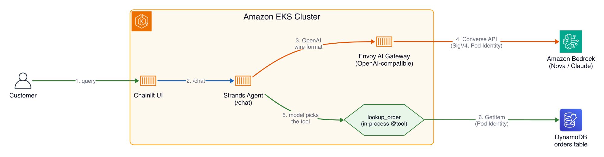
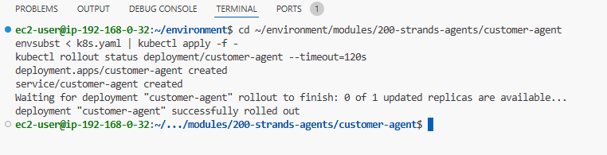

# Building Agents on Amazon EKS - Part 2: Building your first agent

> Tiếp nối Part 1 (The AI Gateway). Ở phần này bạn deploy agent đầu tiên cho AnyCompany Shop, gọi model qua chính gateway mà bạn đã gọi bằng tay ở Part 1.

## The AI Gateway

| At a glance    | Details                                                                                                                       |
| -------------- | ----------------------------------------------------------------------------------------------------------------------------- |
| Goal           | Xây và deploy một customer service agent trả lời câu hỏi đơn hàng bằng cách gọi một tool đọc DynamoDB, suy luận với model Bedrock. |
| Time           | ~15 phút                                                                                                                       |
| Prerequisites  | Trang The AI Gateway (Part 1)                                                                                                  |

Ở lab này bạn deploy một agent cho nhà bán lẻ hư cấu AnyCompany Shop, xây bằng **Strands Agents SDK**. Lời gọi model của nó tới Amazon Bedrock qua Envoy AI Gateway bạn vừa gọi bằng tay.

### Vì sao là customer service agent?

Một agent duy nhất, tiến hóa qua từng lab:

| Lab                                | Agent hưởng lợi gì                                                     |
| ---------------------------------- | --------------------------------------------------------------------- |
| Building your first agent (lab này)| Core loop: nhận query, suy luận, gọi tool, trả lời                     |
| Observability with Langfuse        | Trace mọi LLM call và tool invocation để debug câu trả lời chậm/sai   |
| Agent tools with MCP               | Dời tool ra sau một MCP server mà agent khám phá lúc runtime           |
| Securing the agents                | Ép per-tool access theo persona đã đăng nhập                           |
| Agents using a sandbox             | Đẩy phân tích không tin cậy sang một microVM cô lập                    |

Bạn bắt đầu đơn giản: một vòng lặp hội thoại chạy bằng LLM với một tool. Mỗi lab xếp thêm một khả năng.

## Kiến trúc



Agent không bao giờ gọi Bedrock trực tiếp và không giữ credential Bedrock. Nó gửi một request chat-completions bình thường tới gateway, và gateway sở hữu AWS identity (SigV4 qua EKS Pod Identity) rồi dịch sang Converse API của Bedrock. Đổi model (Nova sang Claude) là đổi một dòng `MODEL_ID`, không phải đổi code.

> **💡 Giải thích:**
> So với Part 1, kiến trúc y hệt, chỉ khác giờ đã có "agent" thật ở giữa (Strands Agent) thay vì bạn gõ curl bằng tay. Agent chính là vòng lặp: nhận câu hỏi → hỏi model → nếu model bảo "gọi tool" thì gọi → đưa kết quả lại cho model → trả lời khách.

### Strands SDK là gì?

Một Python SDK mã nguồn mở để xây agent. LLM quyết định gọi tool nào và theo thứ tự nào. Bốn khái niệm gánh cả SDK, và bạn gặp cả bốn ở Step 1:

- **Agent**: vòng lặp gửi message tới LLM và thực thi tool call
- **Model**: bất kỳ endpoint nào nói chat-completions API. Ở đây là Envoy AI Gateway trước Bedrock
- **Tools**: hàm Python gắn decorator `@tool` mà agent có thể gọi
- **System prompt**: chỉ dẫn định hình hành vi agent

### Step 1: Code walkthrough

Toàn bộ source nằm ở `~/environment/modules/200-strands-agents/customer-agent`.

```bash
cd ~/environment/modules/200-strands-agents/customer-agent
```

Có bảy file. `agent.py` và `tools.py` là hai file dạy học cốt lõi: logic agent và tool. Phần còn lại là hạ tầng. `server.py` là lớp FastAPI mỏng expose agent qua HTTP cho chat UI; `Dockerfile` và `requirements.txt` lo containerization; `k8s.yaml` là Deployment và Service; `test_server_events.py` chứa unit test.

```python
model_base_url = os.environ.get("MODEL_BASE_URL", "http://localhost:4000/v1")

model = OpenAIModel(
    client_args={
        "base_url": model_base_url,
        "api_key": os.environ.get("MODEL_API_KEY", "not-needed"),
    },
    model_id=os.environ.get("MODEL_ID", "nova-lite"),
    params={"max_tokens": 1024, "temperature": 0.3},
)
```

Mọi giá trị đến từ environment, nên cùng một image chạy ở đâu cũng được:

- `base_url`: `MODEL_BASE_URL` trỏ tới Envoy AI Gateway (`http://ai-gateway.envoy-gateway-system.svc.cluster.local/v1`), cấp bởi ConfigMap `agent-config`. Đây là endpoint bạn đã gọi bằng tay ở trang trước.
- `api_key="not-needed"`: gateway tự xác thực với Bedrock bằng identity của nó qua Pod Identity, nên không có client key để quản lý.
- `model_id="nova-lite"`: một alias mà gateway rewrite sang model id Bedrock thật. Đổi thành `claude-sonnet` là agent chạy trên Claude mà không sửa gì khác.

> **💡 Giải thích:**
> Chú ý cả ba giá trị (`base_url`, `api_key`, `model_id`) đều đọc từ biến môi trường chứ không hardcode. Đây là nguyên tắc 12-factor: cấu hình tách khỏi code. Nhờ vậy cùng một Docker image dùng được cho dev/staging/prod, chỉ cần đổi ConfigMap.

### Step 2: Deploy to EKS

`k8s.yaml` là một Deployment cộng một ClusterIP Service ở port 8080. Hai chi tiết wiring gánh việc nặng:

- `serviceAccountName: agent` cấp quyền truy cập DynamoDB qua Pod Identity (cho `lookup_order`)
- `envFrom: agent-config` là ConfigMap đưa `MODEL_BASE_URL`, `MODEL_ID`, `ORDERS_TABLE` vào container tự động

Phần quan trọng trong `k8s.yaml`:

```yaml
spec:
  serviceAccountName: agent
  containers:
    - name: customer-agent
      image: ${ACCOUNT_ID}.dkr.ecr.${AWS_REGION}.amazonaws.com/customer-agent:strands
      imagePullPolicy: Always
      ports:
        - containerPort: 8080
      envFrom:
        - configMapRef:
            name: agent-config
```

`agent-config` được tạo bởi Terraform của platform, không phải bởi lab này, và được chia sẻ cho mọi agent trong workshop. Tự đọc nó:

```bash
kubectl get configmap agent-config -o yaml
```

Các key agent của lab này dùng:

| Key            | Value                                                              | Dùng cho              |
| -------------- | ----------------------------------------------------------------- | --------------------- |
| MODEL_BASE_URL | http://ai-gateway.envoy-gateway-system.svc.cluster.local/v1       | endpoint gateway      |
| MODEL_ID       | nova-lite                                                         | model alias           |
| MODEL_API_KEY  | not-needed                                                       | gateway không lấy key |
| ORDERS_TABLE   | tên bảng DynamoDB                                                 | lookup_order          |
| AWS_REGION     | region của event                                                 | boto3 client          |

Không chắc region nào? Kiểm tra trực tiếp:

```bash
kubectl get configmap agent-config -o jsonpath='{.data.AWS_REGION}'
```

Phần còn lại (`MILVUS_URI`, các key `LANGFUSE_*` và `OTEL_*`) thuộc về các lab sau. Vì `envFrom` import cả ConfigMap, pod này nhận hết và bỏ qua thứ nó không đọc. Lab MCP sẽ thu hẹp xuống các key được đặt tên, khi việc pod nào nhận gì trở nên quan trọng.

Image ref dùng placeholder `${ACCOUNT_ID}` và `${AWS_REGION}`, nên render bằng `envsubst` trước khi apply:

```bash
cd ~/environment/modules/200-strands-agents/customer-agent
envsubst < k8s.yaml | kubectl apply -f -
kubectl rollout status deployment/customer-agent --timeout=120s
```



> **💡 Giải thích:**
> `envsubst` thay các placeholder `${ACCOUNT_ID}`, `${AWS_REGION}` bằng giá trị thật từ biến môi trường rồi mới đưa cho `kubectl apply`. Đây là cách đơn giản để dùng chung một file manifest cho nhiều account/region mà không cần công cụ template phức tạp.

> Nếu timeout 120s hết hạn, Deployment chưa Ready kịp. Xem `kubectl get pods -l app=customer-agent` để biết status, rồi `kubectl describe pod <pod-name>` để tìm lý do. Nguyên nhân hay gặp: image vẫn đang được CodeBuild push, thử lại rollout sau một phút là được. `kubectl logs deploy/customer-agent` cho stack trace nếu container crash — thường do thiếu key ConfigMap hoặc Pod Identity chưa lan truyền.

Xác nhận nó lên và lấy được endpoint gateway:

```bash
kubectl get pods -l app=customer-agent
kubectl exec deploy/customer-agent -- env | grep -E '^(MODEL_BASE_URL|MODEL_ID|ORDERS_TABLE)='
```

Expected output:

```text
NAME                              READY   STATUS    RESTARTS   AGE
customer-agent-7d9f8c6b5b-x2k4p   1/1     Running   0          38s

MODEL_BASE_URL=http://ai-gateway.envoy-gateway-system.svc.cluster.local/v1
MODEL_ID=nova-lite
ORDERS_TABLE=ai-agents-on-eks-demo-orders
```

### Step 3: Chat with it

Banner login in URL Chat UI và thông tin Support Associate ở mỗi terminal mới. In lại nếu cần:

```bash
echo "Chat UI: $CHAT_UI_URL"
echo "  Support Associate -> $CHAT_UI_SUPPORT_USERNAME / $CHAT_UI_SUPPORT_PASSWORD"
```

Mở URL từ banner, đăng nhập với vai Support Associate, rồi thử:

```text
Hi, I ordered a laptop last week and it still hasn't arrived. My order ID is ORD-1001. Can you help?

I want to know the status of the mechanical keyboard from Order ORD-1005.

Can you check on order ORD-99999?
```

`ORD-1001` tới `ORD-1005` là năm đơn cố định, mỗi status một đơn, dùng trong ví dụ xuyên suốt workshop. `ORD-1005` đã ở status Returned, nên prompt hỏi status của nó thay vì yêu cầu trả hàng. Query cuối test đường "đơn không tồn tại". Agent tốt là agent thất bại một cách nhẹ nhàng.

> **💡 Giải thích:**
> Ba câu hỏi này không phải ngẫu nhiên: câu 1 test đường thành công (đơn có thật), câu 2 test đơn ở status đặc biệt, câu 3 test lỗi (đơn không tồn tại). Test đủ cả đường thành công lẫn thất bại là thói quen tốt khi kiểm thử agent.

> Nếu agent trả lời một thông báo kiểu "hãy hoàn tất bước build và deploy của lab này", nghĩa là Deployment chưa Ready. Kiểm tra lại `kubectl rollout status` ở Step 2.

## What you built

- Một Strands agent loop xử lý hội thoại customer service.
- Model call do Amazon Bedrock phục vụ qua Envoy AI Gateway — gateway giữ AWS identity, nên agent không giữ credential cho model call.
- Một tool `lookup_order` mà model gọi để lấy dữ liệu đơn thật từ DynamoDB, dùng Pod Identity để truy cập dữ liệu.
- Một HTTP service chạy lâu dài trên EKS mà chat UI (đã xác thực Cognito) nói chuyện với.

> **✍️ Cảm nhận của mình:**
> _(để trống — mình sẽ tự viết phần này)_

**What's next:** Part 3 — Observability. Agent hiện là hộp đen; hãy trace mọi LLM call và tool invocation, gồm cả span của chính gateway.
