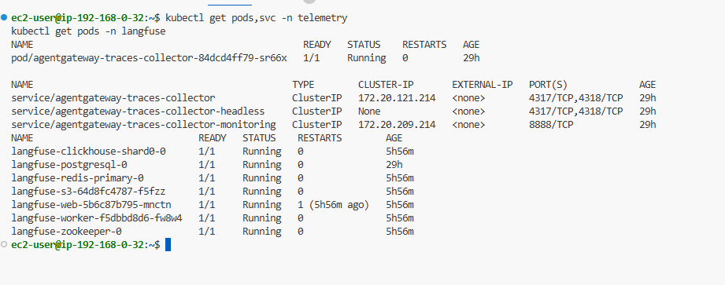
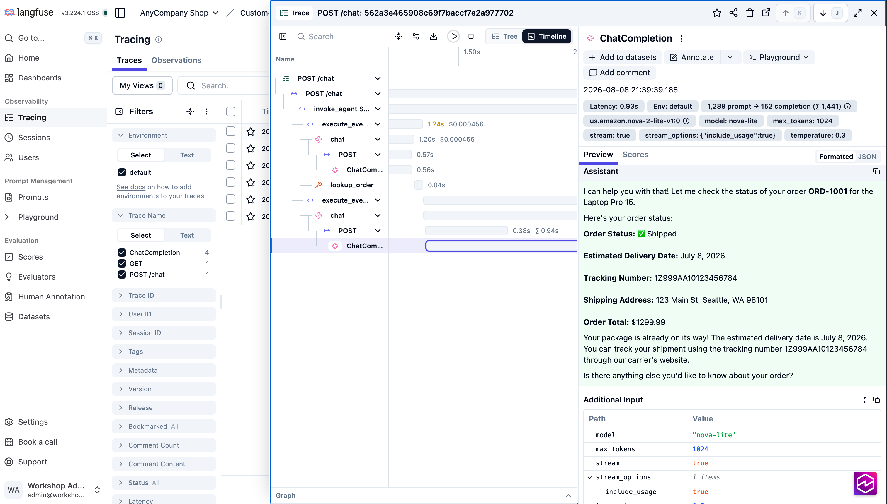
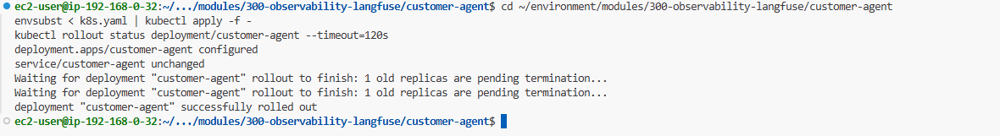
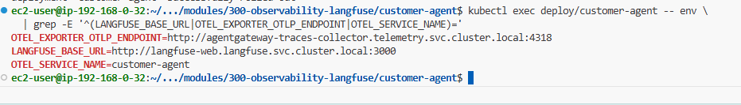
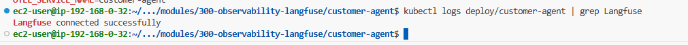
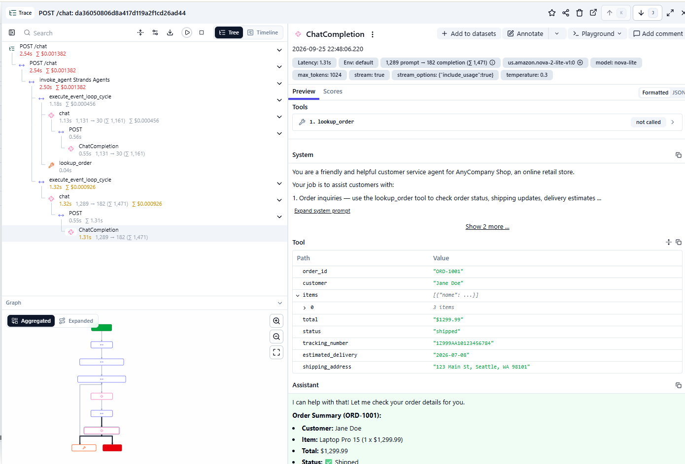
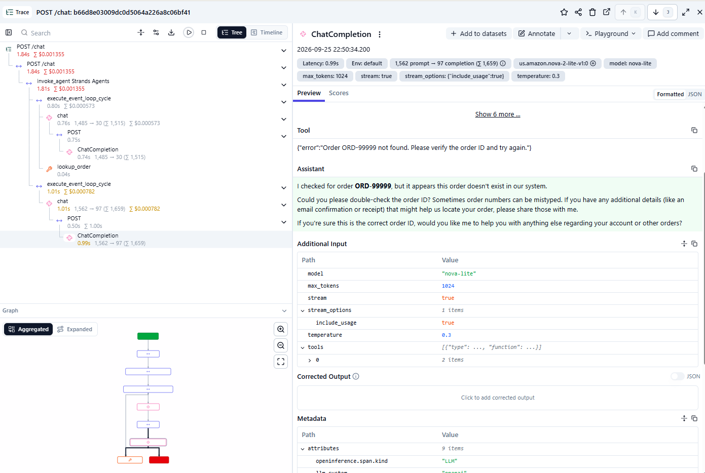

# Building Agents on Amazon EKS - Part 3: Observability with Langfuse

> Tiếp nối Part 2. Agent ở lab đầu là một hộp đen: khi trả lời chậm hoặc sai, bạn không thấy được model call hay tool invocation nào gây ra. Ở phần này bạn instrument agent bằng OpenTelemetry và đọc trace trong Langfuse.

## The AI Gateway

| At a glance    | Details                                                                                          |
| -------------- | ------------------------------------------------------------------------------------------------ |
| Goal           | Làm agent quan sát được bằng cách gửi mọi LLM call và tool call sang Langfuse, rồi đọc trace đầy đủ của một request. |
| Time           | ~15 phút                                                                                          |
| Prerequisites  | Lab Building your first agent (Part 2)                                                            |

Agent từ lab đầu là hộp đen. Ở lab này bạn instrument agent bằng OpenTelemetry và đọc trace trong Langfuse, đồng thời xác nhận Envoy AI Gateway thêm span của chính nó vào cùng một trace.

Phần instrumentation là phần portable. Agent phát ra OpenTelemetry span tiêu chuẩn, nên cùng code đó report được tới bất kỳ backend nào nói OTLP. Langfuse là thứ workshop này trỏ tới.

Hai thành phần đã chạy sẵn trong cluster: Langfuse và một OpenTelemetry (OTel) Collector chung mà mọi workload export tới. Xem thử:

```bash
kubectl get pods,svc -n telemetry
kubectl get pods -n langfuse
```



Service tên `agentgateway-traces-collector` trong namespace `telemetry` là cái quan trọng: nó lắng nghe OTLP trên port 4318, và là địa chỉ agent sắp export tới. Lab này không provision gì mới. Bạn chỉ deploy một phiên bản customer agent có phát trace.

> **💡 Giải thích:**
> Observability = khả năng "nhìn xuyên" vào hệ thống khi nó chạy. Trace là bản ghi chi tiết một request đi qua những đâu, mất bao lâu mỗi chặng. Với agent AI, trace đặc biệt hữu ích vì bạn thấy được model đã quyết định gọi tool nào, tốn bao nhiêu token, chặng nào chậm.

### Vì sao tách backend tracing khỏi cluster sinh ra trace

Trace thường được thu thập tập trung. Một team chạy tracing backend và mọi cluster khác report vào đó, vì giá trị của một trace đến từ việc so sánh với tất cả những trace khác. Trong production, Langfuse này sẽ nằm trên một management cluster, hoặc bạn trỏ collector sang Amazon CloudWatch, và agent không đổi: chúng export OTLP tới một collector và collector quyết định gửi đi đâu.

Đó cũng là vì sao **collector**, không phải agent, giữ credential Langfuse. Một egress xác thực nghĩa là một chỗ để xoay khóa, và các workload không bao giờ thấy nó.

### Khác gì so với lab đầu

Code agent gần như giống hệt. Ba thứ được thêm để trace chảy:

- Một Langfuse client trong `agent.py` xác thực lúc khởi động và flush span sau mỗi request.
- OpenTelemetry auto-instrumentation trong image. Dockerfile khởi chạy app bằng `opentelemetry-instrument`, patch `httpx` và FastAPI mà không đổi code. Request vào trở thành trace root, và LLM call ra mang header W3C `traceparent`.
- Export target: ConfigMap `agent-config` đã set `OTEL_EXPORTER_OTLP_ENDPOINT` tới collector chung và `LANGFUSE_BASE_URL` tới Langfuse trong cluster. Các API key Langfuse đến từ một Kubernetes Secret riêng.

> **💡 Giải thích:**
> Điểm hay ở đây: bạn gần như **không viết thêm code** để có tracing. `opentelemetry-instrument` tự "chèn" đo đạc vào các thư viện có sẵn (httpx, FastAPI) lúc chạy. Đây gọi là auto-instrumentation — đổi lấy observability mà không phải rải log thủ công khắp nơi.

### Vì sao span của gateway nằm chung một trace

Header `traceparent` là phần quan trọng. Envoy AI Gateway đọc nó ở mỗi request, nên span của nó lồng dưới trace của agent thay vì bắt đầu một trace riêng. Đó là cách bạn có một trace duy nhất hiển thị agent, tool call của nó, và gateway ở cùng một chỗ.

Auto-instrumentation của `httpx` thêm header đó vào LLM call ra mà không cần code trong agent. Không có nó, gateway sẽ bắt đầu trace riêng và bạn thấy hai trace rời nhau mỗi request thay vì một.

## Kiến trúc



Collector là egress xác thực duy nhất tới Langfuse. Cả agent lẫn gateway đều export tới nó, và nó chuyển tiếp tới Langfuse với credential giữ ở một chỗ.

### Step 1: Code walkthrough

Toàn bộ source ở `~/environment/modules/300-observability-langfuse/customer-agent`.

```bash
cd ~/environment/modules/300-observability-langfuse/customer-agent
```

```python
from langfuse import get_client

# Config đến từ environment trên EKS: xem k8s.yaml.

langfuse = get_client()
if langfuse.auth_check():
    print("Langfuse connected successfully")
else:
    print("WARNING: Langfuse authentication failed - traces will not be captured")
```

`get_client()` đọc `LANGFUSE_PUBLIC_KEY`, `LANGFUSE_SECRET_KEY`, và `LANGFUSE_BASE_URL` từ environment, nên code không hardcode gì. Kết quả `auth_check()` được in lúc khởi động — đó là cách bạn xác nhận wiring ở Step 2. Phần còn lại của `agent.py` (model client, system prompt, tool `lookup_order`) không đổi so với lab đầu.

### Step 2: Deploy the instrumented agent

Image customer-agent được build sẵn với tag `:langfuse`, và `k8s.yaml` đã tham chiếu nó. Config và credential đều đã ở trong cluster, nên không cần đổi config. Apply và roll:

```bash
cd ~/environment/modules/300-observability-langfuse/customer-agent
envsubst < k8s.yaml | kubectl apply -f -
kubectl rollout status deployment/customer-agent --timeout=120s
```



Xác nhận pod mới lấy được config tracing:

```bash
kubectl exec deploy/customer-agent -- env \
  | grep -E '^(LANGFUSE_BASE_URL|OTEL_EXPORTER_OTLP_ENDPOINT|OTEL_SERVICE_NAME)='
```

Expected output:



```text
LANGFUSE_BASE_URL=http://langfuse-web.langfuse.svc.cluster.local:3000
OTEL_EXPORTER_OTLP_ENDPOINT=http://agentgateway-traces-collector.telemetry.svc.cluster.local:4318
OTEL_SERVICE_NAME=customer-agent
```

Giờ xác nhận Langfuse client đã xác thực. Agent chạy `auth_check()` lúc khởi động và in kết quả, nên đọc log của nó thay vì chạy gì trong pod:

```bash
kubectl logs deploy/customer-agent | grep Langfuse
```



```text
Langfuse connected successfully
```

Nếu bạn thấy dòng warning thay vào đó, pod khởi động nhưng không xác thực được. Kiểm tra Secret `langfuse-keys` có tồn tại không: `kubectl get secret langfuse-keys`.

### Step 3: Generate a trace

Không có gì để xem cho tới khi agent xử lý một request, nên gửi một cái trước. Mở chat UI:

```bash
echo "Chat UI: $CHAT_UI_URL"
echo "  Support Associate -> $CHAT_UI_SUPPORT_USERNAME / $CHAT_UI_SUPPORT_PASSWORD"
```

Đăng nhập vai Support Associate và gửi một query kích hoạt tool call:

```text
Hi, I ordered a laptop last week and it still hasn't arrived. My order ID is ORD-1001. Can you help?
```

Khi agent trả lời xong, trace đã được export và đang chờ bạn.

### Step 4: Read the trace in Langfuse

In URL Langfuse và admin login. Cả hai đều nằm trong environment của IDE shell và trong banner terminal:

```bash
echo "Langfuse: $LANGFUSE_URL"
echo "  Email:    $LANGFUSE_USERNAME"
echo "  Password: $LANGFUSE_PASSWORD"
```

Đây là login riêng, tách khỏi chat UI. Langfuse có admin account riêng, nên persona bạn đăng nhập chat không áp dụng ở đây.

Mở URL và đăng nhập. Langfuse mở ra một organization overview thay vì trace của bạn, nên click vào AnyCompany Shop, rồi Go to project ở card Customer Agent. Rồi mở **Tracing > Traces** và click trace mới nhất. Chuyển view từ Tree sang **Timeline** — đây là cách trace thường được đọc: mỗi span là một thanh, độ dài là thời lượng, và lồng nhau cho thấy cái gì chờ cái gì.

Bạn đang nhìn bốn thứ:

- `POST /chat`, root. Đây là request FastAPI vào, và là thứ đặt tên cho trace.
- Chat generation của agent, mang model, token counts, latency.
- Tool call `lookup_order`, với input và kết quả DynamoDB.
- Một span `ChatCompletion`, là gateway report cùng model call từ phía nó. Nó lồng dưới POST ra của agent.

> **💡 Giải thích:**
> Trace này chính là "phần thưởng" của cả lab: giờ bạn thấy được toàn bộ hành trình của một câu hỏi — model suy nghĩ mất bao lâu, tool trả về gì, gateway ghi nhận ra sao — tất cả trong một cây span duy nhất. Khi câu trả lời chậm hoặc sai, bạn nhìn trace là biết chặng nào có vấn đề.

Hai chi tiết về span cuối đáng dừng lại vì dễ đọc nhầm:

- Service của nó là `envoy-ai-gateway`, nhưng tên là `ChatCompletion` (theo quy ước OpenInference). Không có span nào tên "envoy-ai-gateway", nên tìm nó sẽ không ra.
- Nó report model id Bedrock đã resolve, kiểu `us.amazon.nova-...`, trong khi span của agent hiện alias `nova-lite`. Thấy cả hai trong một trace là thấy alias rewrite của gateway diễn ra.

> Nếu span `ChatCompletion` hiện thành một trace riêng thay vì lồng, agent đã không truyền `traceparent`: xác nhận bạn deploy image `:langfuse` ở Step 2, vì image `:strands` của lab đầu không có auto-instrumentation.



Gửi query "đơn không tồn tại" và so sánh hai trace:

```text
Can you check on order ORD-99999?
```

Tool span hiện kết quả not-found, và bạn thấy model chọn xin lỗi thay vì bịa ra một đơn. Đó là loại hành vi mà trace phơi bày còn chat reply thì giấu.



## Zooming out: Dashboards

Mọi thứ đến giờ là một request mỗi lần. Dashboards là nửa còn lại của Langfuse: cùng những span bạn vừa đọc, cuộn lên trên mọi request.

Tìm nó ở sidebar như một mục top-level ngay dưới Home. Project của bạn ship sẵn bốn dashboard, tất cả do Langfuse tạo:

| Dashboard                    | Trả lời câu hỏi gì                                    |
| ---------------------------- | ----------------------------------------------------- |
| Langfuse Home                | Traces, cost, scores, usage, latency ở một chỗ        |
| Langfuse Cost Dashboard      | Spend đi về đâu, theo model và theo token type         |
| Langfuse Latency Dashboard   | Phân bố latency across traces và generations           |
| Langfuse Usage Management     | Volume across traces, observations, scores            |

Mở Langfuse Home và bạn sẽ thấy một trace count nhỏ khác 0 và một cost cỡ vài phần nghìn cent, từ hai query bạn gửi ở Step 3 và Step 4.

> **💡 Giải thích:**
> Khác biệt then chốt: một **trace** trả lời "vì sao câu này chậm", còn **dashboard** trả lời "câu chậm có phải chuyện bình thường không". Một cái là zoom-in, một cái là zoom-out. Khi vận hành thật, bạn cần cả hai.

> Một dashboard hiện "No data" thường là do time range, không phải thiếu trace. Mỗi trang có picker range riêng, mặc định Past 1 day.

## What you built

- Cùng customer agent, giờ phát OpenTelemetry trace tới Langfuse qua OTel Collector chung.
- Auto-instrumentation trong image, nên tracing không cần code trong logic agent ngoài một Langfuse client và một flush mỗi request.
- Một trace duy nhất mỗi request trải khắp agent, tool call của nó, và Envoy AI Gateway, vì agent truyền W3C `traceparent` và gateway lồng span của nó dưới đó.
- Credential Langfuse để trong một Secret, tách khỏi ConfigMap mang cấu hình thường.

> **✍️ Cảm nhận của mình:**
> _(để trống — mình sẽ tự viết phần này)_

**What's next:** Part 4 — Agent tools with MCP. Dời `lookup_order` ra sau một MCP server mà agent khám phá lúc runtime, định tuyến qua agentgateway.
