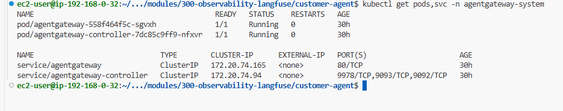
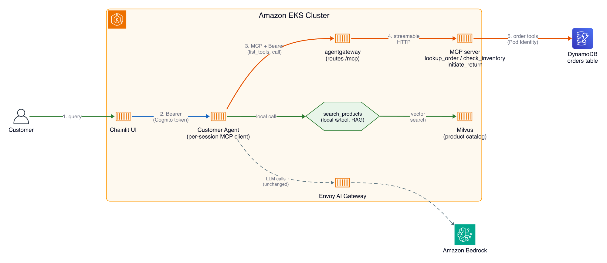
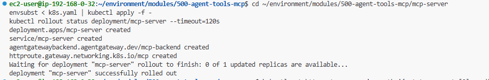
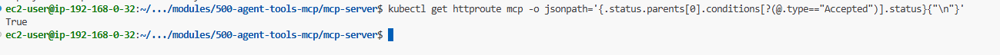
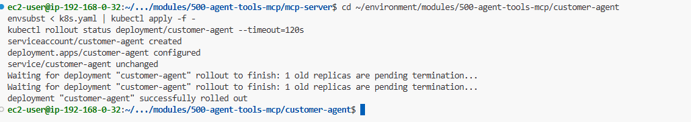
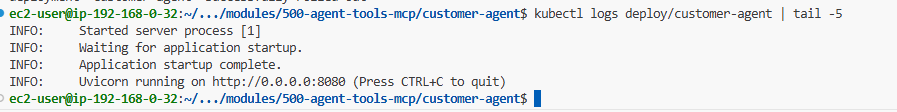
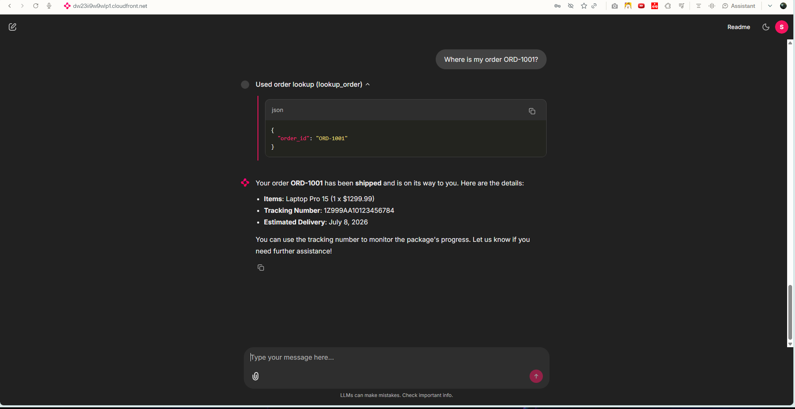
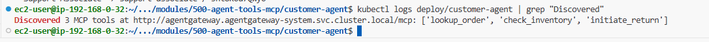

# Building Agents on Amazon EKS - Part 4: Agent tools with MCP

> Tiếp nối Part 3. Đến giờ mọi tool đều sống bên trong process của agent. Ở phần này mình dời tool ra một MCP server độc lập mà agent khám phá lúc runtime, và định tuyến mọi tool call qua agentgateway.

## The AI Gateway

| At a glance    | Details                                                                                                     |
| -------------- | ----------------------------------------------------------------------------------------------------------- |
| Goal           | Dời tool của agent ra một MCP server độc lập mà nó khám phá lúc runtime, và route mọi tool call qua agentgateway. |
| Time           | ~25 phút                                                                                                     |
| Prerequisites  | Lab Building your first agent (Part 2)                                                                        |

Đến giờ mọi tool đều sống trong process agent. `lookup_order` là một hàm Python trong cùng container với agent loop. Nó chạy được, nhưng nghĩa là tool ship kèm agent, chỉ agent này dùng được, và không có chỗ trung tâm nào kiểm soát ai được gọi nó. Ở lab này bạn dời tool ra một MCP server độc lập mà agent khám phá lúc runtime, và route mọi tool call qua **agentgateway**.

### MCP là gì?

**Model Context Protocol** là một chuẩn mở để expose tool cho agent qua mạng. Một MCP server publish một tập tool; một MCP client (ở đây là Strands agent) kết nối, gọi `list_tools` để khám phá cái gì có sẵn, và gọi chúng theo tên. Agent không import code tool; nó học tool lúc runtime từ server.

> **💡 Giải thích:**
> Hãy hình dung: trước đây tool là "hàm nằm trong người agent". Với MCP, tool trở thành "dịch vụ chạy riêng trên mạng" mà agent gọi qua giao thức chuẩn. Giống như bạn đổi từ gọi một hàm nội bộ sang gọi một REST API — nhưng chuẩn hóa riêng cho agent.

**Bốn thứ bạn được khi đưa tool lên mạng:**

- **Decoupled**: logic tool ở một chỗ, đổi một lần thay vì phải roll ra mọi agent nhúng nó. Không agent nào rebuild, không session nào restart. Tool server cũng scale độc lập.
- **Discoverable**: thêm tool vào server và agent nhặt nó ở lần connect kế tiếp, không cần được báo.
- **Shareable**: nhiều agent dùng chung một tool server.
- **Một control point**: vì tool call giờ đi qua mạng, một proxy ở giữa (agentgateway) thấy và phân quyền từng cái. Đó là thứ lab Securing the agents xây tiếp.

### agentgateway là gì?

Tool call không đi thẳng từ agent tới MCP server. Chúng đi qua **agentgateway**, một MCP gateway: proxy nói được giao thức, nên thấy được từng operation `tools/list` và `tools/call` thay vì HTTP body mờ đục. Đó là thứ làm cho per-tool authorization khả thi ở lab sau.

Nó đã chạy sẵn, trong namespace `agentgateway-system`:

```bash
kubectl get pods,svc -n agentgateway-system
```



Cấu hình theo kiểu Kubernetes-native. agentgateway implement Gateway API, nên route là các object `HTTPRoute` bình thường, trỏ tới một backend MCP-specific.

> **💡 Giải thích:**
> Điểm mấu chốt: agentgateway "hiểu" giao thức MCP, nên nó nhìn thấy được "agent đang gọi tool tên gì". Một proxy HTTP thường chỉ thấy "có một request POST tới /mcp" — không đủ để phân quyền theo từng tool. Đây là lý do phải có một proxy chuyên biệt.

### What changes

Tool của agent giờ chia hai loại: remote tool khám phá qua MCP, và một cái ở lại local.

| Tool             | Giờ chạy ở đâu           | Agent lấy nó thế nào               |
| ---------------- | ------------------------ | ----------------------------------- |
| lookup_order     | MCP server (đã dời ra)   | khám phá lúc runtime qua MCP        |
| check_inventory  | MCP server (mới)         | khám phá lúc runtime qua MCP        |
| initiate_return  | MCP server (mới)         | khám phá lúc runtime qua MCP        |
| search_products  | vẫn trong agent          | local `@tool`, vector search catalog |

Hai thứ cũng đổi trong cách agent nói với remote tool: nó tới MCP server qua agentgateway (`MCP_SERVER_URL` trỏ tới `agentgateway...mcp`), và nó giờ được dựng theo session, forward Cognito token của user đã đăng nhập trên MCP call.

**Vì sao search_products ở lại trong agent, và nó làm gì**

`search_products` là tool duy nhất còn chạy trong process agent, để bạn thấy cả hai kiểu cạnh nhau. Nó làm **RAG** (retrieval-augmented generation): thay vì dựa vào thứ model tình cờ biết, agent truy hồi record thật và để model trả lời từ đó. Ở đây record là sản phẩm.

Product search cần điều này vì khách không hỏi bằng SKU. Họ hỏi "thứ gì cắt tiếng ồn nền khi gọi", và không keyword lookup nào match nó với sản phẩm tên "Noise Cancelling Headphones". Nên catalog lưu trong **Milvus** (vector database): mỗi mô tả sản phẩm thành một vector mã hóa ý nghĩa, câu hỏi cũng thành vector tương tự, và search trả về những cái gần nhất. Ý nghĩa giống, không phải chữ giống.

> **💡 Giải thích:**
> RAG là "cho model tra tài liệu trước khi trả lời" thay vì bắt nó nhớ mọi thứ. Vector search cho phép tìm theo *ý nghĩa*: "cắt tiếng ồn" khớp với "tai nghe chống ồn" dù không trùng chữ nào. Đây là kỹ thuật nền tảng của gần như mọi ứng dụng LLM hỏi-đáp trên dữ liệu riêng.

> Một điểm thành thật: Milvus ở đây chạy với auth tắt, nên lời gọi đó không được phân quyền gì cả. Production sẽ bật Milvus auth và cấp cho agent một read-only user, hoặc đưa tool này ra sau MCP luôn.

## Kiến trúc



MCP server giữ quyền truy cập DynamoDB mà order tool của nó cần (qua ServiceAccount `agent` + Pod Identity), y như agent làm ở lab đầu. Tool đã dời, đường dữ liệu của nó thì không. agentgateway ngồi trên đường tool để lab sau phân quyền từng call; ở lab này nó chỉ route.

### Step 1: Code walkthrough

Lần này hai project: MCP server và agent tiêu thụ nó.

```bash
cd ~/environment/modules/500-agent-tools-mcp
ls mcp-server customer-agent
```

Workshop trình bày đoạn này dưới dạng tabs cho từng file. Mình gom lại thành các mục mở rộng cho gọn:

:::debug-accordion
::item mcp-server/server.py — định nghĩa tool
```python
mcp = FastMCP(
    "AnyCompany Tools",
    transport_security=TransportSecuritySettings(enable_dns_rebinding_protection=False),
)

@mcp.tool()
def lookup_order(order_id: str) -> dict:
    """Look up order status, tracking, and details by order ID."""
    ...

@mcp.tool()
def check_inventory(product_name: str) -> dict:
    """Check stock availability for a product."""
    ...
```

FastMCP biến hàm Python thường thành MCP tool. Decorator `@mcp.tool()` là bản đối ứng phía server của `@tool` bên Strands. Cùng `lookup_order` đọc DynamoDB từ lab đầu giờ sống ở đây, cộng thêm `check_inventory` và `initiate_return`. Server chạy như `streamable_http_app()` trên port 8080.
::item Forward token của user theo session
MCP server ngồi sau agentgateway, cái này (ở lab Securing) phân quyền mỗi tool call theo Cognito persona của caller, nên tool call phải mang identity của user. Điều đó tạo một vướng: `MCPClient` của Strands bind auth một lần, lúc transport connect. Một client dùng chung ở import-time không thể mang token per-user. Cách sửa là dựng agent theo session:

```python
# server.py: rút token đã forward, dựng/cache agent theo session
access_token = authorization[7:] if authorization.lower().startswith("bearer ") else None
agent = _get_session_agent(req.session_id, access_token)

# agent.py: MCP client của session connect KÈM token đó
headers = {"Authorization": f"Bearer {access_token}"} if access_token else None
client = MCPClient(lambda u=url: streamablehttp_client(u, headers=headers))
```
:::

> **💡 Giải thích:**
> Chỗ "dựng agent theo session" là mấu chốt dễ bỏ qua: vì mỗi user có token riêng, agent không thể là một instance dùng chung toàn cục. Mỗi phiên chat tạo một agent riêng mang token của chính user đó. Đây là nền móng để Part 5 biến token thành phân quyền thật.

### Step 2: Deploy the MCP server

Cả hai image (`mcp-server:v1` và `customer-agent:mcp`) đều build sẵn và push lên ECR lúc provisioning.

Deploy server trước. Tool discovery của agent sẽ fail nếu không có gì để connect. `k8s.yaml` của nó là Deployment và Service cộng `AgentgatewayBackend` và `HTTPRoute` đặt nó sau agentgateway:

```bash
cd ~/environment/modules/500-agent-tools-mcp/mcp-server
envsubst < k8s.yaml | kubectl apply -f -
kubectl rollout status deployment/mcp-server --timeout=120s
```



Xác nhận agentgateway chấp nhận route. Không có gì mới deploy cho gateway; lệnh này đọc status mà gateway ghi lại lên HTTPRoute của bạn:

```bash
kubectl get httproute mcp -o jsonpath='{.status.parents[0].conditions[?(@.type=="Accepted")].status}{"\n"}'
```



Bạn sẽ thấy `True`. Nếu `False`, gateway từ chối route; `kubectl describe httproute mcp` cho biết vì sao.

### Step 3: Deploy the agent

`k8s.yaml` của agent set `MCP_SERVER_URL` tới endpoint `/mcp` của agentgateway. Nó cũng thu hẹp quyền agent:

:::debug-accordion
::item Agent mất quyền gì
```yaml
apiVersion: v1
kind: ServiceAccount
metadata:
  name: customer-agent      # không Pod Identity association: không AWS access
---
# ...Deployment...
      serviceAccountName: customer-agent
      env:
        - name: MODEL_BASE_URL
          valueFrom:
            configMapKeyRef: { name: agent-config, key: MODEL_BASE_URL }
        # ...chỉ các key được đặt tên: không ORDERS_TABLE, không AWS_REGION...
```

Một ServiceAccount không có AWS access. Agent chạy như `customer-agent`, không có Pod Identity association, nên pod không giữ quyền AWS nào. ServiceAccount `agent` vẫn mang role DynamoDB, và pod mcp-server dùng nó, vì đó là nơi code DynamoDB giờ sống. Manifest cũng chỉ liệt kê các key agent thật sự đọc, nên `ORDERS_TABLE` và `AWS_REGION` không bao giờ tới một process không dùng chúng.
:::

> **💡 Giải thích:**
> Đây là ví dụ đẹp của **least privilege đi theo code**: khả năng (đọc DynamoDB) dời sang MCP server, nên quyền cũng dời theo. Agent giờ "không cầm chìa khóa nào" vì nó không còn tự đọc DynamoDB nữa. Ai làm việc gì thì cầm đúng quyền cho việc đó.

Xác nhận sau khi deploy:

```bash
kubectl exec deploy/customer-agent -- env | grep ORDERS_TABLE || echo "ORDERS_TABLE: not present (correct)"
cd ~/environment/modules/500-agent-tools-mcp/customer-agent
envsubst < k8s.yaml | kubectl apply -f -
kubectl rollout status deployment/customer-agent --timeout=120s
```



Xác nhận pod lên và listening:

```bash
kubectl logs deploy/customer-agent | tail -5
```



Lúc này log chỉ hiện dòng khởi động Uvicorn, chưa có tool discovery. Đó là bình thường. Khác lab đầu, agent này connect tới MCP server một cách lazy, ở tin nhắn chat đầu tiên của session (xem tab per-session identity). MCP client dựng theo session để mang token của user đó, nên chưa có gì để discover cho tới khi ai đó chat.

Tool local `search_products` của agent search collection `product_catalog` của Milvus, ban đầu rỗng. Seed nó một lần:

```bash
kubectl exec -i deploy/customer-agent -- python - < seed_products.py
```

Bạn sẽ thấy `Inserted 13 items into 'product_catalog'` theo sau bởi một test search. Collection persist trong Milvus, nên đây là bước một-lần mỗi cluster. Cho nó 30-60 giây trước khi test product search: Milvus cần chút thời gian để index các row vừa insert.

### Step 4: Chat with it

Không cần đăng xuất/đăng nhập lại. Lệnh dưới chỉ in lại cùng URL và login:

```bash
echo "Chat UI: $CHAT_UI_URL"
echo "  Support Associate -> $CHAT_UI_SUPPORT_USERNAME / $CHAT_UI_SUPPORT_PASSWORD"
```

Thử bốn query, mỗi tool một câu:

```text
Where is my order ORD-1001?
```



```text
Do you have the Mechanical Keyboard in stock?

I want to return the wireless mouse from order ORD-1002.

What do you have for cutting down background noise on calls?
```

Ba câu đầu hit `lookup_order`, `check_inventory`, `initiate_return`, đều phục vụ bởi MCP server qua agentgateway. Câu thứ tư hit local `search_products`, và nó cho thấy vì sao catalog là vector search: không gì trong câu đó match tên sản phẩm, mà vẫn trả về noise cancelling headphones.

> Tool trả hàng cần một lý do, nên với query thứ ba agent có thể hỏi vì sao bạn trả hàng trước khi gọi `initiate_return`. Trả lời bất kỳ lý do nào (ví dụ "changed my mind") là nó hoàn tất.

Giờ session đã connect, dòng log discovery xuất hiện. Đây là bằng chứng cả đường (agent → agentgateway → MCP server) hoạt động:

```bash
kubectl logs deploy/customer-agent | grep "Discovered"
```



```text
Discovered 3 MCP tools at http://agentgateway.agentgateway-system.svc.cluster.local/mcp: ['lookup_order', 'check_inventory', 'initiate_return']
```

Nó chỉ xuất hiện sau tin nhắn đầu tiên, vì agent connect tới MCP theo session (để mang token của user đó), không phải lúc khởi động.

## What you built

- Tool dời khỏi agent vào một MCP server độc lập, được agent khám phá lúc runtime qua `list_tools`. Không hardcode tên tool trong agent.
- Giờ ba tool (`lookup_order`, `check_inventory`, `initiate_return`) qua MCP, cạnh local `search_products`.
- Tool call route qua agentgateway, tạo network control point cho các lab tiếp theo.
- Một agent per-session forward Cognito token của user trên MCP call. Identity giờ đi cùng mọi tool call.

> **✍️ Cảm nhận của mình:**
> _(để trống — mình sẽ tự viết phần này)_

**What's next:** Part 5 — Securing the agents. Token đã forward nhưng chưa được ép; agentgateway route call nhưng chưa kiểm ai được chạy tool nào. Phần sau thêm JWT auth và per-tool authorization.
