# Building Agents on Amazon EKS - Part 5: Securing the agents

> Tiếp nối Part 4. Ở lab MCP, agent bắt đầu forward Cognito token của user trên mỗi tool call, nhưng không gì kiểm tra nó: agentgateway route call và token chỉ đi ké. Cả hai persona đều gọi được mọi tool. Ở phần này mình biến token đó thành access control thật.

## The AI Gateway

| At a glance    | Details                                                                                                       |
| -------------- | ------------------------------------------------------------------------------------------------------------- |
| Goal           | Biến Cognito token đã forward thành access control thật bằng cách gắn authentication và per-tool authorization vào agentgateway. |
| Time           | ~20 phút                                                                                                       |
| Prerequisites  | Lab Agent tools with MCP (Part 4)                                                                              |

Bạn gắn policy vào agentgateway để nó xác thực token và phân quyền từng tool call theo persona của caller, mà không đổi một dòng code agent hay tool. Đây là enforcement point mà các lab sau phụ thuộc vào.

### Hai persona, quyền khác nhau

User pool Cognito của workshop có hai persona, mỗi cái trong một claim `cognito:groups` mang bởi access token:

| Persona           | Group             | Được phép                                     |
| ----------------- | ----------------- | --------------------------------------------- |
| Support Associate | support-associate | Tra cứu đơn và xử lý trả hàng                  |
| Sales Analyst     | sales-analyst     | Chỉ tra cứu đơn (trả hàng là hành động support) |

Ba tool từ lab MCP map tới persona như sau:

| Tool             | Cho phép với        | Lý do                                                      |
| ---------------- | ------------------- | ---------------------------------------------------------- |
| lookup_order     | Cả hai persona      | Read-only, dùng chung.                                     |
| initiate_return  | Chỉ Support Associate | Thay đổi một đơn.                                         |
| check_inventory  | Không ai, ở lab này | Cố tình không map, để minh họa deny-by-default: tool không có rule match sẽ bị từ chối. |

### Hai policy ở gateway

Enforcement là hai object `AgentgatewayPolicy`, và không cái nào đụng agent: `mcp-authn` validate Cognito JWT trên mỗi call, và `mcp-tool-authz` quyết định persona nào gọi tool nào. Deny-by-default lo phần còn lại.

> **💡 Giải thích:**
> Chia làm hai lớp: **authentication** (anh là ai — token có hợp lệ không) và **authorization** (anh được làm gì — persona này gọi được tool nào). Đây là nguyên tắc bảo mật kinh điển: xác thực trước, phân quyền sau. Cả hai đều đặt ở gateway, nên agent hoàn toàn không biết gì về bảo mật — nó chỉ gọi tool như thường.

:::debug-accordion
::item Authentication (mcp-authn) gắn vào Gateway
```yaml
apiVersion: agentgateway.dev/v1alpha1
kind: AgentgatewayPolicy
metadata:
  name: mcp-authn
  namespace: agentgateway-system
spec:
  targetRefs:
    - kind: Gateway
      name: agentgateway
      group: gateway.networking.k8s.io
  traffic:
    jwtAuthentication:
      mode: Strict            # không token, không vào
      providers:
        - issuer: __COGNITO_ISSUER__
          audiences:
            - __COGNITO_CLIENT_ID__
          jwks:
            remote:
              backendRef:     # JWKS host là một Backend, không phải URL trần
                group: agentgateway.dev
                kind: AgentgatewayBackend
                name: cognito-jwks
                namespace: agentgateway-system
                port: 443
              jwksPath: __COGNITO_JWKS_PATH__
```
Nó gắn vào Gateway `agentgateway`, nên áp dụng cho mọi thứ gateway phục vụ. Token thiếu hoặc không hợp lệ bị từ chối 401 trước khi bất kỳ logic tool nào chạy. Nó validate token với signing key mà Cognito publish, fetch qua mạng. agentgateway bắt endpoint đó phải là một `AgentgatewayBackend` khai báo chứ không phải URL trong policy.
::item Authorization (mcp-tool-authz) gắn vào backend
```yaml
apiVersion: agentgateway.dev/v1alpha1
kind: AgentgatewayPolicy
metadata:
  name: mcp-tool-authz
  namespace: default
spec:
  targetRefs:
    - kind: AgentgatewayBackend
      name: mcp-backend       # backend bạn tạo ở lab MCP
      group: agentgateway.dev
  backend:
    mcp:
      authorization:
        action: Allow
        policy:
          matchExpressions:
            - 'false'         # match không gì: deny-all của Step A
```
Nó gắn vào `mcp-backend` từ lab MCP, nên chỉ áp dụng cho tool của server đó. `matchExpressions` là thứ duy nhất đổi qua ba bước; mọi thứ phía trên giữ nguyên — đó là lý do đây là bài tập chỉ-đổi-policy.
:::

> **💡 Giải thích:**
> Chú ý nghịch lý thú vị: `action: Allow` nhưng biểu thức là `'false'` (không match gì) lại **cấm tất cả**. Vì agentgateway là **deny-by-default**: hễ có một rule Allow tồn tại, mọi call không match rule nào đều bị từ chối. Một danh sách Allow rỗng nghĩa là "chỉ cho phép... không gì cả" = cấm hết.

> **Cách một denial trông ra sao rất quan trọng.** Token thiếu/không hợp lệ fail ở authentication với 401 thấy được. Nhưng token hợp lệ mà persona thiếu quyền thì xử lý khác: agentgateway **ẩn** tool không được phép khỏi `tools/list`, nên agent không bao giờ khám phá ra nó. Model rồi chỉ nói nó không làm được, thay vì phơi ra một lỗi 403. Nên hiệu ứng quan sát được của "persona này không được dùng tool này" là tool đó **vắng mặt** khỏi danh sách tool của agent.

## Kiến trúc

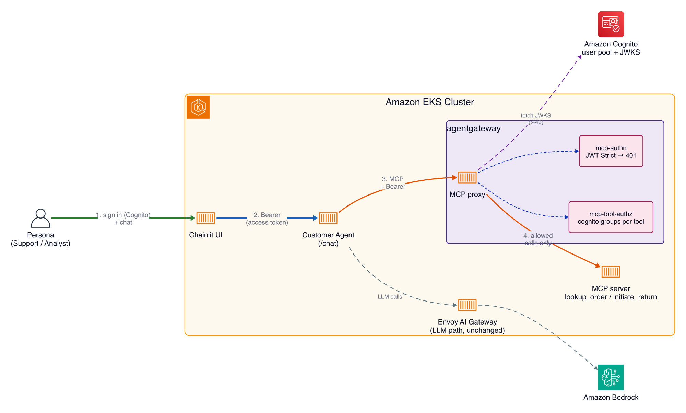

### Step 1: Điền giá trị Cognito của event này

Policy file ship với placeholder (`__COGNITO_ISSUER__` và bạn bè). Điền từ Terraform output. Cờ `-chdir` không expand `~`, nên dùng `$HOME`:

```bash
cd ~/environment/modules/700-agentgateway-authz
TFDIR="$HOME/environment/terraform"

echo "Reading four Terraform outputs, about 10 seconds..."
ISSUER=$(terraform -chdir="$TFDIR" output -raw cognito_issuer)
JWKS_HOST=$(terraform -chdir="$TFDIR" output -raw cognito_jwks_host)
JWKS_PATH=$(terraform -chdir="$TFDIR" output -raw cognito_jwks_path)
CLIENT=$(terraform -chdir="$TFDIR" output -raw cognito_client_id)
echo "Done."

render() {  # render <step-file>, thay bốn placeholder
  sed -e "s|__COGNITO_ISSUER__|$ISSUER|g" \
      -e "s|__COGNITO_JWKS_HOST__|$JWKS_HOST|g" \
      -e "s|__COGNITO_JWKS_PATH__|$JWKS_PATH|g" \
      -e "s|__COGNITO_CLIENT_ID__|$CLIENT|g" "$1"
}
```

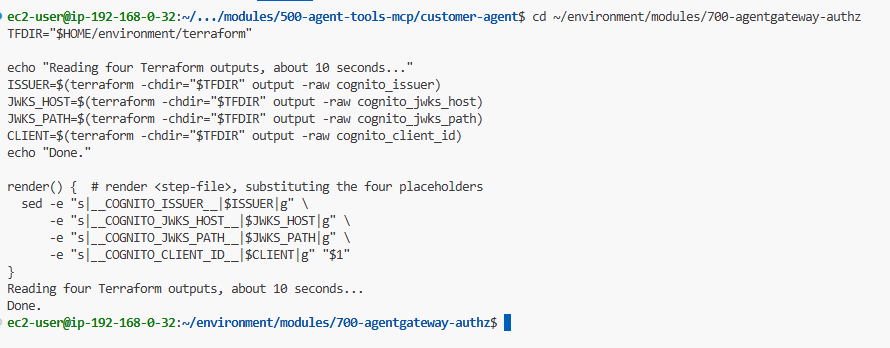

Xác nhận các giá trị khác rỗng trước khi apply. Nếu path Terraform sai, bốn biến trả về rỗng, `render` thay chuỗi rỗng, và `kubectl apply` fail với lỗi kiểu `issuer: Required value`. In ra trước và chắc cả bốn có giá trị:

```bash
printf 'ISSUER=%s\nJWKS_HOST=%s\nJWKS_PATH=%s\nCLIENT=%s\n' \
  "$ISSUER" "$JWKS_HOST" "$JWKS_PATH" "$CLIENT"
```

### Step 2: Đi qua arc ba bước

Mỗi policy file là state tích lũy, nên apply bước N thay thế bước N-1. Apply từng bước một và test trong chat UI sau mỗi bước, để bạn thấy hành vi đổi.

Mở chat UI và đăng nhập vai Support Associate:

```bash
echo "Chat UI: $CHAT_UI_URL"
echo "  Support Associate -> $CHAT_UI_SUPPORT_USERNAME / $CHAT_UI_SUPPORT_PASSWORD"
```

> **💡 Giải thích:**
> Cả bài này là một "demo diễn tiến": cùng một câu hỏi ("trả wireless mouse của ORD-1002"), sau mỗi policy bạn thấy kết quả đổi — từ bị cấm hoàn toàn → tra được đơn nhưng chưa trả được → trả được. Cách học này rất trực quan để hiểu deny-by-default và phân quyền theo persona.

> **Bắt đầu chat mới sau mỗi policy bạn apply.** Agent khám phá tool một lần mỗi cuộc hội thoại, ở tin nhắn đầu, và cache cho phần còn lại. Một policy apply giữa chừng hội thoại không có tác dụng lên hội thoại đó. Nút New Chat là icon bút chì ở góc trên-trái chat UI.

#### Step A: authenticate mọi call và deny mọi tool

Rule Allow duy nhất của authz policy match không gì (`'false'`), nên với một rule tồn tại, deny-by-default chặn mọi tool kể cả với token hợp lệ.

```bash
render policies/step1-deny-all.yaml | kubectl apply -f -
```

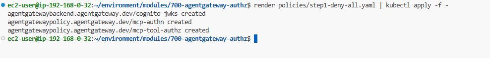

Bắt đầu chat mới (icon bút chì), rồi gửi:

```text
I want to return the wireless mouse from order ORD-1002.
```

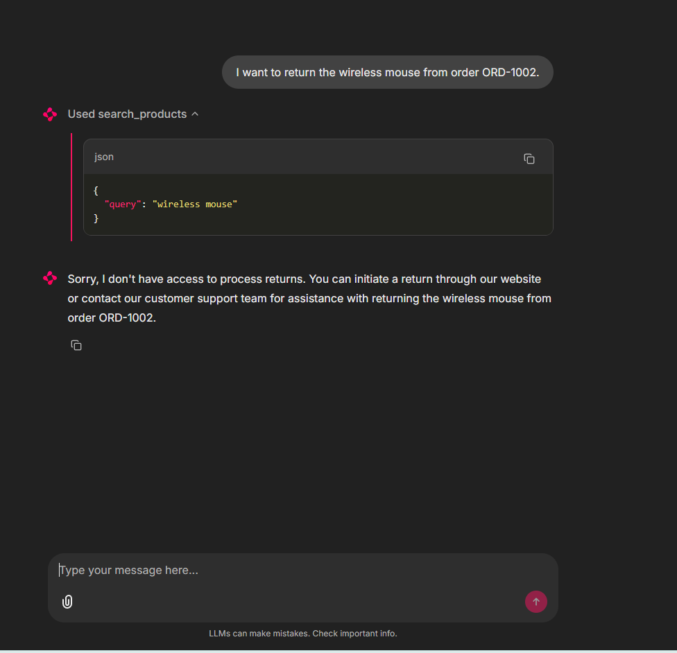

Kỳ vọng: agent trả lời rằng nó không có quyền xử lý trả hàng. Mọi MCP tool bị deny cho cả hai persona, nhưng chú ý denial im lặng: không lỗi trong chat, chỉ là một agent không có tool. Điều này cũng chứng minh token tới được gateway: một call bị từ chối trả về từ authorization, không phải 401 từ authentication.

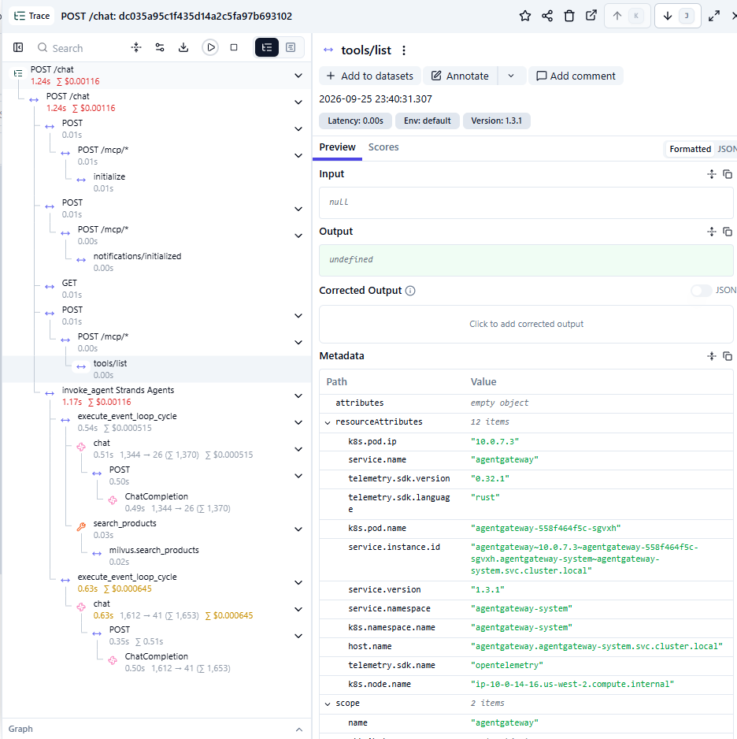

#### Step B: allow tool dùng chung

Cho phép `lookup_order` với bất kỳ persona đã xác thực. Mọi tool khác vẫn bị deny.

```bash
render policies/step2-allow-lookup.yaml | kubectl apply -f -
```

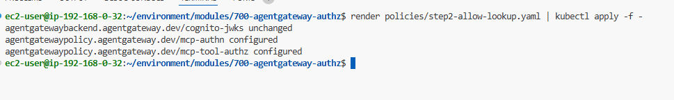

```yaml
matchExpressions:
  - 'mcp.tool.name == "lookup_order"'
```

Bắt đầu chat mới (icon bút chì), rồi gửi cùng tin nhắn:

```text
I want to return the wireless mouse from order ORD-1002.
```

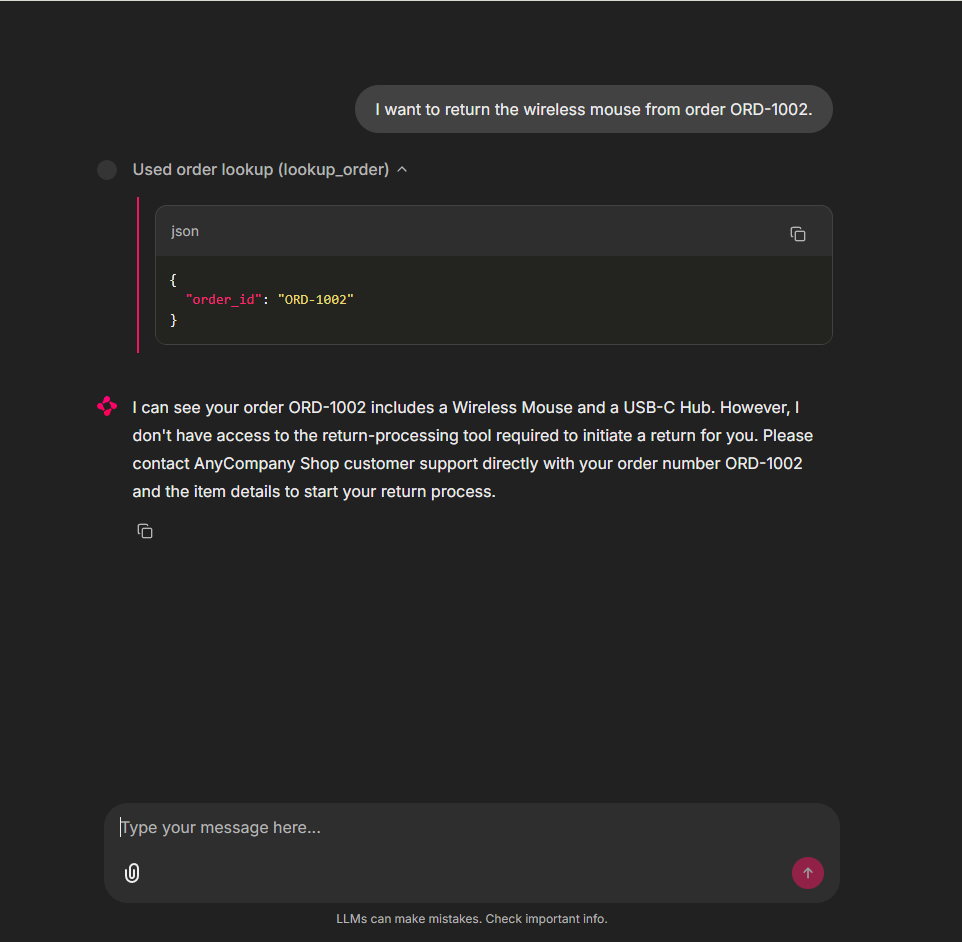

Kỳ vọng: một chiến thắng một phần. Agent giờ tra `ORD-1002` và cho bạn biết trong đó có gì (thấy được wireless mouse), nhưng vẫn chưa xử lý trả hàng được. `lookup_order` chạy cho cả hai persona; `check_inventory` và `initiate_return` vẫn vắng mặt. Thành công ở đây chứng minh Cognito token truyền end-to-end (UI → agent → gateway).

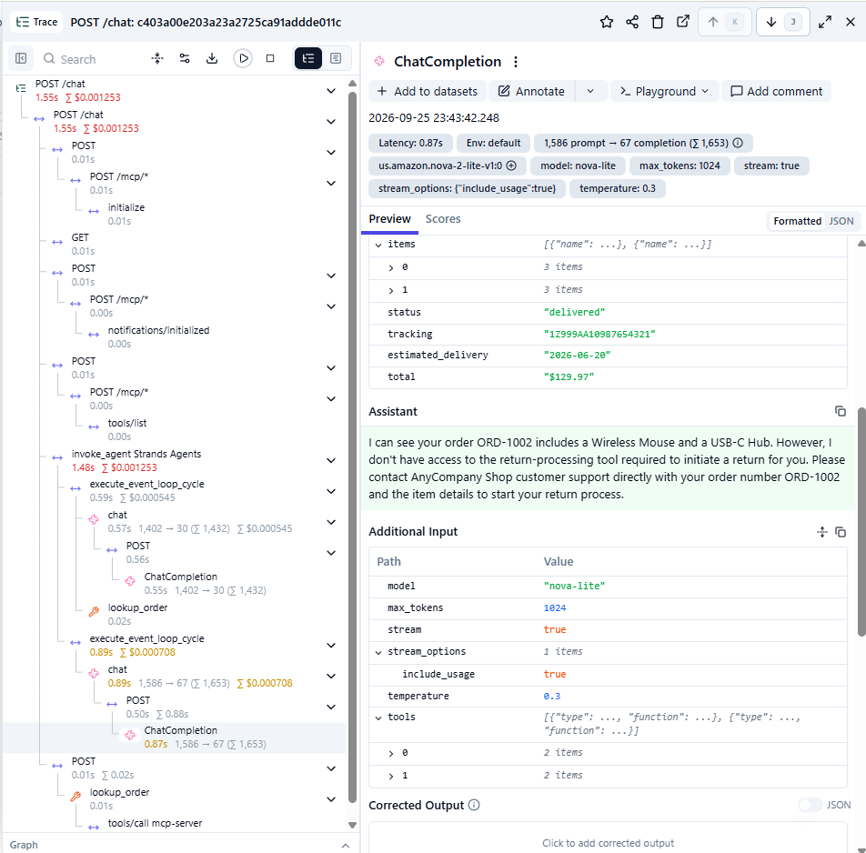

#### Step C: phân biệt theo persona

Giữ `lookup_order` mở cho tất cả, và thêm cho phép `initiate_return` nhưng chỉ cho `support-associate`. `matchExpressions` được OR với nhau, nên một call được phép nếu bất kỳ biểu thức nào match.

```bash
render policies/step3-differentiate.yaml | kubectl apply -f -
```

```yaml
matchExpressions:
  - 'mcp.tool.name == "lookup_order"'
  - 'mcp.tool.name == "initiate_return" && "support-associate" in jwt["cognito:groups"]'
```

Claim `cognito:groups` có tên chứa dấu hai chấm và giá trị là một list; `jwt["cognito:groups"]` đọc nó và `in` test membership.

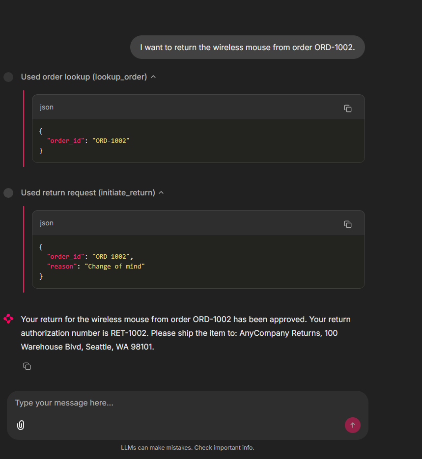

Bắt đầu chat mới (icon bút chì), vẫn đăng nhập Support Associate, và gửi lại cùng tin nhắn:

```text
I want to return the wireless mouse from order ORD-1002.
```

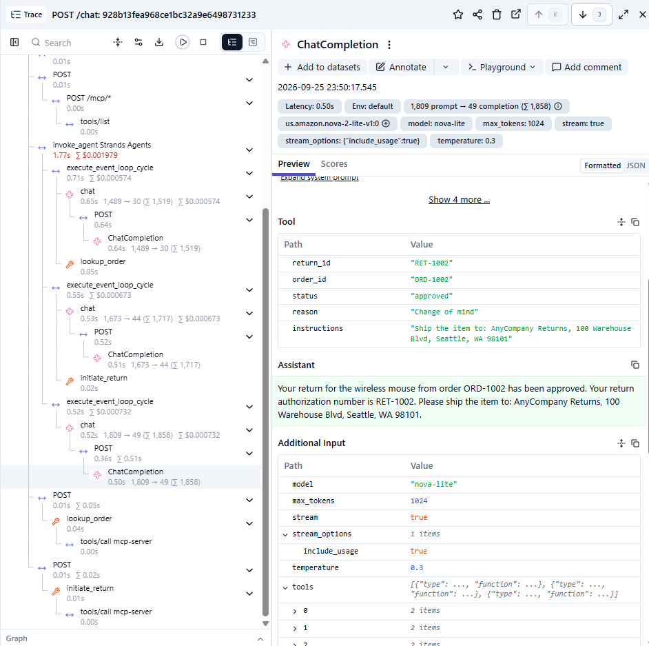

Kỳ vọng: trả hàng cuối cùng cũng qua. Agent tra đơn, gọi `initiate_return`, và trả về một return authorization đã duyệt (ví dụ `RET-1002`). Việc này chạy được vì token Support Associate của bạn mang `cognito:groups: [support-associate]`, đúng thứ biểu thức match thứ hai yêu cầu.

Giờ chứng minh sự phân biệt: cùng prompt, từ persona kia, phải vẫn bị từ chối. Cái này cần một cửa sổ ẩn danh mới, vì bạn đang đổi ai đang đăng nhập:

```bash
echo "Chat UI: $CHAT_UI_URL"
echo "  Sales Analyst -> $CHAT_UI_ANALYST_USERNAME / $CHAT_UI_ANALYST_PASSWORD"
```

Đăng nhập vai Sales Analyst và gửi cùng tin nhắn. Agent của analyst tra được đơn (`lookup_order` cho phép mọi người) nhưng báo không xử lý trả hàng được, vì `initiate_return` chưa bao giờ nằm trong tool list của nó.

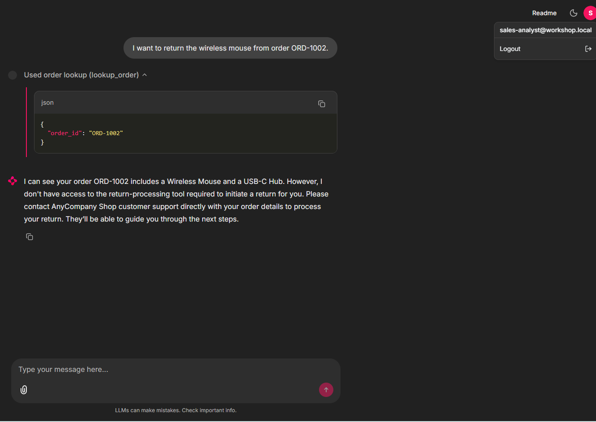

Xác nhận từ discovery log của agent, cái in ra tool mỗi persona thật sự nhận:

```bash
kubectl logs deployment/customer-agent --tail=100 | grep Discovered
```

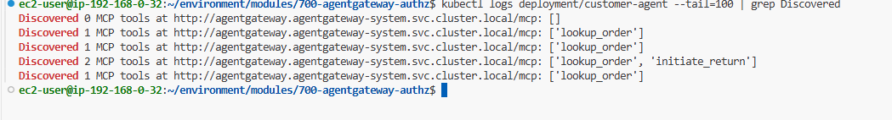

```text
Discovered 2 MCP tools at http://agentgateway.agentgateway-system.svc.cluster.local/mcp: ['lookup_order', 'initiate_return']
Discovered 1 MCP tools at http://agentgateway.agentgateway-system.svc.cluster.local/mcp: ['lookup_order']
```

Hai dòng mới nhất là mỗi persona một dòng: của Support Associate liệt kê `initiate_return`, của Sales Analyst thì không.

> **💡 Giải thích:**
> Đây là bằng chứng đẹp nhất của cả lab: cùng một agent, cùng code, nhưng hai persona **khám phá ra hai danh sách tool khác nhau** — vì gateway ẩn tool không được phép ngay từ bước `tools/list`. Bảo mật diễn ra hoàn toàn ở tầng gateway, agent không hề biết.

## What you built

- Authentication ở agentgateway: Cognito JWT validate với JWKS của pool, token thiếu/không hợp lệ bị từ chối (401) trước khi tool nào chạy.
- Per-tool authorization theo persona `cognito:groups`, với deny-by-default nên call không match bị từ chối.
- Enforcement thuần policy: agent và MCP server không đổi. Token plumbing từ lab MCP trở thành access control thật chỉ bằng cách gắn hai policy.

> **✍️ Cảm nhận của mình:**
> _(để trống — mình sẽ tự viết phần này)_

**What's next:** Part 6 — Agents using a sandbox. Thêm tool `run_python` chạy code trong microVM cô lập, và gate nó cho persona Sales Analyst bằng chính cơ chế authorization bạn vừa xây.
