# Building Agents on Amazon EKS - Part 6: Agents using a sandbox

> Phần cuối của loạt bài. Các tool tới giờ trả lời câu hỏi cố định: `lookup_order` trả về một đơn, `check_inventory` kiểm một sản phẩm. Nhưng một Sales Analyst hỏi câu mở như "vẽ biểu đồ doanh số tháng trước theo region". Không có tool cố định cho việc đó. Model cần viết code, chạy nó trên nhiều đơn, và hiện kết quả.

## The AI Gateway

| At a glance    | Details                                                                                                          |
| -------------- | ---------------------------------------------------------------------------------------------------------------- |
| Goal           | Cho agent một tool run_python viết và chạy pandas trên các đơn trong microVM air-gapped, dùng-một-lần, và render chart inline trong chat. |
| Time           | ~25 phút                                                                                                          |
| Prerequisites  | Lab Agent tools with MCP (Part 4) và Securing the agents (Part 5)                                                 |

Chạy code do model viết là rủi ro mà lab này xử lý. Mỗi lần thực thi có một máy ảo dùng-một-lần riêng trên EKS, tạo qua **Kata Containers**: một runtime nhìn như container với Kubernetes nhưng boot một VM thật với kernel riêng bên dưới, nên một process thoát khỏi container là thoát vào một VM chứ không phải lên node. VM air-gapped, không mạng không credential, và bị huỷ sau một lần chạy.

Kata hỗ trợ nhiều hypervisor. Workshop này cấu hình nó với **Firecracker**, hypervisor mã nguồn mở của AWS xây riêng cho đúng loại workload này: nó boot một VM tinh gọn trong vài trăm mili-giây, đủ nhanh để per-execution isolation trở nên khả thi. Runtime class tên `kata-fc` theo cặp đó.

> **💡 Giải thích:**
> Ý tưởng cốt lõi: code do LLM sinh ra là **không đáng tin** — bạn không biết nó sẽ làm gì. Giải pháp không phải là kiểm duyệt code cho kỹ, mà là chạy nó ở một nơi cô lập hoàn toàn: không mạng để tuồn dữ liệu ra, không credential để trộm, và bị xoá sạch sau mỗi lần. Firecracker/Kata cho phép "container nhưng thực chất là VM riêng", isolation mạnh hơn container thường nhiều.

### Prerequisites: hai lab trước

Lab này xây trên hai lab trước và không thay thế chúng. Hoàn tất cả hai trước, hoặc agent không có gì để connect và không có persona check để pass:

- **Agent tools with MCP**: `mcp-server` phải đang chạy. Nếu không, log agent hiện `MCPClientInitializationError` và mọi chat trả về không gì.
- **Securing the agents**: policy `mcp-authn` JWT của gateway phải được apply, hoặc không có `jwt` cho rule `run_python` đọc và log hiện `Discovered 0 MCP tools at .../code-mcp: []`.

Xác nhận nhanh cả hai:

```bash
kubectl rollout status deployment/mcp-server
kubectl get agentgatewaypolicy mcp-authn -n agentgateway-system
```

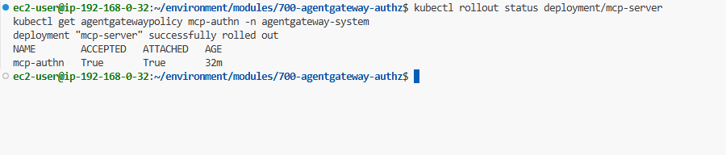

### Vì sao không đưa thẳng raw orders cho model?

Bạn có thể đưa model vài trăm dòng đơn và bảo nó cộng lại. Việc đó chậm, tốn token, và model không đáng tin cậy khi làm số học trên list dài. Viết `df.groupby('region')['total'].sum()` và chạy nó thì chính xác và rẻ. Nên lab này cho agent một tool, `run_python`, và dạy model trả lời câu hỏi phân tích bằng cách viết pandas thay vì đoán.

Vướng mắc: code do model viết là không tin cậy. Bạn không muốn nó chạy trong pod của agent với credential DynamoDB của agent. Nên code chạy ở một nơi không có gì đáng trộm.

### The isolation model

`run_python` không thực thi code trong agent. Nó gọi một broker (MCP server `code-executor`) mà: fetch một lát đơn có scope, claim một `kata-fc` microVM tươi, ghi các row và code sinh ra vào đó thành file, chạy code, đọc lại kết quả, và huỷ microVM. Hai tính chất làm việc này an toàn: microVM air-gapped (không mạng, không credential), và các row đơn vào dưới dạng file, nên raw data không bao giờ đi qua LLM.

:::debug-accordion
::item Broker làm gì mỗi call
Mỗi call, broker:

- dựng một DynamoDB query có scope, tham số hoá từ tham số đã validate (model chọn một fiscal quarter và filter tuỳ chọn, không bao giờ một raw query),
- fetch lát đơn có giới hạn đó (broker giữ read-only creds),
- claim một `kata-fc` microVM pre-warmed từ pool và ghi row + code sinh ra vào đó thành file,
- chạy code, đọc lại stdout và chart nếu có, rồi huỷ microVM.

Pool là lý do việc này đủ nhanh để ngồi sau một tin nhắn chat: vài microVM giữ sẵn booted và idle, nên một lần chạy claim một cái thay vì chờ cold start.
::item Hai tính chất làm nó an toàn
- **microVM air-gapped.** NetworkPolicy của nó set `egress: []` và nó mount không ServiceAccount token, nên kể cả code cố tuồn dữ liệu hay gọi AWS, không có chỗ nào để đi và không có gì để xác thực.
- **Dữ liệu vào out-of-band.** Row đơn ghi vào microVM thành file (`/app/orders.json`), không truyền qua LLM. Model viết code trên một schema được mô tả; nó không bao giờ thấy raw row trong context của nó.
::item Giữ chart ngoài đường LLM
Khi analyst muốn một bức hình, code sinh ra lưu một matplotlib figure vào `/app/chart.png` trong microVM. Chart rồi theo cùng đường out-of-band như dữ liệu đơn, nên ảnh không bao giờ vào context LLM:

- `run_python` → broker → microVM: code lưu `/app/chart.png`
- broker đọc PNG lại, cache, trả về một `chart_id` ngắn cho agent
- agent fetch PNG từ broker (`GET /chart/{id}`) và stream tới UI
- UI render chart inline, dưới bước code có thể mở rộng

Model chỉ bao giờ thấy một `chart_id`, không bao giờ ảnh base64.
:::

> **💡 Giải thích:**
> Chi tiết tinh tế nhất của lab: **cả dữ liệu vào lẫn ảnh ra đều đi "đường vòng" (out-of-band), không qua LLM.** Model chỉ viết code và nhận về một cái `chart_id` ngắn. Điều này vừa tiết kiệm token (ảnh rất tốn token và vô dụng với model), vừa giữ nguyên tính chất "dữ liệu thô không bao giờ vào context của model" — tốt cho cả bảo mật lẫn chi phí.

### Persona: ai được chạy code

`run_python` bị gate cho persona **Sales Analyst**. Đăng nhập là analyst, tool có sẵn; đăng nhập là Support Associate, cùng request bị deny ở agentgateway (JWT persona check từ lab Securing the agents). Chạy code là khả năng tác động lớn, nên scope cho đúng vai cần nó.

## Kiến trúc


### Step 1: Code walkthrough

Broker expose một tool và phục vụ chart trên một route side-channel. Agent fetch chart đó và re-stream tới UI.

```bash
cd ~/environment/modules/900-sandboxed-code-exec
ls code-executor-mcp python-runtime-sandbox
```

:::debug-accordion
::item server.py — tool run_python
```python
@mcp.tool()
def run_python(code: str, period: str, region: str | None = None, ...) -> dict:
    """Run Python against a scoped slice of the orders dataset in a microVM.
    Save a chart to /app/chart.png to show the user a figure.
    ..."""
    rows = _fetch_rows(period=period, region=region, ...)  # scoped DynamoDB Query
    result = run_in_sandbox(code, rows)                      # vend microVM, run code
    image_png = result.pop("image_png", None)
    if image_png:
        result["chart_id"] = _charts.put(image_png)          # cache; return id only
    return result
```
Tool trả về stdout, một row count, và (nếu code vẽ) một `chart_id`. Raw PNG ở lại trong cache của broker. Docstring bảo model fetch cả một fiscal quarter và filter xuống một tháng trong code, nên câu hỏi "last month" chạy được trên dataset key theo quarter.
:::

> **💡 Giải thích:**
> Để ý docstring của tool cũng là "prompt" cho model: nó hướng dẫn model cách dùng tool (fetch cả quý rồi lọc trong code). Với agent, mô tả tool viết cẩn thận quan trọng ngang code — vì đó là thứ model đọc để quyết định gọi tool thế nào.

### Step 2: Deploy broker và authz của nó

Ba image chống lưng lab này, tất cả build sẵn và push lên ECR lúc provisioning: broker (`code-executor-mcp`), microVM runtime (`python-runtime-sandbox`, bundle matplotlib), và agent (`customer-agent:code-exec`, trỏ tới cả orders MCP và broker).

Deploy broker trước, rồi policy scope `run_python` cho analyst:

```bash
cd ~/environment/modules/900-sandboxed-code-exec
envsubst < code-executor-mcp/k8s.yaml | kubectl apply -f -
kubectl rollout status deployment/code-executor-mcp --timeout=120s
kubectl apply -f policies/run-python-authz.yaml
```

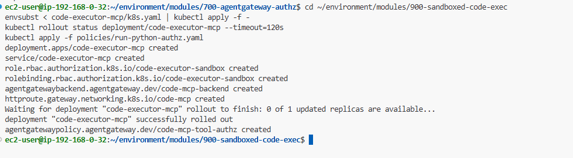

Bạn sẽ thấy `deployment "code-executor-mcp" successfully rolled out`.

Xác nhận broker rolled out và authz policy đã ở đó:

```bash
kubectl get agentgatewaypolicy code-mcp-tool-authz -n default
```

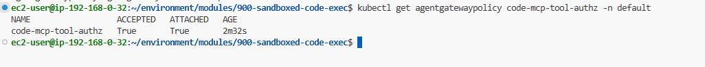

```text
NAME                  AGE
code-mcp-tool-authz   12s
```

### Step 3: Deploy agent

`k8s.yaml` của agent trỏ `MCP_SERVER_URLS` tới cả orders MCP và broker, nên nó có `run_python` cạnh các tool trước:

```bash
cd ~/environment/modules/900-sandboxed-code-exec/agent
envsubst < k8s.yaml | kubectl apply -f -
kubectl rollout status deployment/customer-agent --timeout=120s
```

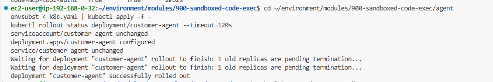

Code agent không đổi từ lab MCP. `customer-agent:code-exec` build từ cùng source như `customer-agent:mcp`, chỉ tag khác, và khác biệt duy nhất lúc deploy là `MCP_SERVER_URLS` nêu hai endpoint thay vì một. Agent có thêm tool bằng cách được trỏ tới một MCP server khác, không phải bằng viết lại — đó là phần thưởng của lab trước. Nó cũng giữ cùng ServiceAccount `customer-agent` không-IAM: broker giữ read-only DynamoDB access, agent giữ không.

> **💡 Giải thích:**
> Điểm hay: agent "học" được một khả năng mới (chạy code) mà **không sửa một dòng code nào** — chỉ cần trỏ nó tới thêm một MCP server. Đây chính là giá trị của kiến trúc MCP đã xây ở Part 4: thêm khả năng = thêm một endpoint, không phải rebuild agent.

### Step 4: Xin một cái chart

Mở chat UI và đăng nhập vai **Sales Analyst**. Nếu bạn đã có chat mở từ lab trước, bắt đầu hội thoại mới bằng icon bút chì góc trên-trái: agent khám phá tool một lần mỗi hội thoại, nên session cũ sẽ không nhặt được `run_python`.

```bash
echo "Chat UI: $CHAT_UI_URL"
echo "  Sales Analyst -> $CHAT_UI_ANALYST_USERNAME / $CHAT_UI_ANALYST_PASSWORD"
```

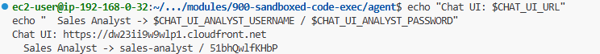

Hỏi một câu phân tích:

```text
Chart last month's sales by region.
```

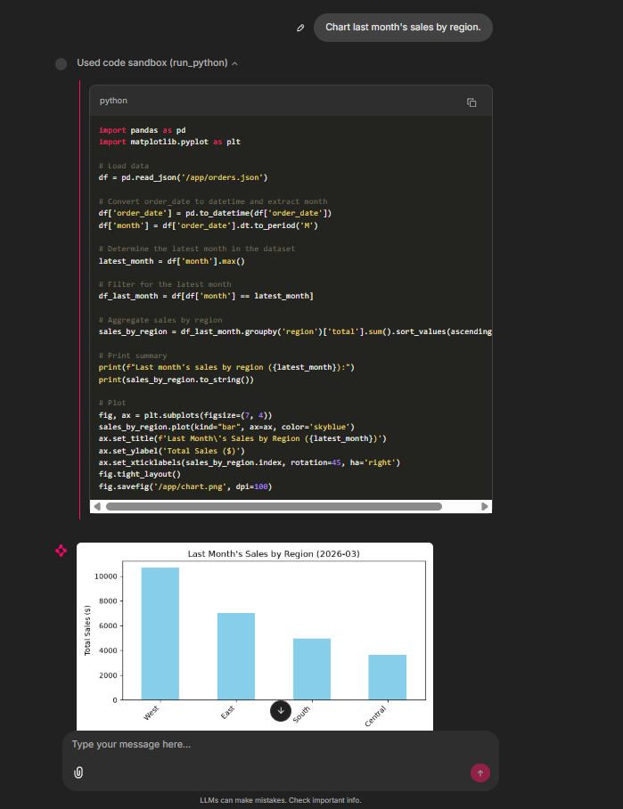

Agent viết pandas, chạy nó trong một microVM, và trả lời bằng một readout text ngắn cộng một chart inline. Mở rộng bước code sandbox (`run_python`) để xem đúng code đã tạo ra nó.

Thử một câu chỉ-text nữa:

```text
What were total Q1 2026 sales aggregated by region?
```

Giờ đăng xuất và đăng nhập lại vai Support Associate rồi hỏi cùng câu chart. Persona analyst được chạy code; persona support thì không. Y như ở Securing the agents, agentgateway ẩn `run_python` khỏi tool list của session support, nên agent trả lời rằng nó không chạy được phân tích đó chứ không trả về lỗi.

```bash
echo "  Support Associate -> $CHAT_UI_SUPPORT_USERNAME / $CHAT_UI_SUPPORT_PASSWORD"
```

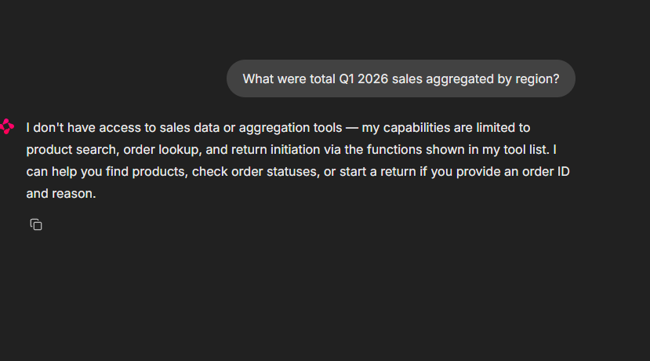

Trace Langfuse hiện cả request chart trong một cây: chat generation đầu viết pandas, tool span `run_python` route nó qua gateway tới broker, và tool result về với `exit_code: 0`, `row_count`, và một `chart_id`. Chú ý thứ result **không** chứa: chính ảnh chart. Model chỉ bao giờ thấy `chart_id` ngắn đó.

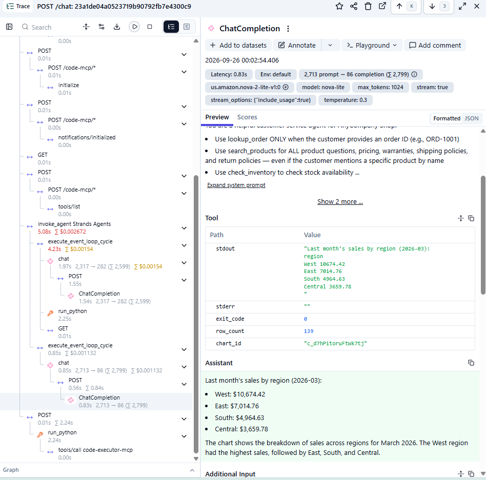

### Verify the isolation

Mỗi lần thực thi là dùng-một-lần: broker claim một microVM pre-warmed từ `kata-fc-python-pool`, chạy code, và luôn terminate nó, nên không gì (file, process, state) sống sót sang lần sau. Pool rồi spin up một cái tươi thay thế.

Để xem điều đó, bạn cần mắt trên các sandbox trước khi run bắt đầu, nên set up hai terminal quan sát trước. Terminal thứ nhất, watch các sandbox pod:

```bash
kubectl get pods -n agent-sandbox -l sandbox-kind=python -w
```

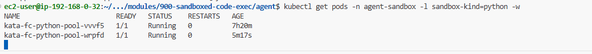

Terminal thứ hai, stream log của các sandbox pod của lab này. `grep -v` bỏ readiness probe:

```bash
kubectl logs -n agent-sandbox -l sandbox-kind=python --prefix -f \
  | grep -v '"GET / HTTP'
```

Với cả hai đang chạy, quay lại chat và hỏi thêm một câu chart:

```text
Chart last month's sales by region.
```

Trong pod watch, một pool pod bị claim cho lần chạy, terminate vài giây sau, và một pod hoàn toàn mới xuất hiện thay chỗ nó trong pool.

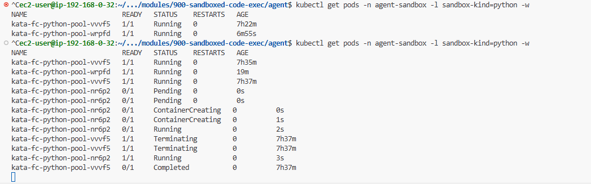

Claim và terminate xảy ra trong vài giây, nên nếu lỡ trong watch, chạy cái này trước và sau một query rồi so tên pod:

```bash
kubectl get pods -n agent-sandbox -l sandbox-kind=python
```

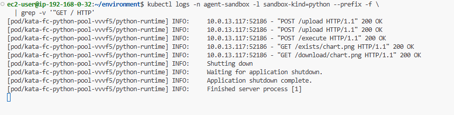

Cuối cùng, xác nhận air gap. Đọc chính policy thay vì bảng tóm tắt:

```bash
kubectl get networkpolicy kata-fc-python-airgap -n agent-sandbox \
  -o jsonpath='{.spec}' | python3 -m json.tool
```

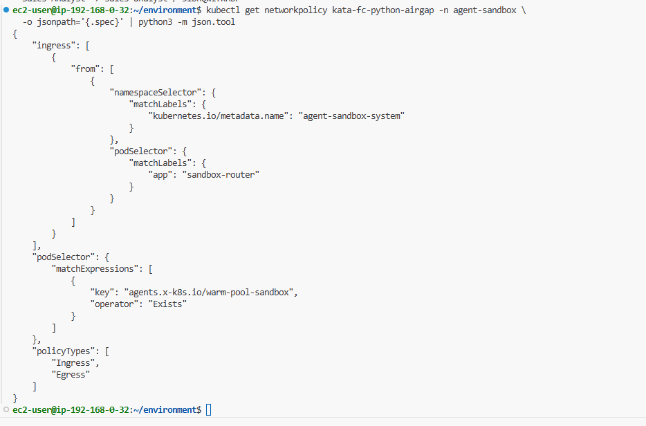

Phần quan trọng:

```text
"egress": [],
"policyTypes": ["Ingress", "Egress"]
```

Một egress list rỗng với Egress trong policyTypes không phải "chưa cấu hình rule", mà là "không đích nào được phép". microVM tính chart của bạn với không chỗ nào để gửi bất cứ gì. Kết hợp với `automountServiceAccountToken: false` trên pod, code chạy trong đó không có đường ra lẫn credential để dùng nếu tìm thấy.

> **💡 Giải thích:**
> Đây là bằng chứng "air gap" cụ thể nhất: `egress: []` nghĩa là microVM **không được phép gửi gói tin ra bất cứ đâu**. Dù code độc hại có chạy trong đó, nó không có mạng để tuồn dữ liệu và không có credential để lạm dụng. Cô lập ở tầng network + tầng identity, cộng với VM riêng của Kata, tạo thành nhiều lớp phòng thủ.

## What you built

- Một tool `run_python` trả lời câu hỏi phân tích mở bằng cách viết pandas, không phải đoán trên raw row.
- VM-level isolation cho code không tin cậy: một `kata-fc` microVM per-execution, air-gapped, không credential, claim mỗi call và huỷ sau đó.
- Chart render inline trong chat, với một dropdown mở rộng hiện code đã tạo ra mỗi cái, và chart bytes giữ ngoài đường LLM.
- Code execution scope cho persona Sales Analyst ở agentgateway.

> **✍️ Cảm nhận của mình:**
> _(để trống — mình sẽ tự viết phần này)_

**Kết loạt bài:** Qua sáu phần, một customer service agent đơn giản đã tiến hoá thành một hệ thống có observability, dùng tool qua MCP, phân quyền theo persona, và chạy code không tin cậy trong sandbox cô lập — tất cả trên Amazon EKS, với AI Gateway làm control point cho mọi lời gọi model.
