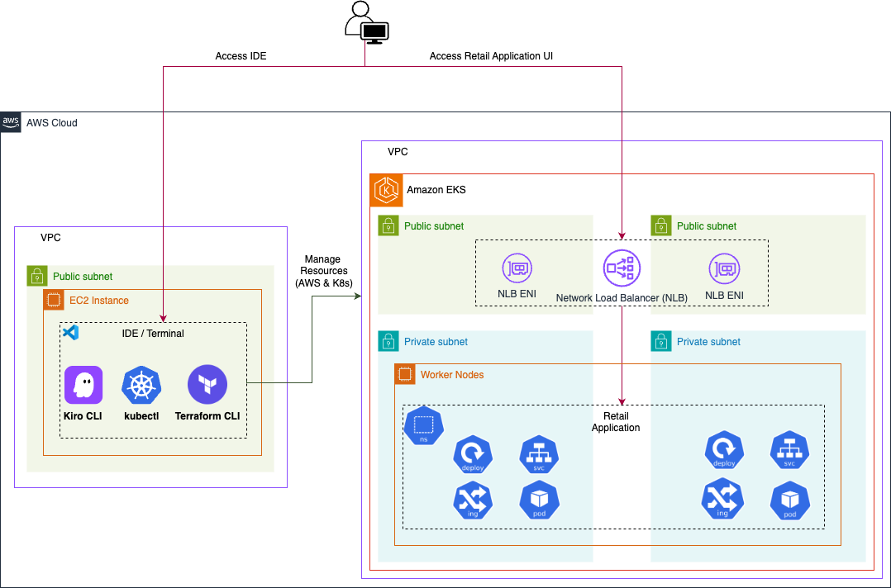
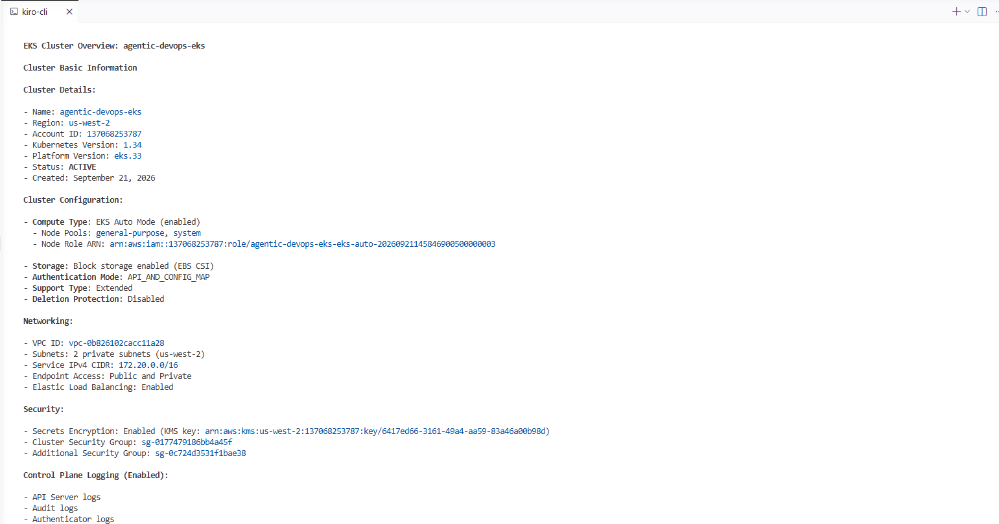
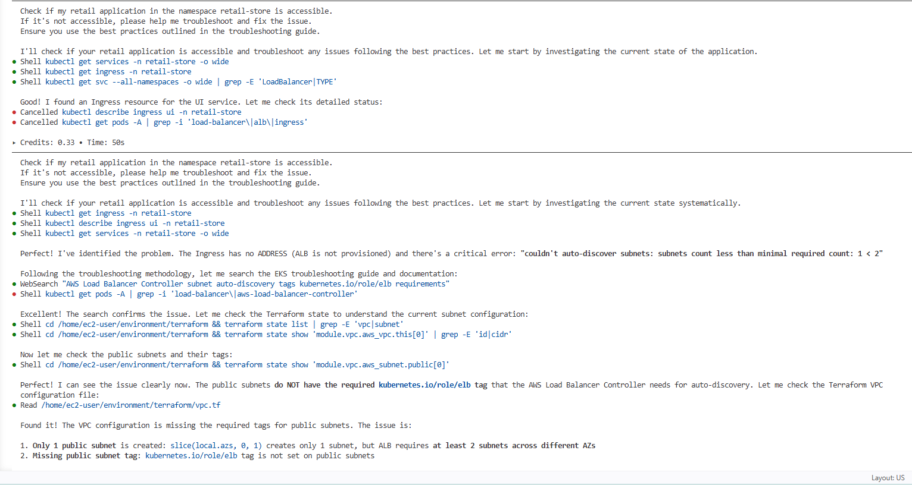
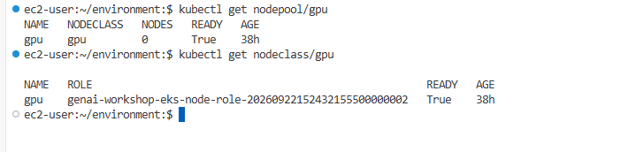
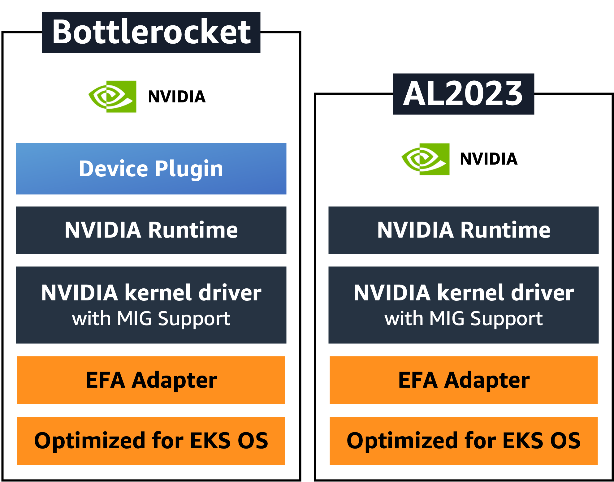
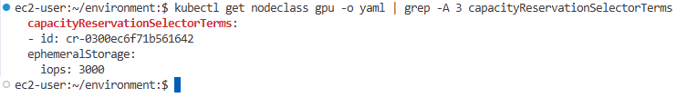
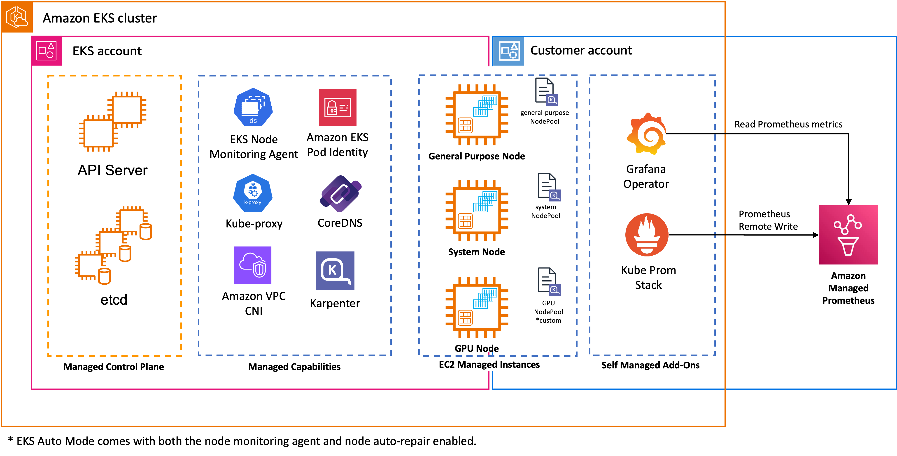

# Hosting and Scaling GenAI Workloads on Amazon EKS

## Setting Up the Cluster

### Explore the Environment

Workshop đã provision sẵn một môi trường để chạy các workload generative AI. Hạ tầng hỗ trợ large language model (LLM) và các ứng dụng AI/ML với compute, network và storage cần thiết.

#### Workshop Infrastructure

- **Amazon VPC:** Virtual network riêng với public subnet và private subnet trên nhiều Availability Zone.
- **Amazon EKS Auto Mode:** Tự động quản lý compute, storage và networking cho cluster; tự provision infrastructure, scale resource, tối ưu chi phí và quản lý các add-on cốt lõi.
- **Self-managed add-ons:** Monitoring stack gồm Kube Prometheus Stack và Grafana Operator.
- **Amazon Managed Service for Prometheus:** Dịch vụ managed để thu thập và lưu trữ metric với khả năng scale và bảo mật.


#### Kết nối tới EKS cluster

Cluster `genai-workshop` đã được provision sẵn và `kubectl` đã được cấu hình để kết nối. Kiểm tra connection bằng lệnh sau:

```bash
kubectl get pods --all-namespaces
```



> **Ý nghĩa output:** Xác nhận terminal đang nói chuyện được với đúng cluster và xem trạng thái các pod trong tất cả namespace.

#### Giới hạn quyền truy cập vào cluster

Mặc định, `IngressClassParams` của ALB cho phép inbound traffic từ mọi IP (`0.0.0.0/0`). Nên giới hạn quyền truy cập về public IP hiện tại để chỉ mình bạn truy cập được các ALB do workshop tạo ra.

##### Lấy public IP

Mở `https://checkip.amazonaws.com` bằng trình duyệt local để lấy public IP.

> Không chạy `curl https://checkip.amazonaws.com` trong terminal của workshop IDE. IDE chạy trên một EC2 instance nên lệnh đó trả về IP của instance, không phải IP local của bạn.

##### Lưu IP vào biến môi trường

Thay `<YOUR_PUBLIC_IP>` bằng IP lấy ở bước trước:

```bash
export MY_IP=<YOUR_PUBLIC_IP>
```

##### Patch IngressClassParams

```bash
kubectl patch ingressclassparams alb --type=merge -p "{\"spec\":{\"inboundCIDRs\":[\"${MY_IP}/32\"]}}"
```

Đây là cấu hình cấp cluster và áp dụng cho tất cả ALB do workshop tạo. Nếu public IP thay đổi, hãy chạy lại lệnh với IP mới.



> **Ý nghĩa output:** Xác nhận `IngressClassParams` đã nhận CIDR `/32`, tức chỉ cho phép đúng một public IP truy cập.

#### Kiểm tra cấu hình cluster ban đầu

EKS Auto Mode tự động quản lý việc provision node thông qua các NodePool dựng sẵn.

##### General-Purpose NodePool

```bash
# Xem node thuộc General-Purpose NodePool
kubectl get nodes -l karpenter.sh/nodepool=general-purpose
```



> **Ý nghĩa output:** Đây là nhóm node dành cho workload ứng dụng thông thường, sử dụng capacity on-demand và kiến trúc amd64.

##### System NodePool

```bash
# Xem node thuộc System NodePool
kubectl get nodes -l karpenter.sh/nodepool=system
```


> **Ý nghĩa output:** Đây là nhóm node dành cho thành phần hệ thống và add-on. Node có taint `CriticalAddonsOnly` để tách workload hệ thống khỏi workload ứng dụng.

EKS Auto Mode sử dụng Bottlerocket OS cho các NodePool này, tự chọn EKS-optimized AMI và tự provision thêm compute khi workload cần.

#### Tổng quan các EKS add-on

##### Built-in EKS Auto Mode Components

- **CoreDNS:** Phân giải DNS trong cluster.
- **kube-proxy:** Networking và load balancing cho pod.
- **VPC CNI:** Cấp network cho pod bằng AWS VPC IP.
- **EKS Pod Identity Agent:** Quản lý credential cho application.
- **EBS CSI Driver:** Hỗ trợ block storage cho persistent volume.
- **NVIDIA Device Plugin:** Quản lý GPU resource trên Bottlerocket OS cho GPU workload.

EKS Auto Mode dùng Karpenter ở bên dưới để provision node thông minh và tự động thay node tối đa mỗi 21 ngày vì lý do security và cập nhật.

##### Self-managed Add-ons

- **Kube Prometheus Stack:** Bộ Kubernetes manifest, Grafana dashboard và Prometheus rule để monitor cluster.
- **Grafana Operator:** Kubernetes operator quản lý Grafana instance, dashboard và data source.

#### Kiểm tra vị trí chạy của monitoring stack

Liệt kê các pod monitoring và node đang chạy chúng:

```bash
kubectl get pods -n monitoring -o wide
```


> **Ý nghĩa output:** Dùng cột `NODE` để đối chiếu pod monitoring đang chạy trên node thuộc NodePool nào.

Kiểm tra trực tiếp label NodePool của từng pod:

```bash
kubectl get pods -n monitoring -o jsonpath='{range .items[*]}{.metadata.name}{"\t"}{.spec.nodeName}{"\n"}{end}' | while read pod node; do
  echo "Pod: $pod -> Node: $node ($(kubectl get node $node -o jsonpath='{.metadata.labels.karpenter\\.sh/nodepool}' 2>/dev/null || echo 'unknown'))"
done
```


Các component cốt lõi như Prometheus, Grafana và Grafana Operator thường được schedule trên `system` NodePool nhờ node selector và toleration trong Helm chart.

##### Expected behavior: node-exporter

`node-exporter` có thể xuất hiện trên tất cả NodePool vì nó là một DaemonSet, được thiết kế để chạy trên mỗi node nhằm thu thập system metric. Đây là hành vi bình thường.

#### Kiểm tra model download job

Workshop có một job download model chạy trên General-Purpose NodePool:

```bash
kubectl get job model-download -o wide
```


Kiểm tra NodePool mà pod của job đã chạy trên đó:

```bash
kubectl get pod -l job-name=model-download -o jsonpath='{range .items[*]}{.metadata.name}{"\t"}{.spec.nodeName}{"\n"}{end}' | while read pod node; do
  echo "Pod: $pod -> Node: $node ($(kubectl get node $node -o jsonpath='{.metadata.labels.karpenter\\.sh/nodepool}' 2>/dev/null || echo 'general-purpose'))"
done
```


> **Trạng thái:** Chưa chạy bước này nên chưa có output thực tế.
>
> **Ý nghĩa output:** Xác nhận model download job chạy trên `general-purpose`, vì job không cần GPU và không có toleration dành cho `system` NodePool.

##### Expected behavior: pod Error

Có thể thấy một pod ở trạng thái `Error` nằm cạnh pod `Completed`. Đây là race condition có thể xảy ra trong lúc workshop provision, không nhất thiết có nghĩa model download cuối cùng thất bại.

#### Kết luận

Qua module này, ta đã kiểm tra môi trường GenAI trên Amazon EKS, giới hạn quyền truy cập ALB, phân biệt hai NodePool và xác nhận vị trí chạy của monitoring stack cùng model download job.

EKS Auto Mode đảm nhận phần nặng như quản lý cluster, provision node và quản lý add-on cốt lõi. Nhờ đó, các bước tiếp theo có thể tập trung vào việc triển khai AI/ML workload và quan sát hệ thống thay vì quản lý node thủ công.

### GPU Infrastructure

Phần này tập trung vào việc tối ưu GPU infrastructure cho LLM inference hiệu năng cao trên EKS Auto Mode. Ta sẽ kiểm tra GPU NodePool, SOCI acceleration và khả năng hoạt động của GPU.

#### EKS Auto Mode GPU Node Provisioning

EKS Auto Mode tự động provision GPU node thông qua custom NodePool khi workload yêu cầu, giúp scale hiệu quả mà không cần trực tiếp quản lý Karpenter.

Kiểm tra cấu hình GPU NodePool và NodeClass đã được tạo sẵn:

```bash
# Kiểm tra GPU NodePool
kubectl get nodepool/gpu

# Xem GPU NodeClass được tối ưu cho SOCI
kubectl get nodeclass/gpu
```


GPU NodePool bao gồm:

- **Instance types:** `g6e.xlarge`, `g6e.2xlarge`, `g6e.4xlarge` và `g6e.8xlarge`.
- **AMI:** EKS-optimized Bottlerocket có embedded NVIDIA support.
- > **Giải thích:** GPU EC2 không có nghĩa Kubernetes tự động sử dụng được GPU. Thông thường cần có NVIDIA driver và cơ chế để Kubernetes nhận diện GPU.
  >
  > Với EKS Auto Mode, GPU node sử dụng GPU-optimized Bottlerocket AMI đã được AWS chuẩn bị sẵn NVIDIA support và NVIDIA Device Plugin. Vì vậy khi Auto Mode provision GPU node, node có thể expose GPU resource cho Kubernetes mà mình không phải tự SSH vào node để cài driver và Device Plugin như khi tự quản lý GPU node.
  >
  > Có thể hình dung đơn giản:
  >
  > `GPU EC2 → Bottlerocket GPU AMI → NVIDIA support → Kubernetes nhận diện GPU → Pod sử dụng GPU`
  >
  > Đây là một trong những điểm mình thấy EKS Auto Mode giúp giảm đáng kể phần việc vận hành GPU infrastructure.

- **SOCI snapshotter:** Tự động bật cho instance family G, P và Trn.
- **Taint:** `nvidia.com/gpu=true:NoSchedule` để chỉ GPU workload được schedule lên node.
- **Label:** `karpenter.sh/nodepool: gpu` để nhận diện GPU node.
- **Architecture:** AMD64.
- **Custom NodeClass:** Storage configuration được tối ưu cho SOCI.

> **Giải thích:** GPU NodePool có thể hiểu là một nhóm node dành riêng cho các workload cần GPU, chẳng hạn như LLM inference. Khi một Pod yêu cầu `nvidia.com/gpu`, EKS Auto Mode có thể dựa vào NodePool này để provision GPU instance phù hợp.
>
> Khác với `general-purpose` NodePool, GPU NodePool có taint `nvidia.com/gpu=true:NoSchedule`. Điều này giúp workload thông thường không vô tình được schedule lên GPU node, tránh lãng phí tài nguyên GPU.

#### SOCI snapshotter cho container startup nhanh hơn

EKS Auto Mode tự động bật SOCI (Seekable OCI) snapshotter cho instance family G, P và Trn có local NVMe storage. Cơ chế này tăng tốc startup của container image lớn, đặc biệt phù hợp với ML workload có image vài GB.

Từ ngày 19 tháng 11 năm 2025, SOCI parallel pull và unpack luôn được bật cho GPU instance trong EKS Auto Mode, không cần cấu hình thêm. EKS Auto Mode tận dụng NVMe storage có sẵn để cung cấp IOPS và throughput cao.

#### Bottlerocket với embedded NVIDIA Device Plugin

Với GPU workload, EKS Auto Mode tự chọn Bottlerocket AMI có NVIDIA driver và device plugin tích hợp sẵn. Khi GPU node được provision, embedded device plugin tự cấu hình node để workload có thể dùng GPU ngay.


#### Kiểm tra On-Demand Capacity Reservation

Workshop Studio cung cấp một shared On-Demand Capacity Reservation (ODCR) để đảm bảo GPU capacity cho session. Môi trường workshop đã patch `NodeClass/gpu` trước khi IDE mở, nên không cần cấu hình thủ công.

Kiểm tra reservation đã được attach:

```bash
kubectl get nodeclass gpu -o yaml | grep -A 3 capacityReservationSelectorTerms
```


Output thường có một entry `capacityReservationSelectorTerms` chứa reservation ID:

```yaml
capacityReservationSelectorTerms:
  - id: cr-0a1b2c3d4e5f67890
```

Khi selector này tồn tại, EKS Auto Mode sẽ launch workshop GPU node từ capacity đã reserve.

> **Workshop Studio only:** Self-paced deployment không bắt buộc ODCR. Nếu không có ODCR, EKS Auto Mode sẽ dùng on-demand GPU capacity hiện có.

#### Kiểm tra GPU functionality

Triển khai một GPU workload để kiểm tra EKS Auto Mode tự provision GPU node khi cần:

```bash
# Deploy nvidia-smi test để trigger GPU node provisioning
cat <<'EOF' | kubectl apply -f -
apiVersion: v1
kind: Pod
metadata:
  name: nvidia-smi
spec:
  tolerations:
    - key: "nvidia.com/gpu"
      operator: "Exists"
      effect: "NoSchedule"
  nodeSelector:
    karpenter.sh/nodepool: gpu
  containers:
    - name: nvidia-smi
      image: public.ecr.aws/amazonlinux/amazonlinux:2023-minimal
      command: ["nvidia-smi"]
      resources:
        limits:
          nvidia.com/gpu: 1
  restartPolicy: OnFailure
EOF
```

Chờ EKS Auto Mode provision GPU node và pod hoàn thành:

```bash
# Chờ tới khi pod đạt trạng thái Succeeded
kubectl wait --for=jsonpath='{.status.phase}'=Succeeded pod/nvidia-smi --timeout=300s
```

Kết quả mong đợi:

- **Pod status:** Ban đầu là `Pending` vì chưa có GPU node.
- **Node creation:** GPU node mới xuất hiện trong `kubectl get nodes` với label của EKS Auto Mode.
- **GPU availability:** Node được cấu hình GPU support bởi embedded device plugin.
- **Pod scheduling:** Pod chuyển sang `Running`, sau đó `Succeeded` khi lệnh hoàn tất.

Thông thường cần khoảng 30 giây đến 1 phút để GPU node mới sẵn sàng.

Kiểm tra output của `nvidia-smi`:

```bash
kubectl logs nvidia-smi
```

Output cần hiển thị:

- GPU model và architecture.
- Driver version và CUDA version được hỗ trợ.
- Memory capacity và memory usage.
- Power usage và temperature.
- Process đang chạy, nếu có.

> **Ảnh cần bổ sung:** Chụp output `kubectl wait`, trạng thái node mới và `kubectl logs nvidia-smi`.
>
> **Ý nghĩa output:** Xác nhận EKS Auto Mode đã tự tạo GPU node, embedded NVIDIA device plugin hoạt động và pod có thể gọi GPU.

#### Sơ đồ kiến trúc


