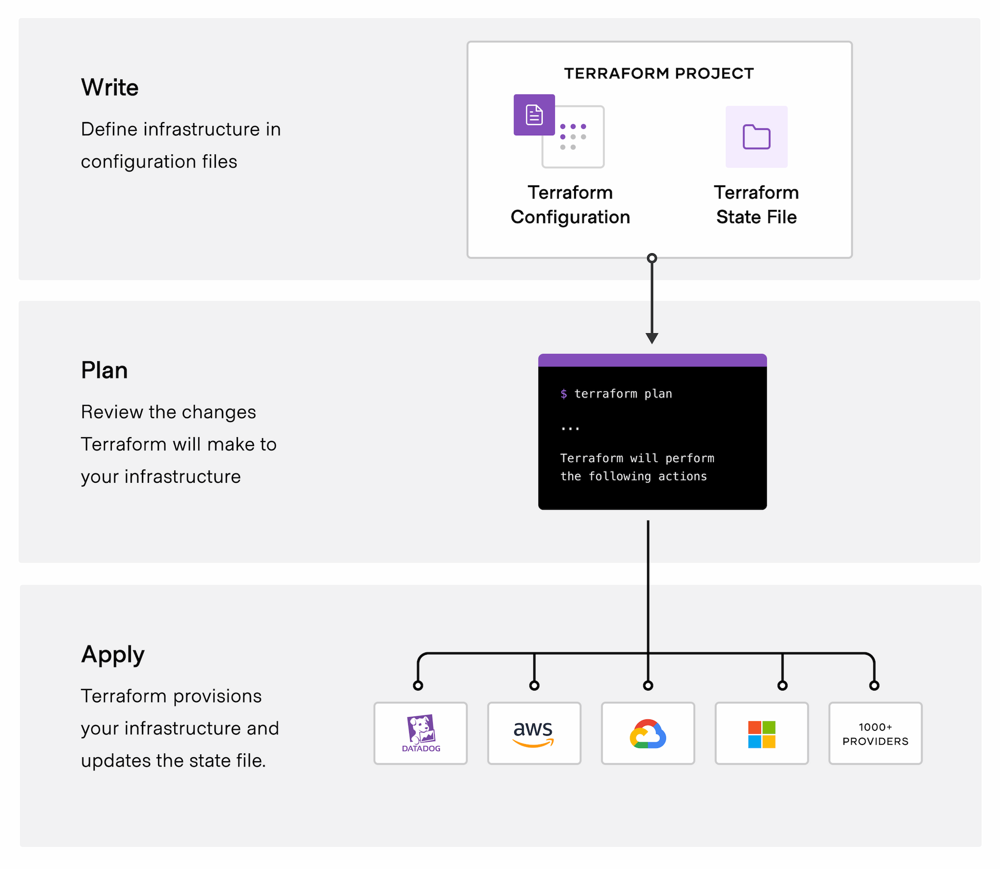

# Terraform vs Crossplane: Tạo được hạ tầng chưa có nghĩa là quản lý được hạ tầng

## Mở đầu: Tạo được hạ tầng chưa có nghĩa là quản lý được hạ tầng

Khi một dự án Cloud còn nhỏ, việc quản lý hạ tầng có thể bắt đầu bằng một quy trình tương đối đơn giản: viết Terraform để tạo VPC, subnet, security group, EC2 hoặc EKS cluster; kiểm tra kế hoạch thay đổi; sau đó áp dụng cấu hình lên AWS.

Đây là một cách tiếp cận hiệu quả. Hạ tầng được mô tả bằng code, thay đổi có thể được review thông qua Git, và quá trình triển khai có thể được tự động hóa bằng CI/CD.

Tuy nhiên, khi hệ thống phát triển, bài toán không còn dừng lại ở việc tạo tài nguyên.

Giả sử một công ty có hàng chục đội phát triển ứng dụng. Mỗi đội cần môi trường riêng, nhưng tất cả vẫn phải tuân theo những quy định chung về mạng, IAM, tagging, bảo mật và chi phí. Đội Platform Engineering muốn developer có thể tự yêu cầu môi trường mà không cần trực tiếp chỉnh sửa hàng loạt cấu hình Terraform hoặc hiểu toàn bộ kiến trúc AWS.

Sau khi môi trường được tạo, những câu hỏi khác lại xuất hiện:

- Làm thế nào để phát hiện tài nguyên bị thay đổi trực tiếp trên AWS Console?
- Làm thế nào để bảo đảm các môi trường tuân theo cùng một tiêu chuẩn?
- Khi một tài nguyên phụ thuộc vào nhiều tài nguyên khác, làm thế nào để quản lý thứ tự và thời điểm cập nhật?
- Ai có quyền yêu cầu tạo tài nguyên, và những chính sách nào phải được kiểm tra trước khi provisioning?
- Khi một dự án kết thúc, làm thế nào để xác định và dọn dẹp những tài nguyên không còn sử dụng?
- Làm thế nào để developer sử dụng hạ tầng thông qua một API hoặc giao diện đơn giản, thay vì phải biết chi tiết về từng dịch vụ Cloud?

Đây là những vấn đề liên quan đến vòng đời hạ tầng, quản trị và cách tổ chức cung cấp dịch vụ cho các đội phát triển.

Terraform có nhiều khả năng giải quyết các vấn đề này thông qua module, remote state, workflow, policy, CI/CD và các công cụ cộng tác. Crossplane tiếp cận bài toán từ một mô hình khác: đưa việc quản lý hạ tầng vào Kubernetes control plane, cung cấp API khai báo và sử dụng controller để liên tục đối chiếu trạng thái mong muốn với trạng thái thực tế.

Hai công cụ có thể giải quyết những nhu cầu liên quan, nhưng không hoàn toàn giống nhau.

Trong bài viết này, chúng ta sẽ bắt đầu bằng Terraform và thực hành tạo một EC2 instance trên AWS với nhiều thuộc tính có thể thử nghiệm. Tiếp theo, chúng ta sẽ triển khai cùng một ý tưởng bằng Crossplane, theo dõi trạng thái `Synced` và `Ready`, kiểm tra sự thay đổi cấu hình và thử nghiệm drift. Cuối cùng, chúng ta sẽ xem xét cách Terraform, Crossplane, Argo CD, Backstage và Kubernetes có thể phối hợp trong một kiến trúc Platform Engineering.

> **Lưu ý về phạm vi:** Các đoạn cấu hình dưới đây là lab hướng dẫn. Chúng chưa được chạy và xác nhận trong môi trường của tác giả. Vì vậy, bài viết không trình bày các output giả định như kết quả thực nghiệm thực tế. Những điểm phụ thuộc phiên bản, provider, quyền IAM và hành vi của AWS sẽ được chỉ rõ để người đọc có thể kiểm chứng.

---

## 1. Terraform: Quản lý hạ tầng bằng cấu hình, state và workflow

### 1.1. Terraform giải quyết bài toán gì?

Terraform là công cụ Infrastructure as Code (IaC), cho phép mô tả hạ tầng bằng cấu hình khai báo.

Thay vì phải tạo từng tài nguyên bằng AWS Console, kỹ sư định nghĩa trạng thái mong muốn trong các file cấu hình. Terraform sử dụng provider để giao tiếp với AWS, tính toán những thay đổi cần thiết và thực hiện chúng khi người dùng chấp thuận.

Ví dụ, cấu hình sau mô tả một VPC:

```hcl
resource "aws_vpc" "main" {
  cidr_block = "10.10.0.0/16"

  tags = {
    Name = "application-vpc"
  }
}
```

Đoạn code này không chỉ là một tập hợp thông số. Nó còn biểu diễn một resource mà Terraform sẽ theo dõi trong state và sử dụng trong những lần lập kế hoạch tiếp theo.

Nếu cấu hình được quản lý đúng cách trong Git, đội ngũ có thể review thay đổi, kiểm tra lịch sử và đưa quá trình provisioning vào CI/CD.

Tuy nhiên, để hiểu cách Terraform hoạt động, cần phân biệt những thành phần chính trong kiến trúc của nó.

### 1.2. Kiến trúc Terraform

Có thể chia kiến trúc Terraform thành những thành phần sau.

**Configuration**

Đây là các file HCL mô tả tài nguyên, biến, output, module và quan hệ phụ thuộc.

Ví dụ, configuration có thể khai báo rằng một môi trường cần VPC với CIDR `10.10.0.0/16`, bật DNS support và sử dụng một bộ tag nhất định.

**Terraform Core**

Terraform Core đọc configuration, kết hợp thông tin state và dữ liệu thu thập từ provider để xây dựng kế hoạch thay đổi.

Core xác định những thao tác cần thực hiện, như tạo resource mới, cập nhật thuộc tính hoặc thay thế tài nguyên.

**Provider**

Provider là phần tích hợp với hệ thống bên ngoài.

Với AWS, provider thực hiện các thao tác cần thiết thông qua AWS API. Provider cũng định nghĩa schema và hành vi quản lý của từng loại resource.

Điều này có nghĩa là hành vi khi thay đổi một thuộc tính không chỉ phụ thuộc vào HCL. Nó còn phụ thuộc vào API của AWS và cách provider triển khai resource đó.

**State**

Terraform state lưu mối liên hệ giữa các resource trong configuration và đối tượng thực tế mà Terraform quản lý. State còn chứa metadata và một số giá trị thuộc tính cần thiết cho các lần thực thi tiếp theo.

Ví dụ, resource `aws_vpc.main` có thể tương ứng với một VPC thực tế mang ID `vpc-0123456789abcdef0`.

State không phải bản sao đầy đủ của AWS account và cũng không phải danh sách mọi tài nguyên tồn tại trên AWS.

**Backend**

Backend quyết định nơi lưu state và, tùy loại backend, cách hỗ trợ cộng tác hoặc khóa state.

Khi làm việc nhóm, remote state thường phù hợp hơn việc mỗi kỹ sư lưu state ở máy riêng. Việc truy cập state cần được kiểm soát vì file này có thể chứa dữ liệu nhạy cảm.

Nếu backend hỗ trợ state locking, Terraform sử dụng cơ chế khóa để hạn chế các thao tác ghi state xung đột.

**Modules**

Module giúp đóng gói và tái sử dụng cấu hình.

Ví dụ, đội Platform có thể tạo một module VPC với những tham số được cho phép, thay vì để từng đội tự viết lại toàn bộ cấu hình mạng.

Tài liệu tham khảo:

- Terraform State: https://developer.hashicorp.com/terraform/language/state
- Purpose of Terraform State: https://developer.hashicorp.com/terraform/language/state/purpose
- State Locking: https://developer.hashicorp.com/terraform/language/state/locking

### 1.3. Workflow `init → plan → apply`

Quy trình Terraform xoay quanh ba giai đoạn: viết cấu hình, lập kế hoạch và áp dụng. Sơ đồ dưới đây (từ [tài liệu Terraform của HashiCorp](https://developer.hashicorp.com/terraform/intro)) cho thấy cấu hình và state file đi vào bước `plan`, rồi `apply` gọi các provider để tạo hạ tầng và cập nhật state.



Về mặt lệnh, quy trình thường bắt đầu bằng ba lệnh quen thuộc.

#### Bước 1: `terraform init`

```bash
terraform init
```

Terraform chuẩn bị thư mục làm việc, tải các provider cần thiết và khởi tạo backend theo cấu hình.

Đối với một dự án mới, bước này còn tạo hoặc cập nhật file `.terraform.lock.hcl` để khóa các phiên bản provider đã được lựa chọn.

File lock nên được đưa vào Git để các thành viên trong nhóm sử dụng những phiên bản provider nhất quán.

#### Bước 2: `terraform plan`

```bash
terraform plan
```

Terraform tính toán những thay đổi dự kiến dựa trên configuration, state và thông tin thu thập từ các resource mà provider có thể quan sát.

Kết quả có thể gồm:

- Tạo mới resource.
- Cập nhật resource hiện có.
- Thay thế resource.
- Xóa resource.

Đây là bước quan trọng để kỹ sư xem lại tác động trước khi thực hiện thay đổi.

Tuy nhiên, `plan` không phải cam kết rằng toàn bộ quá trình `apply` chắc chắn thành công. AWS API có thể trả về lỗi, quota có thể bị giới hạn hoặc trạng thái hạ tầng có thể thay đổi sau khi kế hoạch được lập.

#### Bước 3: `terraform apply`

```bash
terraform apply
```

Terraform thực hiện các thao tác được xác định trong kế hoạch và cập nhật state theo kết quả của quá trình quản lý tài nguyên.

Trong quy trình nhóm, đầu ra của `plan` thường được review hoặc kiểm tra bởi các bước tự động trước khi cho phép `apply`.

Để áp dụng chính xác một kế hoạch đã lưu, có thể sử dụng:

```bash
terraform plan -out=tfplan
terraform show tfplan
terraform apply tfplan
```

Lệnh cuối áp dụng kế hoạch đã lưu và không hỏi xác nhận tương tác như cách chạy `terraform apply` thông thường. Vì vậy, chỉ thực hiện sau khi đã kiểm tra kỹ kế hoạch và được chấp thuận theo quy trình của mình.

Không đưa file kế hoạch hoặc các file chứa dữ liệu nhạy cảm vào Git nếu chưa đánh giá rủi ro.

### 1.4. Terraform xử lý thay đổi và drift như thế nào?

Hãy giả sử configuration mô tả một VPC có CIDR `10.10.0.0/16`. Sau đó, kỹ sư thay đổi CIDR trong code thành `10.20.0.0/16`.

Không nên mặc định rằng Terraform sẽ cập nhật VPC tại chỗ. Với thuộc tính CIDR IPv4 chính của VPC trên AWS, thay đổi này thường yêu cầu thay thế VPC. Những tài nguyên phụ thuộc có thể chịu ảnh hưởng theo.

Đây là lý do cần đọc kỹ `terraform plan` trước khi áp dụng.

Drift là sự khác biệt giữa cấu hình mong muốn, thông tin mà Terraform theo dõi và trạng thái thực tế của tài nguyên.

Ví dụ:

1. Terraform tạo VPC với tag `Environment=dev`.
2. Một người dùng mở AWS Console và đổi tag thành `Environment=production`.
3. Trong lần chạy `terraform plan` tiếp theo, Terraform có thể phát hiện sự khác biệt và đề xuất đưa tag về giá trị được khai báo trong code.

Điểm quan trọng là Terraform không mặc định liên tục chạy lại để sửa tất cả các thay đổi ngoài luồng. Việc kiểm tra drift phải được kích hoạt thông qua `plan`, workflow định kỳ hoặc cơ chế tự động hóa phù hợp.

Terraform có thể quản lý hạ tầng quy mô lớn. Tuy nhiên, khi số lượng resource, repository, workspace và đội sử dụng tăng lên, doanh nghiệp cần thiết kế thêm cách tổ chức module, phân quyền, kiểm soát thay đổi, quản lý state và cung cấp dịch vụ self-service.

Để thấy điều này trong thực tế, hãy bắt đầu bằng một lab nhỏ.

---

## 2. Hands-on: Tạo AWS EC2 bằng Terraform

### 2.1. Mục tiêu và điều kiện

Lab này tạo một EC2 instance có cấu hình đủ phong phú để thử thay đổi nhiều thuộc tính: AMI, instance type, subnet, security group, public IP, EBS root volume, mã hóa ổ đĩa, CloudWatch detailed monitoring, IMDSv2, user data và tags.

Để tránh mở SSH ra Internet hoặc phải quản lý SSH key ngay trong lab đầu tiên, ví dụ này chỉ mở HTTP port 80 cho web server demo. Quy tắc inbound HTTP cũng được giới hạn bằng biến `allowed_http_cidr`; hãy đổi giá trị mặc định thành IP/CIDR mà bạn thực sự muốn cho phép. Không dùng `0.0.0.0/0` trong môi trường có dữ liệu hoặc dịch vụ thật.

Điều kiện:

- AWS account có quyền tạo EC2, security group, EBS volume và đọc thông tin subnet/AMI.
- AWS CLI đã cấu hình credentials.
- Terraform CLI 1.x.
- Region ví dụ: `ap-southeast-1` (Singapore).

Trước khi làm, kiểm tra danh tính AWS:

```bash
aws sts get-caller-identity
```

Xác nhận đúng account và role trước khi tạo tài nguyên. Lab có thể phát sinh chi phí EC2 và EBS. Chọn instance type phù hợp, kiểm tra AWS Free Tier/credit nếu có, và destroy sau khi thực hành.

### 2.2. Viết configuration

Tạo thư mục `terraform-ec2-lab`, sau đó tạo file `main.tf`:

```hcl
terraform {
  required_version = ">= 1.9.0, < 2.0.0"

  required_providers {
    aws = {
      source  = "hashicorp/aws"
      version = "~> 6.0"
    }
  }
}

variable "aws_region" {
  description = "AWS region for the lab"
  type        = string
  default     = "ap-southeast-1"
}

variable "allowed_http_cidr" {
  description = "CIDR allowed to reach the demo web server; replace with your trusted IP/CIDR"
  type        = string
  default     = "203.0.113.10/32"
}

provider "aws" {
  region = var.aws_region
}

# Dùng default VPC/subnet để tập trung vào EC2 properties.
data "aws_vpc" "default" {
  default = true
}

data "aws_subnets" "default" {
  filter {
    name   = "vpc-id"
    values = [data.aws_vpc.default.id]
  }
}

# Tìm Ubuntu Server 24.04 LTS AMI mới nhất do Canonical publish.
data "aws_ami" "ubuntu" {
  most_recent = true
  owners      = ["099720109477"]

  filter {
    name   = "name"
    values = ["ubuntu/images/hvm-ssd-gp3/ubuntu-noble-24.04-amd64-server-*"]
  }

  filter {
    name   = "architecture"
    values = ["x86_64"]
  }

  filter {
    name   = "virtualization-type"
    values = ["hvm"]
  }
}

resource "aws_security_group" "web" {
  name_prefix = "terraform-ec2-lab-"
  description = "Allow restricted HTTP access to the Terraform EC2 lab"
  vpc_id      = data.aws_vpc.default.id

  ingress {
    description = "HTTP from the configured trusted CIDR"
    from_port   = 80
    to_port     = 80
    protocol    = "tcp"
    cidr_blocks = [var.allowed_http_cidr]
  }

  egress {
    description = "Allow outbound traffic for package installation and responses"
    from_port   = 0
    to_port     = 0
    protocol    = "-1"
    cidr_blocks = ["0.0.0.0/0"]
  }

  tags = {
    Name      = "terraform-ec2-lab-sg"
    ManagedBy = "Terraform"
  }
}

resource "aws_instance" "web" {
  ami                         = data.aws_ami.ubuntu.id
  instance_type               = "t3.micro"
  subnet_id                   = data.aws_subnets.default.ids[0]
  vpc_security_group_ids      = [aws_security_group.web.id]
  associate_public_ip_address = true
  monitoring                  = false

  # Yêu cầu IMDSv2; hạn chế truy cập metadata bằng token bắt buộc.
  metadata_options {
    http_endpoint               = "enabled"
    http_tokens                 = "required"
    http_put_response_hop_limit = 1
  }

  # EBS root volume: gp3, 12 GiB và bật mã hóa.
  root_block_device {
    volume_type           = "gp3"
    volume_size           = 12
    encrypted             = true
    delete_on_termination = true
  }

  # Cài Nginx khi instance khởi động lần đầu.
  user_data = <<-EOF
    #!/bin/bash
    set -eux
    apt-get update
    apt-get install -y nginx
    cat > /var/www/html/index.html <<'HTML'
    <!doctype html>
    <html><head><title>Terraform EC2 Lab</title></head>
    <body><h1>Hello from Terraform-managed EC2</h1>
    <p>Try changing instance_type, volume_size, monitoring, tags or user_data.</p>
    </body></html>
    HTML
    systemctl enable --now nginx
  EOF

  tags = {
    Name        = "terraform-ec2-lab"
    Environment = "dev"
    ManagedBy   = "Terraform"
    Project     = "terraform-crossplane-comparison"
  }
}

output "instance_id" {
  description = "EC2 instance ID"
  value       = aws_instance.web.id
}

output "instance_type" {
  description = "Configured EC2 instance type"
  value       = aws_instance.web.instance_type
}

output "public_ip" {
  description = "Public IPv4 address, if assigned"
  value       = aws_instance.web.public_ip
}

output "security_group_id" {
  description = "Security group attached to the EC2 instance"
  value       = aws_security_group.web.id
}
```

**Trước khi chạy:** thay `203.0.113.10/32` bằng public IP/CIDR đáng tin cậy của bạn, ví dụ `x.x.x.x/32`. Dải `203.0.113.0/24` là dải dành cho tài liệu minh họa, không phải địa chỉ public thực tế để truy cập.

Configuration đang dùng default VPC và subnet đầu tiên được trả về. Nếu AWS account không có default VPC hoặc subnet phù hợp, hãy tạo/chọn VPC và subnet riêng, rồi chỉnh data source tương ứng. EC2 cần subnet có định tuyến và cấu hình IP phù hợp nếu bạn muốn truy cập bằng public IPv4.

### 2.3. Hiểu các thuộc tính quan trọng trước khi apply

- `ami`: image dùng để khởi động hệ điều hành. Data source tìm Ubuntu 24.04 LTS AMI mới nhất theo owner và filters.
- `instance_type = "t3.micro"`: quyết định tài nguyên CPU/RAM và ảnh hưởng chi phí. Có thể thử `t3.small` nếu region/account hỗ trợ, nhưng chi phí sẽ khác.
- `subnet_id`: xác định subnet đặt EC2. Subnet và route table ảnh hưởng khả năng truy cập mạng.
- `vpc_security_group_ids`: gắn security group; inbound rule chỉ mở HTTP theo CIDR đã cấu hình.
- `associate_public_ip_address`: yêu cầu gắn public IPv4 nếu subnet và cấu hình hỗ trợ.
- `root_block_device`: cấu hình ổ đĩa hệ điều hành. Lab dùng `gp3`, 12 GiB, mã hóa bật và xóa ổ đĩa khi terminate instance.
- `monitoring = false`: tắt detailed monitoring. Có thể thử bật `true` và xem plan; detailed monitoring có thể phát sinh chi phí.
- `metadata_options.http_tokens = "required"`: bắt buộc IMDSv2 để lấy metadata instance.
- `user_data`: script chạy khi instance khởi động lần đầu để cài Nginx. Thay user data không phải lúc nào cũng tự chạy lại script trên instance đang tồn tại.
- `tags`: metadata để phân loại, tìm kiếm, tính chi phí và xác định ownership.

Một điểm quan trọng: không phải mọi thuộc tính đều được cập nhật tại chỗ. Tùy resource schema và API của AWS, một số thay đổi có thể cập nhật instance, một số thay đổi có thể yêu cầu stop/start hoặc thay thế resource. Luôn xem `terraform plan`.

### 2.4. Kiểm tra và tạo EC2

Chạy lần lượt:

```bash
terraform fmt
terraform init
terraform validate
terraform plan -out=tfplan
terraform show tfplan
```

Đọc kỹ kế hoạch, đặc biệt là:

- AMI và instance type được chọn.
- Subnet và security group.
- Inbound HTTP CIDR có đúng không.
- EBS root volume có mã hóa và đúng dung lượng không.
- Các thao tác tạo mới, thay đổi hoặc thay thế.

Nếu kế hoạch hợp lý, áp dụng:

```bash
terraform apply tfplan
```

Xem output:

```bash
terraform output
```

Đây là các giá trị cần kiểm tra sau khi chạy, không phải output đã được xác nhận trước.

### 2.5. Xác minh trên AWS

Kiểm tra instance:

```bash
aws ec2 describe-instances \
  --region ap-southeast-1 \
  --filters "Name=tag:Name,Values=terraform-ec2-lab" \
  --query 'Reservations[].Instances[].{Id:InstanceId,State:State.Name,Type:InstanceType,AMI:ImageId,PrivateIP:PrivateIpAddress,PublicIP:PublicIpAddress,Subnet:SubnetId}' \
  --output table
```

Kiểm tra security group:

```bash
aws ec2 describe-security-groups \
  --region ap-southeast-1 \
  --filters "Name=tag:Name,Values=terraform-ec2-lab-sg" \
  --query 'SecurityGroups[].{Id:GroupId,Name:GroupName,Ingress:IpPermissions}' \
  --output json
```

Kiểm tra root EBS volume và mã hóa:

```bash
INSTANCE_ID=$(terraform output -raw instance_id)

aws ec2 describe-instances \
  --region ap-southeast-1 \
  --instance-ids "$INSTANCE_ID" \
  --query 'Reservations[].Instances[].BlockDeviceMappings[].Ebs.VolumeId' \
  --output text
```

Lấy volume ID từ output trên, rồi chạy:

```bash
aws ec2 describe-volumes \
  --region ap-southeast-1 \
  --volume-ids vol-REPLACE_WITH_REAL_VOLUME_ID \
  --query 'Volumes[].{Id:VolumeId,Size:Size,Type:VolumeType,Encrypted:Encrypted,State:State}' \
  --output table
```

Thay placeholder bằng volume ID thật. Kiểm tra cả EC2 instance state và system status checks trong AWS Console hoặc AWS CLI trước khi đánh giá user data.

Nếu instance có public IP và Nginx khởi động thành công, hãy truy cập `http://PUBLIC_IP` từ IP/CIDR được phép. Nếu không truy cập được, kiểm tra security group, route table, public IP, Network ACL, trạng thái instance và log khởi động; đừng mặc định lỗi nằm ở Terraform.

### 2.6. Thử thay đổi nhiều thuộc tính

Thực hiện từng thay đổi một để quan sát tác động riêng biệt. Sau mỗi lần sửa, chạy `terraform plan` và đọc xem Terraform đề xuất `update`, `replace` hay không có thay đổi.

**Thử nghiệm A: đổi instance type**

Đổi:

```hcl
instance_type = "t3.micro"
```

thành:

```hcl
instance_type = "t3.small"
```

Chạy `terraform plan`. Thay đổi loại instance thường có thể được thực hiện bằng stop/start hoặc thao tác cập nhật tùy loại instance và điều kiện AWS/provider. Không áp dụng mù quáng nếu instance đang chạy workload.

**Thử nghiệm B: đổi dung lượng root volume**

Đổi:

```hcl
volume_size = 12
```

thành:

```hcl
volume_size = 16
```

Chạy `terraform plan`. Tăng kích thước EBS root volume thường không giống việc thay thế toàn bộ instance, nhưng phải kiểm tra kế hoạch và tài liệu provider. Việc mở rộng filesystem trong hệ điều hành có thể là bước riêng.

**Thử nghiệm C: bật detailed monitoring**

Đổi:

```hcl
monitoring = false
```

thành:

```hcl
monitoring = true
```

Xem plan và kiểm tra tác động chi phí trước khi apply.

**Thử nghiệm D: chỉnh tags**

Đổi:

```hcl
Environment = "dev"
```

thành:

```hcl
Environment = "test"
```

Tag là cách dễ quan sát nhất để thực hành phát hiện khác biệt. Chạy plan trước khi apply.

**Thử nghiệm E: đổi IMDSv2**

Giữ `http_tokens = "required"` như hiện tại. Thử đổi `http_put_response_hop_limit` từ `1` thành `2`, rồi đọc plan. Đây là cơ hội để hiểu một thuộc tính bảo mật có tác dụng gì; không nên hạ yêu cầu IMDSv2 chỉ để làm lab tiện hơn.

**Thử nghiệm F: chỉnh user data**

Thay dòng nội dung HTML trong `user_data`, rồi chạy plan. User data thường được xử lý lúc bootstrap ban đầu; thay nội dung trong Terraform không đảm bảo script sẽ được chạy lại trên instance hiện tại. Quan sát xem provider đề xuất cập nhật hay thay thế instance và kiểm tra tài liệu trước khi apply.

### 2.7. Thử nghiệm drift

Thay đổi tag trực tiếp trên AWS mà không sửa code:

```bash
INSTANCE_ID=$(terraform output -raw instance_id)

aws ec2 create-tags \
  --region ap-southeast-1 \
  --resources "$INSTANCE_ID" \
  --tags Key=Environment,Value=manual-change
```

Sau đó chạy:

```bash
terraform plan
```

Quan sát xem Terraform phát hiện tag khác với configuration và đề xuất đưa về `Environment = "dev"` hay không. Nếu muốn khôi phục, review plan rồi mới apply.

Điểm cần rút ra: Terraform không mặc định chạy nền để liên tục sửa mọi drift. Drift được phát hiện khi workflow kiểm tra được chạy hoặc thông qua hệ thống tự động hóa định kỳ.

### 2.8. Dọn dẹp sau lab

EC2 instance và EBS volume có thể phát sinh chi phí. Khi không cần dùng nữa, chạy:

```bash
terraform destroy
```

Đọc kế hoạch xóa trước khi xác nhận. Sau đó kiểm tra instance:

```bash
aws ec2 describe-instances \
  --region ap-southeast-1 \
  --filters "Name=tag:Name,Values=terraform-ec2-lab" \
  --query 'Reservations[].Instances[].{Id:InstanceId,State:State.Name}' \
  --output table
```

Kiểm tra cả security group và EBS volume nếu còn sót. Không xóa security group nếu nó đang được tài nguyên khác sử dụng.

---

## 3. Khi IaC trở thành một phần của Platform Engineering

Terraform giải quyết tốt việc mô tả, lập kế hoạch và thay đổi hạ tầng. Tuy nhiên, một tổ chức lớn có thể cần thêm một lớp để cung cấp hạ tầng cho developer.

Hãy hình dung đội phát triển muốn tạo một môi trường cho microservice mới.

Nếu giao trực tiếp mọi chi tiết hạ tầng cho developer, họ có thể phải hiểu VPC, subnet, IAM role, security group, database, logging và tagging. Điều này không phải lúc nào cũng phù hợp với mục tiêu của một developer platform.

Đội Platform có thể đóng gói các tiêu chuẩn thành một API hoặc giao diện đơn giản hơn.

Ví dụ, thay vì yêu cầu developer tự chọn tất cả tài nguyên AWS, platform có thể cho phép họ khai báo:

```yaml
environment:
  name: payment-dev
  tier: development
  dataClassification: internal
```

Đây chỉ là ví dụ API giả định. Nó không phải tài nguyên chuẩn có sẵn của Terraform hoặc Crossplane.

Hệ thống phía sau sẽ chuyển yêu cầu thành cấu hình hạ tầng theo những quy tắc do tổ chức thiết kế.

Có nhiều cách triển khai mô hình này. Terraform vẫn có thể là công cụ provisioning bên dưới, kết hợp module, API, workflow và một developer portal.

Vậy Crossplane bổ sung điều gì?

Điểm khác biệt nằm ở việc Crossplane cho phép xây dựng control plane dựa trên Kubernetes API, trong đó resource được theo dõi và quản lý bởi các controller thay vì chỉ phụ thuộc vào những lần chạy workflow.

Trước khi đi vào lab, cần tìm hiểu cơ chế này và cách nó khác với mô hình Terraform.

---

## 4. Crossplane: Quản lý hạ tầng qua Kubernetes API và reconciliation

### 4.1. Crossplane là gì?

Crossplane là framework dùng để xây dựng cloud-native control plane. Nó mở rộng mô hình Kubernetes API và controller sang việc quản lý những tài nguyên bên ngoài Kubernetes, chẳng hạn tài nguyên AWS.

Thay vì chỉ khai báo một resource trong file Terraform rồi chạy workflow, người dùng tạo một Kubernetes custom resource. Crossplane controller quan sát resource đó, yêu cầu provider tương tác với dịch vụ bên ngoài và cập nhật trạng thái.

Sơ đồ dưới đây cho thấy Crossplane xếp chồng lên Kubernetes runtime. Kubernetes cung cấp API machinery, CRD, event, watch và reconciliation; Crossplane runtime quản lý các API bên ngoài (create/update/delete); Provider kết nối tới Cloud API; Configuration cho phép compose các API tùy chỉnh để tạo nên một platform theo domain của tổ chức.


Tài liệu chính thức:

https://docs.crossplane.io/latest/

Một điểm cần hiểu đúng: Crossplane không tự biết cách tạo mọi loại tài nguyên Cloud chỉ vì nó được cài lên Kubernetes. Nó cần provider thích hợp, API resource được hỗ trợ và cấu hình xác thực cùng quyền cần thiết.

### 4.2. Provider: Thành phần kết nối với AWS

Provider là package mở rộng Crossplane để quản lý một tập hợp tài nguyên của hệ thống bên ngoài.

Ví dụ, AWS provider có thể cung cấp các API để quản lý VPC, subnet, security group, EC2 hoặc database, tùy theo package và phiên bản được cài đặt.

Trong Crossplane v2, một số provider AWS đời mới được chia thành các package theo nhóm dịch vụ. Ví dụ, `provider-aws-ec2` cung cấp các resource thuộc phạm vi EC2 và mạng liên quan.

Điều này giúp tổ chức chỉ cài những phần cần thiết thay vì mặc định phải đưa tất cả API resource của AWS vào một cluster.

Provider cũng cần được cấu hình credentials. Việc cài đặt provider không đồng nghĩa nó đã có quyền tạo VPC trong AWS account.

Nguồn tham khảo:

https://docs.crossplane.io/v2.4/get-started/get-started-with-managed-resources/

### 4.3. Managed Resource: Đại diện cho tài nguyên bên ngoài

Managed Resource (MR) là một Kubernetes resource đại diện cho một tài nguyên bên ngoài mà Crossplane quản lý.

Ví dụ, một object có `kind: VPC` có thể đại diện cho một VPC trên AWS thông qua provider tương thích.

Resource bao gồm cấu hình mong muốn trong `spec` và trạng thái quan sát được trong `status`.

Trong lab, chúng ta sẽ sử dụng một resource VPC để quan sát mối quan hệ giữa:

- Kubernetes object được khai báo bằng YAML.
- Controller của Crossplane.
- AWS provider.
- VPC thực tế trên AWS.

Tên Kubernetes object không nhất thiết phải trùng với ID VPC trên AWS. ID bên ngoài có thể được ghi trong các trường trạng thái hoặc external-name mà provider sử dụng.

### 4.4. Reconciliation: Cơ chế đối chiếu trạng thái

Đây là một trong những khác biệt quan trọng nhất giữa Terraform và Crossplane.

Trong mô hình controller của Crossplane, hệ thống liên tục theo dõi trạng thái của resource và đối chiếu trạng thái đó với cấu hình mong muốn.

Một vòng reconciliation có thể được hình dung như sau:

1. Người dùng khai báo một VPC qua Kubernetes API.
2. Kubernetes lưu object.
3. Crossplane controller quan sát object.
4. AWS provider thực hiện các thao tác cần thiết qua AWS API.
5. Controller tiếp tục quan sát, cập nhật trạng thái và xử lý những lần reconciliation tiếp theo.

Nếu cấu hình yêu cầu một resource chưa tồn tại, provider có thể tạo tài nguyên tương ứng.

Nếu cấu hình thay đổi, controller có thể yêu cầu cập nhật hoặc thay thế tùy thuộc vào thuộc tính và khả năng của provider.

Nếu tài nguyên bên ngoài bị thay đổi, controller có thể phát hiện sự khác biệt và đưa tài nguyên trở về trạng thái được khai báo.

Tuy nhiên, reconciliation không có nghĩa mọi thay đổi sẽ được sửa ngay lập tức hoặc tất cả thuộc tính đều có thể được cập nhật tại chỗ.

Kết quả phụ thuộc vào nhiều yếu tố:

- Provider có hỗ trợ theo dõi và cập nhật thuộc tính đó hay không.
- Thuộc tính có thể thay đổi sau khi resource được tạo hay cần thay thế.
- Quyền IAM và trạng thái dịch vụ bên ngoài.
- Các management policy và cấu hình liên quan.
- Tần suất reconciliation, lỗi API và trạng thái của controller.

Crossplane sử dụng mô hình cập nhật bất đồng bộ và eventual consistency. Người dùng có thể gửi yêu cầu trước khi tài nguyên thực tế sẵn sàng, sau đó theo dõi tiến trình qua trạng thái resource.

### 4.5. `Synced` và `Ready` có ý nghĩa gì?

Khi chạy:

```bash
kubectl get vpcs
```

hoặc lệnh tương ứng với API group đã cài, output thường hiển thị các cột như `SYNCED` và `READY`.

**Synced=True**

Điều kiện này cho biết quá trình đồng bộ/reconciliation gần nhất được đánh giá là thành công theo logic của controller.

**Ready=True**

Điều kiện này cho biết resource đáp ứng tiêu chí sẵn sàng do provider hoặc controller xác định.

Hai điều kiện không giống nhau.

Resource có thể được đồng bộ thành công nhưng chưa sẵn sàng. Ngược lại, khi có lỗi IAM hoặc AWS API, trạng thái có thể phản ánh reconciliation thất bại.

Cũng không nên hiểu `Ready=True` là toàn bộ ứng dụng sử dụng VPC đang khỏe mạnh. Nó chỉ phản ánh trạng thái của resource theo những điều kiện được provider định nghĩa.

Khi kết quả không như mong đợi, nên kiểm tra:

```bash
kubectl describe vpc <resource-name>
kubectl get events -A --sort-by=.metadata.creationTimestamp
kubectl get pods -A
```

Các lệnh trên là ví dụ tổng quát. Tên resource và phạm vi namespace phải được điều chỉnh theo provider đang cài đặt.

### 4.6. XRD và Composition: Chuyển từ quản lý resource sang API cho developer

Managed Resource giúp quản lý từng tài nguyên riêng lẻ. Nhưng nếu muốn xây dựng một platform self-service, yêu cầu developer tự định nghĩa VPC, subnet, security group, IAM role và nhiều tài nguyên khác có thể vẫn quá phức tạp.

Crossplane cung cấp hai cơ chế quan trọng để xây dựng API trừu tượng.

**XRD (Composite Resource Definition)**

XRD định nghĩa schema cho một loại Composite Resource (XR) do platform thiết kế.

Ví dụ, đội Platform có thể định nghĩa API `DevelopmentEnvironment` với các tham số như tên môi trường, tier và một số tùy chọn đã được phê duyệt.

`DevelopmentEnvironment` là tên minh họa, không phải loại resource được cài sẵn trong Crossplane.

**Composition**

Composition định nghĩa cách một XR được chuyển thành một tập hợp tài nguyên bên dưới.

Một Composition có thể kết hợp nhiều Managed Resource và, khi được cấu hình phù hợp, những Kubernetes resource khác.

Các Composition Function xử lý đầu vào và xây dựng trạng thái mong muốn của các resource được tạo thông qua Composition.

Ví dụ, developer yêu cầu một môi trường development. Composition có thể ánh xạ yêu cầu thành VPC, subnet, security group và một số tài nguyên khác theo tiêu chuẩn của tổ chức.

Trong kiến trúc này, developer không nhất thiết phải tự viết YAML cho từng tài nguyên AWS. Họ sử dụng API mà đội Platform cung cấp.

Cần lưu ý Crossplane v2 có những thay đổi quan trọng về API và scope của XR so với thế hệ trước. Khi xây dựng lab Composition, phải dùng tài liệu đúng phiên bản, không sao chép YAML v1 sang v2 mà không kiểm tra.

Tài liệu chính thức:

- Compositions: https://docs.crossplane.io/v2.4/composition/compositions/
- What's New in Crossplane v2: https://docs.crossplane.io/v2.4/whats-new/

---

## 5. Hands-on: Tạo AWS EC2 bằng Crossplane

### 5.1. Mục tiêu và điều kiện

Lab này tạo một EC2 instance thông qua Crossplane, rồi theo dõi Kubernetes resource, kiểm tra trạng thái trên AWS, thử chỉnh sửa tag và quan sát hành vi khi có thay đổi ngoài luồng.

Để giữ lab tập trung vào thuộc tính EC2, ví dụ này dùng một subnet và security group đã tồn tại trong AWS account. Bạn cần lấy AMI ID Ubuntu, subnet ID và security group ID thực tế trong region `ap-southeast-1`. Security group được chọn không nên mở cổng quản trị cho toàn Internet. Ví dụ này không yêu cầu SSH; mục tiêu chính là thực hành provisioning và cấu hình.

Bộ phiên bản Crossplane/provider được nêu ở các phần trước chỉ là mốc tham khảo. Trước khi chạy, hãy kiểm tra package, API group, resource scope và schema tương ứng với provider thực tế của bạn.

### 5.2. Chuẩn bị các giá trị AWS

Kiểm tra danh tính:

```bash
aws sts get-caller-identity
```

Tìm AMI Ubuntu 24.04 LTS do Canonical publish:

```bash
aws ec2 describe-images \
  --region ap-southeast-1 \
  --owners 099720109477 \
  --filters \
    'Name=name,Values=ubuntu/images/hvm-ssd-gp3/ubuntu-noble-24.04-amd64-server-*' \
    'Name=architecture,Values=x86_64' \
    'Name=virtualization-type,Values=hvm' \
  --query 'Images | sort_by(@, &CreationDate)[-1].{ImageId:ImageId,Name:Name,CreationDate:CreationDate}' \
  --output table
```

Lưu lại `ImageId` thực tế. Lấy danh sách subnet và security group trong VPC bạn định dùng:

```bash
aws ec2 describe-subnets \
  --region ap-southeast-1 \
  --query 'Subnets[].{SubnetId:SubnetId,VpcId:VpcId,AZ:AvailabilityZone,DefaultForAZ:DefaultForAz,MapPublicIP:MapPublicIpOnLaunch}' \
  --output table
```

```bash
aws ec2 describe-security-groups \
  --region ap-southeast-1 \
  --query 'SecurityGroups[].{GroupId:GroupId,Name:GroupName,VpcId:VpcId}' \
  --output table
```

Chọn subnet và security group thuộc cùng VPC. Nếu muốn dùng public IP, subnet cần có route phù hợp và cho phép gán public IPv4. Không chọn security group có quyền truy cập rộng ngoài nhu cầu.

### 5.3. Cài đặt hoặc kiểm tra Crossplane và provider

Nếu đã có Crossplane, kiểm tra trạng thái trước:

```bash
kubectl get nodes
kubectl get pods -A
kubectl get providers
```

Nếu bắt đầu từ cluster mới, cài Crossplane theo tài liệu đúng phiên bản. Không chạy lệnh cài đặt mới lên cluster do hệ thống khác quản lý mà chưa kiểm tra cách triển khai hiện tại.

Tạo file `provider.yaml` với package tham chiếu dưới đây. Kiểm tra lại version tại thời điểm chạy; không mặc định package này luôn là bản mới nhất.

```yaml
apiVersion: pkg.crossplane.io/v1
kind: Provider
metadata:
  name: upbound-provider-aws-ec2
spec:
  package: xpkg.upbound.io/upbound/provider-aws-ec2:v2.9.3
```

Áp dụng provider, rồi đợi đến khi báo healthy:

```bash
kubectl apply -f provider.yaml
kubectl get providers
```

Kiểm tra API resource đã được cài:

```bash
kubectl api-resources | grep -i instance
```

### 5.4. Cấu hình xác thực AWS

Provider cần credentials hoặc workload identity có quyền phù hợp để tạo, đọc, cập nhật và xóa EC2 instance. Trong môi trường doanh nghiệp, ưu tiên cơ chế IAM role/workload identity phù hợp với nền tảng. Với lab cá nhân, nếu dùng Secret thì không đưa credentials vào Git, không dùng access key của root và xóa Secret sau khi hoàn thành.

Với lab dùng credentials dạng file, có thể tạo file `aws-credentials.ini` (không commit file này vào Git):

```ini
[default]
aws_access_key_id = REPLACE_WITH_ACCESS_KEY
aws_secret_access_key = REPLACE_WITH_SECRET_KEY
```

Tạo Kubernetes Secret:

```bash
kubectl create secret generic aws-secret \
  --namespace=crossplane-system \
  --from-file=creds=./aws-credentials.ini
```

Tạo file `providerconfig.yaml` theo API của package tham chiếu:

```yaml
apiVersion: aws.m.upbound.io/v1beta1
kind: ClusterProviderConfig
metadata:
  name: default
spec:
  credentials:
    source: Secret
    secretRef:
      namespace: crossplane-system
      name: aws-secret
      key: creds
```

Áp dụng:

```bash
kubectl apply -f providerconfig.yaml
kubectl get clusterproviderconfigs
```

Nếu API resource hoặc schema không khớp, hãy kiểm tra tài liệu và CRD của đúng package/version. Sau khi cấu hình, xác minh provider controller có thể xác thực AWS thông qua logs/events; `aws sts get-caller-identity` ở terminal chỉ xác nhận credentials của AWS CLI, không chứng minh provider pod dùng cùng credentials.

### 5.5. Khai báo EC2 instance

Tạo file `instance.yaml`. Thay các giá trị `ami-REPLACE_WITH_REAL_AMI_ID`, `subnet-REPLACE_WITH_REAL_SUBNET_ID` và `sg-REPLACE_WITH_REAL_SECURITY_GROUP_ID` bằng giá trị thật đã lấy ở bước 5.2. Kiểm tra schema của provider để xác nhận các trường có đúng kiểu dữ liệu.

```yaml
apiVersion: ec2.aws.m.upbound.io/v1beta1
kind: Instance
metadata:
  name: crossplane-ec2-lab
spec:
  forProvider:
    region: ap-southeast-1
    ami: ami-REPLACE_WITH_REAL_AMI_ID
    instanceType: t3.micro
    subnetId: subnet-REPLACE_WITH_REAL_SUBNET_ID
    vpcSecurityGroupIds:
      - sg-REPLACE_WITH_REAL_SECURITY_GROUP_ID
    associatePublicIpAddress: false
    monitoring: false
    metadataOptions:
      - httpEndpoint: enabled
        httpTokens: required
        httpPutResponseHopLimit: 1
    rootBlockDevice:
      - volumeType: gp3
        volumeSize: 12
        encrypted: true
        deleteOnTermination: true
    tags:
      Name: crossplane-ec2-lab
      Environment: dev
      ManagedBy: Crossplane
      Project: terraform-crossplane-comparison
  providerConfigRef:
    name: default
```

> **Quan trọng:** Đây là ví dụ theo schema provider đã chọn làm mốc, chưa được kiểm thử end-to-end. Một số phiên bản provider có thể dùng API group, scope hoặc kiểu lồng `rootBlockDevice`/`metadataOptions` khác.

Trước khi apply, kiểm tra:

```bash
kubectl api-resources | grep -i instance
kubectl explain instance.spec.forProvider --api-version=ec2.aws.m.upbound.io/v1beta1
```

Nếu API group hoặc schema không khớp, dùng API version và trường đúng theo provider đã cài thay vì cố áp dụng YAML này.

Các thuộc tính trong manifest tương ứng với những khái niệm sau:

- `ami`: image của hệ điều hành.
- `instanceType`: CPU/RAM và loại instance.
- `subnetId`: subnet đặt instance.
- `vpcSecurityGroupIds`: security group gắn với instance.
- `associatePublicIpAddress`: có yêu cầu gán public IPv4 hay không.
- `monitoring`: detailed monitoring.
- `metadataOptions`: cấu hình Instance Metadata Service, trong đó `httpTokens: required` yêu cầu IMDSv2.
- `rootBlockDevice`: loại, dung lượng, mã hóa và hành vi xóa root volume.
- `tags`: metadata dùng để tìm kiếm, phân loại và quản lý ownership.

### 5.6. Apply và theo dõi reconciliation

Áp dụng manifest:

```bash
kubectl apply -f instance.yaml
```

Lệnh này tạo Kubernetes object; nó không đảm bảo EC2 đã sẵn sàng ngay lập tức.

Kiểm tra resource bằng API group thực tế đã cài. Ví dụ:

```bash
kubectl get instances.ec2.aws.m.upbound.io
kubectl describe instance.ec2.aws.m.upbound.io crossplane-ec2-lab
kubectl get instance.ec2.aws.m.upbound.io crossplane-ec2-lab -o yaml
```

Nếu provider dùng API group khác, thay tên resource tương ứng. Đọc `SYNCED`, `READY`, `conditions`, `events` và `status.atProvider` nếu những trường đó được schema cung cấp.

Khi chưa thành công, kiểm tra events và provider logs:

```bash
kubectl get events -A --sort-by=.metadata.creationTimestamp
kubectl get pods -n crossplane-system
kubectl logs -n crossplane-system <provider-pod-name> --all-containers=true --since=10m
```

Các nguyên nhân thường gặp gồm AMI ID không hợp lệ, subnet và security group không cùng VPC, thiếu IAM permission, credentials sai, API group/schema không khớp, instance type không được hỗ trợ ở Availability Zone hoặc giới hạn quota.

### 5.7. Xác minh EC2 trên AWS

Kiểm tra instance theo tag:

```bash
aws ec2 describe-instances \
  --region ap-southeast-1 \
  --filters "Name=tag:Name,Values=crossplane-ec2-lab" \
  --query 'Reservations[].Instances[].{Id:InstanceId,State:State.Name,Type:InstanceType,AMI:ImageId,PrivateIP:PrivateIpAddress,PublicIP:PublicIpAddress,Subnet:SubnetId}' \
  --output table
```

Đối chiếu kết quả AWS với Kubernetes resource. Chỉ ghi lab là thành công sau khi kiểm tra được instance ID, state và cấu hình thực tế.

### 5.8. Thử thay đổi thuộc tính

Thực hiện từng thay đổi một. Sau mỗi lần, `kubectl apply -f instance.yaml`, rồi theo dõi `describe`, conditions và cấu hình trên AWS.

**Thử nghiệm A: đổi instance type**

```yaml
instanceType: t3.small
```

Quan sát cách provider xử lý thay đổi. Đừng giả định mọi thay đổi instance type đều có cùng hành vi với mọi loại instance.

**Thử nghiệm B: đổi root volume size**

```yaml
volumeSize: 16
```

Xác minh kích thước EBS thực tế. Tăng EBS volume và mở rộng filesystem trong hệ điều hành có thể là hai việc riêng biệt.

**Thử nghiệm C: bật detailed monitoring**

```yaml
monitoring: true
```

Kiểm tra plan tương đương không có sẵn như Terraform; thay vào đó theo dõi reconciliation và AWS API. Detailed monitoring có thể phát sinh chi phí.

**Thử nghiệm D: đổi tag**

```yaml
Environment: test
```

Đây là thử nghiệm dễ quan sát để hiểu cách provider cập nhật thuộc tính được quản lý.

**Thử nghiệm E: đổi public IP hoặc metadata options**

Thử thay `associatePublicIpAddress` hoặc `httpPutResponseHopLimit`, nhưng hãy đọc schema và kế hoạch thay đổi theo provider trước. Không tắt yêu cầu IMDSv2 chỉ để tiện kiểm thử.

### 5.9. Thử nghiệm drift

Thay đổi tag trực tiếp trên AWS:

```bash
INSTANCE_ID=$(aws ec2 describe-instances \
  --region ap-southeast-1 \
  --filters "Name=tag:Name,Values=crossplane-ec2-lab" \
  --query 'Reservations[].Instances[0].InstanceId' \
  --output text)

aws ec2 create-tags \
  --region ap-southeast-1 \
  --resources "$INSTANCE_ID" \
  --tags Key=Environment,Value=manual-change
```

Kiểm tra tag trực tiếp trên AWS, rồi theo dõi Crossplane qua các lần reconciliation tiếp theo. Xác minh xem tag có trở về giá trị được khai báo hay không. Hành vi phụ thuộc provider, thuộc tính và management policy; không nên khẳng định mọi drift đều được tự sửa.

Ghi lại thời điểm thay đổi, conditions, events và kết quả AWS thật. Nếu không thấy tag quay lại, điều tra provider schema, management policy và logs thay vì kết luận ngay rằng reconciliation không hoạt động.

### 5.10. Dọn dẹp sau lab

Trước khi xóa, xác nhận instance chỉ thuộc lab này. Xóa Managed Resource:

```bash
kubectl delete -f instance.yaml
```

Theo dõi quá trình xóa và xác minh trên AWS:

```bash
aws ec2 describe-instances \
  --region ap-southeast-1 \
  --filters "Name=tag:Name,Values=crossplane-ec2-lab" \
  --query 'Reservations[].Instances[].{Id:InstanceId,State:State.Name}' \
  --output table
```

Crossplane có thể xóa tài nguyên bên ngoài khi Managed Resource bị xóa, tùy management policy và cấu hình deletion policy. Đừng gỡ provider hoặc tắt controller trước khi xác minh vòng đời resource đã hoàn tất. Kiểm tra cả EBS volume, security group và những tài nguyên phụ trợ trước khi kết thúc lab.

#### Những gì lab chứng minh và chưa chứng minh

Nếu chạy thành công, lab có thể minh họa cách khai báo EC2 qua Kubernetes API, theo dõi reconciliation, quan sát nhiều thuộc tính của instance và thử nghiệm thay đổi/drift. Lab này chưa chứng minh Crossplane tốt hơn Terraform trong production, cũng chưa thể hiện đầy đủ lợi ích của XRD và Composition vì mới quản lý một instance đơn lẻ.

---

## 6. Bằng chứng công khai từ doanh nghiệp: Họ thực sự đã làm gì?

Một phép so sánh đáng tin cậy cần dựa trên những trường hợp có nguồn kiểm tra được. Những trường hợp dưới đây cho thấy các doanh nghiệp đã tiếp cận bài toán quản lý hạ tầng ở quy mô lớn như thế nào, nhưng chúng không phải các benchmark được đo trong cùng một điều kiện.

### 6.1. Wayfair: Terraform và Backstage trong mô hình self-service

Trong bài trình bày được HashiCorp công bố tháng 12/2023, Wayfair mô tả việc xây dựng nền tảng nội bộ dựa trên Terraform Enterprise và Google Cloud.

Theo nội dung được trình bày, Wayfair có hơn 2.000 kỹ sư vào cuối năm 2022. Đội kỹ thuật xây dựng một quy trình provisioning trong đó người dùng có thể điền biểu mẫu trên Backstage. Phía backend gọi Terraform Enterprise API để tạo workspace, cấu hình module và biến phù hợp với yêu cầu.

Nguồn:

https://www.hashicorp.com/en/resources/transforming-access-to-cloud-infrastructure-at-wayfair-with-terraform-enterprise

Trường hợp này cho thấy Terraform có thể đóng vai trò là công cụ IaC bên dưới một developer platform. Developer không nhất thiết phải thao tác trực tiếp với toàn bộ quy trình Terraform.

Wayfair cũng chia sẻ những khó khăn vận hành. Một môi trường có thể quản lý hàng trăm resource và mất khoảng 10–15 phút cho lần provisioning ban đầu trong ví dụ họ trình bày. Quản lý hàng trăm workspace, quyền truy cập, quota, thời gian chạy và các lỗi giữa chuỗi dependency tiếp tục là những vấn đề cần thiết kế và tự động hóa.

**Điều có thể kết luận:** Terraform có thể tham gia vào mô hình self-service cùng Backstage.

**Điều không thể kết luận:** Wayfair đã chuyển sang Crossplane hoặc Terraform không thể đáp ứng platform engineering. Nguồn trên mô tả một mô hình dựa trên Terraform Enterprise và Google Cloud.

### 6.2. Starbucks: Chuẩn hóa module và workflow triển khai

Trong bài chia sẻ *Terraform at Starbucks: Infrastructure as Code for Software Engineers*, được HashiCorp công bố ngày 27/09/2019, đội Cloud Foundation Services của Starbucks mô tả quá trình phát triển nền tảng IaC nội bộ.

Nguồn:

https://www.hashicorp.com/en/resources/terraform-at-starbucks-infrastructure-as-code-for-software-engineers

Trong giai đoạn đầu, họ chia các thành phần hạ tầng và môi trường ra nhiều repository. Cách tổ chức này giúp nhận diện thành phần và môi trường tương đối rõ ràng, nhưng đồng thời tạo ra công việc lặp lại và sự khác biệt giữa các môi trường.

Đội ngũ tiếp tục hướng tới module hóa, chuẩn hóa cấu hình và xây dựng pipeline cho hạ tầng. Họ mô tả workflow theo hướng build, test, promote và deploy qua những giai đoạn khác nhau, có bước kiểm tra và phê duyệt trước khi áp dụng thay đổi.

Trường hợp này nhấn mạnh một vấn đề thường bị bỏ qua: sử dụng IaC không tự động bảo đảm tất cả môi trường đồng nhất. Cấu trúc repository, cách phát hành module, kiểm thử, phê duyệt và triển khai vẫn cần được thiết kế.

**Điều có thể kết luận:** Starbucks từng công khai chia sẻ việc sử dụng Terraform và Vault, đồng thời phát triển các quy trình để chuẩn hóa, kiểm thử và tự động hóa hạ tầng.

**Điều không thể kết luận:** Bài trình bày năm 2019 xác nhận toàn bộ kiến trúc hiện tại của Starbucks hoặc chứng minh Terraform phù hợp hơn Crossplane trong mọi trường hợp.

### 6.3. Deutsche Kreditbank (DKB): Crossplane trong bối cảnh nhiều dependency

Bài viết của TechTarget ngày 28/06/2023, *Banks dump Terraform for Crossplane infrastructure as code*, thuật lại kinh nghiệm của Deutsche Kreditbank và Millennium BCP khi chuyển đổi cách quản lý hạ tầng.

Nguồn:

https://www.techtarget.com/it-infrastructure/news/366543172/Banks-dump-Terraform-for-Crossplane-infrastructure-as-code

Theo bài viết, Christopher Haar, lead cloud engineer tại DKB, mô tả những khó khăn trong môi trường có nhiều tài nguyên mạng AWS liên kết với nhau, như VPC, VPN và Transit Gateway. Đội kỹ thuật gặp tình huống thay đổi phụ thuộc vào nhiều stack, cần xử lý thủ công thứ tự cập nhật và có thể mất nhiều thời gian để hoàn tất provisioning.

Họ lựa chọn Crossplane trong bối cảnh phần lớn môi trường đã sử dụng Kubernetes và đội ngũ quen với mô hình control plane. Bài báo thuật lại rằng thời gian tạo cluster của DKB đã giảm từ nhiều tuần xuống dưới một giờ trong bối cảnh được mô tả.

Đây là một kết quả đáng chú ý, nhưng phải đọc đúng phạm vi. Bài viết không phải benchmark độc lập so sánh hai công cụ trên cùng một hệ thống, cùng số lượng resource và cùng workflow. Kết quả phản ánh bối cảnh kiến trúc, vấn đề vận hành và quá trình chuyển đổi của đội ngũ đó.

Bài viết cũng ghi nhận quá trình chuyển đổi không đơn giản: đội ngũ DKB phải giải quyết những thay đổi về Kubernetes, networking và provider.

**Điều có thể kết luận:** DKB đã công khai chia sẻ lý do họ chọn Crossplane trong bối cảnh nhiều dependency và nhu cầu reconciliation bất đồng bộ.

**Điều không thể kết luận:** Crossplane luôn provisioning nhanh hơn Terraform hoặc mọi tổ chức lớn nên thay Terraform bằng Crossplane.

### 6.4. Millennium BCP: Chuyển đổi không nhất thiết diễn ra ngay lập tức

Bài báo TechTarget cũng mô tả trường hợp Millennium BCP ở Bồ Đào Nha.

Theo bài viết, đội ngũ của ngân hàng từng dùng Crossplane để quản lý quá trình reconciliation cho một lượng lớn cấu hình Terraform, bao gồm khoảng 170.000 dòng code. Họ có workflow kiểm tra và reconciliation theo chu kỳ bốn giờ trước khi tiếp tục hướng tới việc chuyển đổi mô hình.

Trường hợp này cho thấy việc thay đổi cách quản lý hạ tầng có thể là quá trình nhiều giai đoạn. Doanh nghiệp có thể phải quản lý hiện trạng, bảo đảm khả năng vận hành và tạo lộ trình chuyển đổi trước khi thay đổi hoàn toàn cách cung cấp hạ tầng.

Điều quan trọng không phải là một công cụ thắng công cụ còn lại. Điều quan trọng là mô hình quản lý mới phải giải quyết được những khó khăn hiện tại mà không tạo ra rủi ro lớn hơn trong quá trình chuyển đổi.

#### Nhìn chung, các dẫn chứng này nói lên điều gì?

Wayfair cho thấy Terraform có thể nằm bên dưới một quy trình self-service. Starbucks cho thấy chuẩn hóa module và workflow là một phần quan trọng của IaC. DKB cho thấy reconciliation có thể hữu ích trong một hệ thống Kubernetes-centric có nhiều dependency. Millennium BCP minh họa rằng chuyển đổi có thể diễn ra qua nhiều bước.

Đây là các trường hợp được công bố ở những thời điểm và bối cảnh khác nhau. Chúng không thể thay thế cho việc đánh giá yêu cầu của một tổ chức cụ thể.

---

## 7. Terraform, Crossplane, Argo CD, Backstage và Kubernetes trong một kiến trúc tham khảo

Khi tìm hiểu Platform Engineering, cần phân biệt trách nhiệm của từng công cụ. Việc chúng cùng xuất hiện trong một kiến trúc không có nghĩa chúng thay thế nhau hoặc mặc định phải sử dụng tất cả.

### 7.1. Vai trò của từng thành phần

**Terraform: Provisioning và quản lý vòng đời hạ tầng theo workflow**

Có thể dùng Terraform để triển khai nền tảng ban đầu, chẳng hạn VPC nền tảng, EKS cluster, IAM role và các thành phần cần thiết để vận hành control plane.

Terraform cũng có thể tiếp tục quản lý các resource độc lập có vòng đời phù hợp với workflow plan/apply.

**Crossplane: Control plane cho tài nguyên được cung cấp thông qua Kubernetes API**

Crossplane có thể cung cấp API hạ tầng cho các đội phát triển thông qua Managed Resource, XRD và Composition.

Developer có thể yêu cầu môi trường hoặc dịch vụ theo những tham số do đội Platform định nghĩa. Controller quản lý các resource được Crossplane giao trách nhiệm.

**Argo CD: Đồng bộ cấu hình Kubernetes từ Git**

Argo CD theo dõi cấu hình Kubernetes trong Git và đồng bộ trạng thái cluster theo mô hình GitOps.

Argo CD không trực tiếp thay thế Terraform để quản lý mọi resource AWS. Trong mô hình kết hợp, Argo CD có thể triển khai các manifest Crossplane, provider configuration và những Kubernetes resource liên quan. Sau đó, Crossplane quản lý tài nguyên Cloud mà các manifest đó đại diện.

**Backstage: Developer portal**

Backstage cung cấp giao diện để developer khám phá dịch vụ, sử dụng template và khởi tạo workflow.

Backstage không phải controller tự quản lý vòng đời VPC. Nó có thể kết nối với hệ thống Git, API hoặc workflow provisioning để chuyển yêu cầu của người dùng thành thay đổi có kiểm soát.

**Kubernetes: Nền tảng API và runtime**

Kubernetes cung cấp API server, cơ chế lưu trữ resource và runtime để chạy Crossplane cùng các controller liên quan.

Trong kiến trúc này, Kubernetes không chỉ chạy workload ứng dụng; nó còn là nền tảng control plane mà Crossplane mở rộng.

### 7.2. Luồng hoạt động đề xuất

Có thể mô tả một kiến trúc tham khảo bằng sơ đồ sau:

```text
                   Developer
                       |
                       v
                   Backstage
                       |
             Submit request / PR
                       |
                       v
                 Git Repository
                       |
                       v
                    Argo CD
                       |
             Sync Kubernetes YAML
                       |
                       v
              Kubernetes API Server
                       |
                       v
                   Crossplane
                       |
               Composition / MR
                       |
                       v
                 AWS Provider
                       |
                       v
                    AWS API
                       |
                       v
             VPC / Subnet / Database
```

Terraform có thể nằm ở giai đoạn bootstrap hoặc quản lý các phần hạ tầng có chủ sở hữu riêng:

```text
Terraform
    |
    +--> Base Networking
    |
    +--> EKS Cluster
    |
    +--> Base IAM / Platform Prerequisites
                  |
                  v
           Kubernetes Cluster
                  |
             Crossplane
                  |
          Team-owned Cloud Resources
```

Đây là kiến trúc đề xuất để minh họa cách phân chia trách nhiệm. Nó không phải sơ đồ kiến trúc được xác nhận của Wayfair, Starbucks hay DKB.

### 7.3. Ranh giới sở hữu resource là điều bắt buộc

Giả sử Terraform đang quản lý một VPC thông qua state của nó. Nếu đồng thời khai báo một Managed Resource Crossplane cho cùng VPC đó mà không có chiến lược chuyển giao quyền quản lý, hai công cụ có thể đưa ra những quyết định không thống nhất.

Terraform có state và workflow thay đổi riêng. Crossplane có object mong muốn và controller reconciliation riêng.

Một bên có thể đề xuất sửa hoặc thay thế resource trong khi bên còn lại tiếp tục điều chỉnh trạng thái bên ngoài. Rủi ro này không biến mất chỉ vì cả hai công cụ cùng sử dụng cấu hình khai báo.

Vì vậy, trong một kiến trúc kết hợp, cần xác định rõ:

- Công cụ nào là chủ sở hữu của từng resource.
- State và cấu hình mong muốn được quản lý ở đâu.
- Công cụ nào được quyền cập nhật hoặc xóa resource.
- Quy trình import hoặc chuyển giao quyền sở hữu nếu cần migration.
- Cơ chế kiểm tra, phê duyệt và rollback khi thay đổi.
- Cách xử lý resource bị bỏ quên hoặc không còn được quản lý.

Một ranh giới đơn giản có thể là Terraform sở hữu EKS cluster và hạ tầng nền tảng, trong khi Crossplane sở hữu các database hoặc mạng riêng được yêu cầu thông qua platform API.

Đây chỉ là một ví dụ. Ranh giới thực tế cần dựa vào phụ thuộc, vòng đời và năng lực vận hành của đội ngũ.

### 7.4. GitOps không đồng nghĩa với việc mọi thứ đều tự động an toàn

Khi sử dụng Argo CD để quản lý Crossplane manifest, cần chú ý đến hành vi pruning.

Nếu một Managed Resource bị xóa khỏi Git và Argo CD được cấu hình tự động prune, Kubernetes object có thể bị xóa. Nếu resource đó cho phép Crossplane xóa tài nguyên bên ngoài, việc pruning có thể dẫn đến xóa tài nguyên AWS.

Vì vậy, cần thiết kế chính sách bảo vệ, quy trình review và cơ chế xác nhận trước khi xóa những resource có ảnh hưởng lớn.

Tương tự, việc Backstage cung cấp một giao diện thuận tiện không có nghĩa mọi yêu cầu của developer đều nên được chấp thuận. Platform vẫn cần kiểm tra quyền, giới hạn cấu hình được phép, ownership, quota, policy và vòng đời resource.

Mục tiêu của Platform Engineering không phải loại bỏ mọi kiểm soát. Mục tiêu là biến các kiểm soát cần thiết thành một quy trình sử dụng thuận tiện, nhất quán và có thể quan sát.

---

## 8. So sánh Terraform và Crossplane theo mô hình vận hành

| Tiêu chí | Terraform | Crossplane |
|---|---|---|
| Mô hình thực thi | Workflow dựa trên cấu hình, plan và apply | Controller liên tục đối chiếu trạng thái mong muốn với trạng thái quan sát được |
| Nơi mô tả trạng thái mong muốn | Configuration HCL | Kubernetes custom resources và cấu hình liên quan |
| Cách theo dõi resource | State ánh xạ resource trong code tới đối tượng thực tế và lưu metadata | Kubernetes object, status và thông tin do provider ghi nhận |
| Drift | Có thể phát hiện khi chạy plan hoặc qua workflow định kỳ | Có thể phát hiện và xử lý qua reconciliation, tùy thuộc provider và thuộc tính |
| Thay đổi hạ tầng | Kế hoạch thể hiện thao tác dự kiến; cần review trước khi áp dụng | Controller xử lý bất đồng bộ; cần theo dõi trạng thái và kết quả thực tế |
| Dependency | Xây dựng dependency graph để xác định thứ tự thực thi | Dựa trên tham chiếu resource, quan hệ và reconciliation; không có nghĩa mọi dependency tự giải quyết thành công |
| API cho developer | Có thể xây dựng qua module, workflow, API hoặc portal | Có thể xây dựng trực tiếp trên Kubernetes API thông qua XRD và Composition |
| Self-service | Cần thiết kế workflow và giao diện phù hợp; module và policy có thể hỗ trợ | Có thể cung cấp API trừu tượng, nhưng vẫn cần thiết kế, phân quyền và vận hành control plane |
| Yêu cầu nền tảng | Terraform CLI hoặc dịch vụ thực thi, backend và hệ thống CI/CD phù hợp | Kubernetes cluster, Crossplane, provider, API resources và hạ tầng vận hành controller |
| Vấn đề cần quản lý | State, backend, locking, workflow, module, policy và vòng đời resource | Controller, provider, CRD, version tương thích, reconciliation, quyền truy cập và vòng đời resource |
| Khi nào đáng cân nhắc | Khi cần workflow IaC rõ ràng, kế hoạch thay đổi có thể review và hệ sinh thái module/provider | Khi muốn xây dựng control plane dựa trên Kubernetes API và cung cấp hạ tầng qua API trừu tượng |

Bảng này mô tả sự khác biệt về mô hình vận hành, không phải bảng xếp hạng chất lượng.

Crossplane không làm mất đi nhu cầu quản lý dependency hoặc hiểu hành vi của provider. Terraform cũng không bị giới hạn ở một quy trình chạy thủ công; nó có thể được tự động hóa thông qua CI/CD, dịch vụ cộng tác, policy và các hệ thống self-service.

### 8.1. Khi nào nên chọn Terraform?

Terraform thường là lựa chọn hợp lý khi tổ chức cần:

- Quản lý tài nguyên bằng workflow có bước lập kế hoạch và review.
- Chuẩn hóa cấu hình thông qua module.
- Tổ chức quyền truy cập và state theo team hoặc hệ thống.
- Tích hợp IaC vào pipeline hiện có.
- Cung cấp hạ tầng self-service thông qua một lớp API hoặc portal.
- Quản lý hạ tầng mà không muốn đưa toàn bộ vòng đời Cloud vào Kubernetes control plane.

Nếu nhu cầu hiện tại có thể được đáp ứng tốt bằng Terraform, remote state, CI/CD, policy và module, việc chuyển sang Crossplane không mặc định đem lại lợi ích.

### 8.2. Khi nào nên cân nhắc Crossplane?

Crossplane đáng cân nhắc khi tổ chức muốn:

- Cung cấp hạ tầng thông qua Kubernetes API.
- Xây dựng API trừu tượng dành cho developer.
- Dùng controller reconciliation để quản lý trạng thái resource theo thời gian.
- Kết hợp việc cung cấp tài nguyên Cloud với mô hình control plane của Kubernetes.
- Quản lý nhiều dịch vụ và tài nguyên liên kết theo những API nền tảng do đội Platform thiết kế.

Tuy nhiên, những lợi ích này đi kèm chi phí vận hành. Đội ngũ cần hiểu Kubernetes, CRD, provider, quyền truy cập, khả năng tương thích giữa phiên bản và quá trình điều tra lỗi reconciliation.

Crossplane không tự biến một nhóm kỹ sư thành Platform Engineering team. Việc thiết kế API, tiêu chuẩn hóa cấu hình, quan sát trạng thái, hỗ trợ người dùng và xử lý vòng đời tài nguyên vẫn là công việc kỹ thuật thực sự.

### 8.3. Có nên kết hợp cả hai?

Có thể, nếu mỗi công cụ có phạm vi quản lý rõ ràng.

Ví dụ:

- Terraform quản lý hạ tầng nền tảng và cluster.
- Crossplane cung cấp API self-service cho một số loại resource Cloud.
- Argo CD triển khai các manifest và cấu hình Kubernetes từ Git.
- Backstage là giao diện developer sử dụng để khám phá dịch vụ hoặc khởi tạo yêu cầu.
- Kubernetes cung cấp runtime và API cho control plane.

Điều kiện quan trọng nhất là không để Terraform và Crossplane cùng quản lý một resource theo hai nguồn cấu hình độc lập.

Ngoài ra, tổ chức cần đánh giá năng lực vận hành, mức độ phức tạp của việc chuyển đổi và lợi ích thực tế trước khi đưa thêm công cụ vào kiến trúc.

---

## 9. Kết luận: Khác biệt nằm ở mô hình quản lý, không chỉ ở cú pháp

Terraform và Crossplane đều hướng tới việc quản lý hạ tầng bằng cách khai báo trạng thái mong muốn, nhưng chúng tổ chức quá trình quản lý theo những mô hình khác nhau.

Terraform lấy configuration, state và workflow plan/apply làm nền tảng. Mô hình này rất phù hợp khi tổ chức cần kiểm soát, review và thực hiện các thay đổi hạ tầng qua những lần chạy có chủ đích.

Crossplane đưa việc quản lý resource vào Kubernetes API và controller reconciliation. Mô hình này phù hợp để nghiên cứu và xây dựng control plane, đặc biệt khi doanh nghiệp muốn cung cấp API hạ tầng trừu tượng cho nhiều đội phát triển.

Các trường hợp công khai của Wayfair, Starbucks, DKB và Millennium BCP cho thấy doanh nghiệp phải giải quyết nhiều bài toán ngoài việc tạo tài nguyên: workflow, dependency, chuẩn hóa, self-service và vòng đời vận hành. Tuy nhiên, chúng không chứng minh một công cụ luôn tốt hơn công cụ còn lại.

Bài học quan trọng nhất là cần bắt đầu từ mô hình vận hành mà tổ chức muốn xây dựng.

Nếu đã có workflow Terraform hiệu quả, không cần chuyển sang Crossplane chỉ vì muốn dùng một công nghệ cloud-native hơn. Nếu tổ chức cần một control plane dựa trên Kubernetes API và có năng lực vận hành nó, Crossplane là một lựa chọn đáng nghiên cứu.

Và nếu chọn kết hợp, cần phân định ranh giới sở hữu resource ngay từ đầu.

Tạo được EC2 chỉ chứng minh rằng chúng ta có thể provisioning một tài nguyên. Quản lý được hạ tầng còn đòi hỏi khả năng quan sát trạng thái, xử lý drift, kiểm soát thay đổi, quản lý quyền và duy trì vòng đời tài nguyên một cách nhất quán.

Đó mới là bài toán thực sự của Cloud Engineering và Platform Engineering.

---

## Tài liệu tham khảo

### Tài liệu chính thức của Terraform

1. Terraform Documentation: https://developer.hashicorp.com/terraform/docs
2. Terraform State, Purpose and behavior: https://developer.hashicorp.com/terraform/language/state/purpose
3. Terraform State Locking: https://developer.hashicorp.com/terraform/language/state/locking
4. AWS EC2 Instance resource trong Terraform Registry: https://registry.terraform.io/providers/hashicorp/aws/latest/docs/resources/instance

### Tài liệu chính thức của Crossplane

5. Crossplane v2.4, Get Started with Managed Resources: https://docs.crossplane.io/v2.4/get-started/get-started-with-managed-resources/
6. Crossplane v2.4, Compositions: https://docs.crossplane.io/v2.4/composition/compositions/
7. Crossplane v2.4, What's New in v2: https://docs.crossplane.io/v2.4/whats-new/
8. Upbound AWS EC2 Provider, Instance API schema (hãy kiểm tra version đang dùng): https://marketplace.upbound.io/providers/upbound/provider-aws-ec2
9. Crossplane Releases: https://github.com/crossplane/crossplane/releases

### Các trường hợp doanh nghiệp được công bố

10. Wayfair, Transforming access to cloud infrastructure with Terraform Enterprise, HashiCorp, 2023: https://www.hashicorp.com/en/resources/transforming-access-to-cloud-infrastructure-at-wayfair-with-terraform-enterprise
11. Starbucks, Terraform at Starbucks: Infrastructure as Code for Software Engineers, HashiCorp, 2019: https://www.hashicorp.com/en/resources/terraform-at-starbucks-infrastructure-as-code-for-software-engineers
12. Deutsche Kreditbank và Millennium BCP, Banks dump Terraform for Crossplane infrastructure as code, TechTarget, 28/06/2023: https://www.techtarget.com/it-infrastructure/news/366543172/Banks-dump-Terraform-for-Crossplane-infrastructure-as-code

### Ghi chú về xác minh trước khi xuất bản

- Kiểm tra lại phiên bản Terraform CLI, AWS provider, Crossplane và provider AWS tại thời điểm chạy lab.
- Với Crossplane, xác nhận API group, schema, scope và ProviderConfig đúng với phiên bản đã cài.
- Chạy toàn bộ lệnh, lưu output thật của `terraform plan`, `terraform apply`, `kubectl describe`, conditions, events và AWS CLI.
- Ghi rõ lab được chạy trên môi trường và phiên bản nào.
- Chỉ khẳng định drift đã được phát hiện hoặc tự khôi phục sau khi quan sát kết quả thực tế.
- Không sử dụng số liệu provisioning từ bài báo doanh nghiệp như benchmark áp dụng chung cho mọi hệ thống.
- Trước khi xóa resource, xác nhận ownership, dependency, quyền IAM và khả năng dọn dẹp thành công.
- Nếu cập nhật bài viết trong tương lai, kiểm tra lại các đường dẫn, phiên bản và nội dung nguồn tham khảo trước khi đăng.
